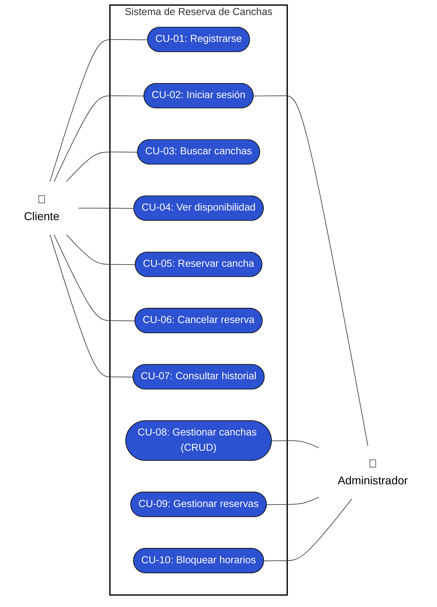
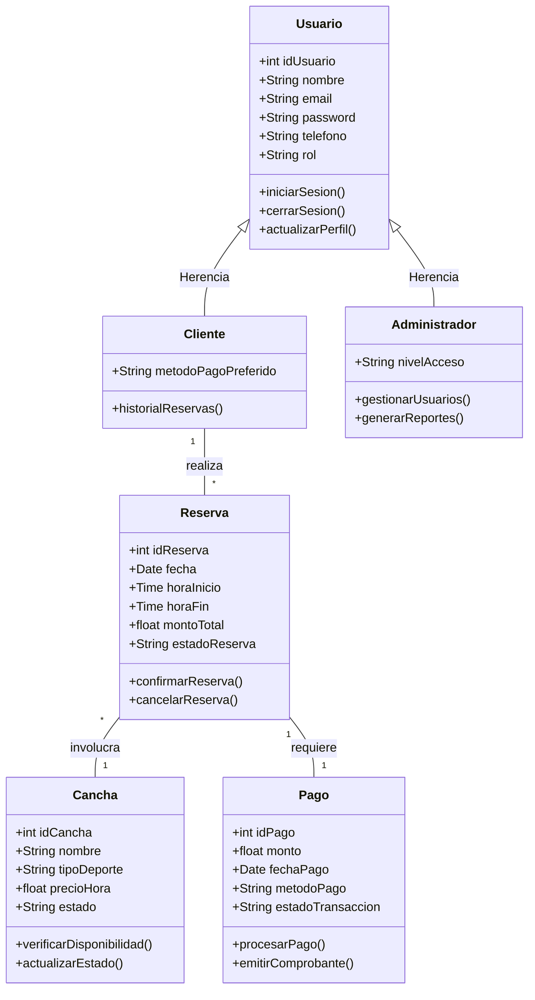
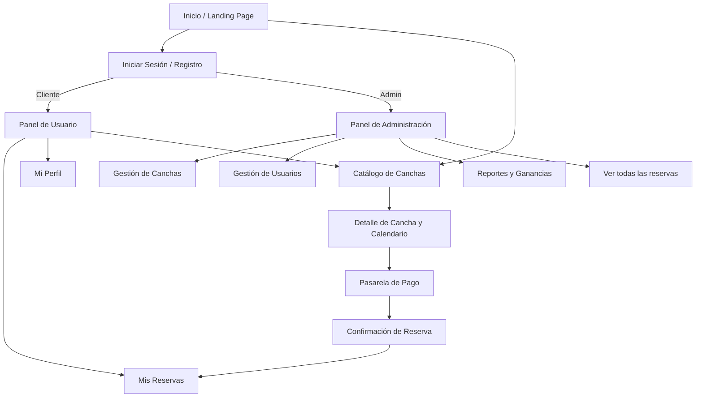
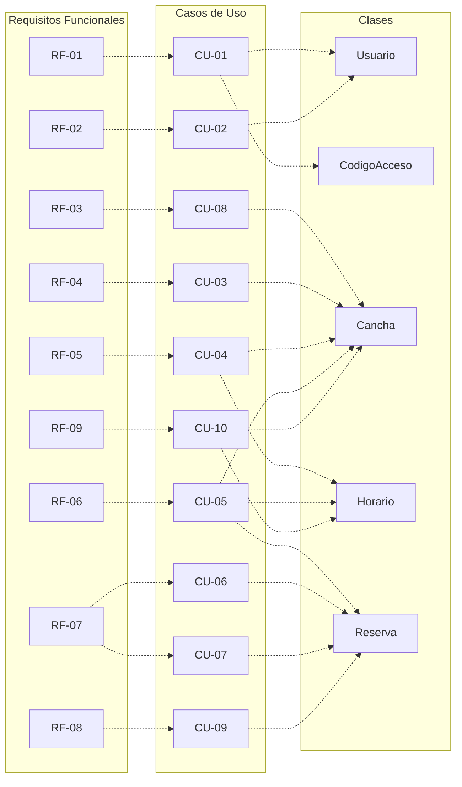

# Sistema Web para Reserva de Canchas e Instalaciones Deportivas - Fase 1 (Parte 2)

## 6. Casos de Uso del Sistema

A continuación se presenta el diagrama de Casos de Uso del sistema web y las descripciones de los procesos principales.

### Diagrama de Casos de Uso

### Descripción de Casos de Uso Principales

#### Caso de Uso 1: Gestión de Reservas (Cliente)
*   **Actor:** Cliente.
*   **Precondición:** El cliente debe haber iniciado sesión y seleccionado una cancha disponible.
*   **Flujo Principal:**
    1. El cliente selecciona la fecha y hora deseada en el calendario.
    2. El sistema verifica la disponibilidad de la cancha.
    3. El cliente confirma los detalles de la reserva.
    4. El sistema redirige a la pasarela de pago (UC4).
    5. El cliente completa el pago y el sistema confirma la reserva, enviando un comprobante.
*   **Flujo Alterno:** La cancha no está disponible en el horario seleccionado. El sistema muestra horarios alternativos cercanos.
*   **Poscondición:** La reserva queda guardada en la base de datos y bloqueada para otros clientes.

#### Caso de Uso 2: Búsqueda de Canchas (Cliente)
*   **Actor:** Cliente.
*   **Precondición:** El cliente accede a la plataforma web.
*   **Flujo Principal:**
    1. El cliente ingresa a la sección de búsqueda y aplica filtros (deporte, fecha, ubicación).
    2. El sistema procesa los filtros y consulta la base de datos de instalaciones.
    3. El sistema muestra la lista de canchas disponibles con fotos, precio y detalles.
*   **Flujo Alterno:** No hay canchas que coincidan con los filtros. El sistema sugiere eliminar algunos filtros o buscar en fechas cercanas.
*   **Poscondición:** El cliente visualiza las opciones para proceder con una reserva.

#### Caso de Uso 3: Administración de Instalaciones (Administrador)
*   **Actor:** Administrador.
*   **Precondición:** El administrador ha iniciado sesión con sus credenciales autorizadas.
*   **Flujo Principal:**
    1. El administrador ingresa al módulo de "Gestión de Instalaciones".
    2. Selecciona la opción para añadir, editar o eliminar una cancha.
    3. Ingresa los datos correspondientes (nombre, tipo, capacidad, precio, fotos).
    4. El sistema guarda y actualiza la información de forma inmediata.
*   **Flujo Alterno:** El sistema detecta datos incompletos al intentar crear o editar. Se solicita llenar los campos obligatorios para poder guardar.
*   **Poscondición:** El catálogo de instalaciones se encuentra actualizado para los clientes.

#### Caso de Uso 4: Reportes y Estadísticas (Administrador)
*   **Actor:** Administrador.
*   **Precondición:** El administrador ha iniciado sesión en el sistema.
*   **Flujo Principal:**
    1. El administrador navega al módulo de "Reportes y Estadísticas".
    2. Selecciona el periodo de tiempo a consultar.
    3. El sistema genera gráficos de ingresos, canchas más populares y porcentaje de ocupación.
*   **Flujo Alterno:** No hay datos de reservas en el periodo consultado. El sistema muestra gráficos vacíos y notifica la ausencia de datos.
*   **Poscondición:** El administrador obtiene información valiosa para la toma de decisiones.

---

## 7. Modelo de Clases

Este modelo representa las entidades principales, sus atributos, métodos y la forma en que se relacionan dentro del sistema.

---

## 8. Modelo de Navegación Inicial

Diagrama que muestra la estructura del sitio y cómo los usuarios interactúan y se desplazan entre las pantallas principales de la aplicación.

---

## 9. Matriz de Trazabilidad

Esta matriz relaciona los Requisitos Funcionales iniciales con los Casos de Uso descritos y las Clases que soportan el sistema, demostrando que todos los componentes están vinculados.

| Código Req. | Descripción del Requisito | Caso de Uso Asignado | Clases Involucradas |
| :--- | :--- | :--- | :--- |
| **RF-01** | El sistema debe permitir registrar usuarios (Cliente y Administrador). | CU-01: Registrarse | Usuario, CodigoAcceso |
| **RF-02** | El sistema debe permitir inicio de sesión seguro. | CU-02: Iniciar sesión | Usuario |
| **RF-03** | Permitir CRUD de la información de las canchas. | CU-08: Gestionar canchas (CRUD) | Cancha |
| **RF-04** | Buscar canchas filtrando por deporte, fecha, horario y precio. | CU-03: Buscar canchas | Cancha |
| **RF-05** | Mostrar interfaz de disponibilidad (calendario/horarios libres). | CU-04: Ver disponibilidad | Horario, Cancha |
| **RF-06** | Seleccionar bloque de tiempo y confirmar la reserva. | CU-05: Reservar cancha | Reserva, Horario, Cancha |
| **RF-07** | Visualizar estado de reservas actuales y pasadas. | CU-06: Cancelar reserva CU-07: Consultar historial | Reserva |
| **RF-08** | Administrador puede visualizar listado general y cambiar estado de reservas. | CU-09: Gestionar reservas | Reserva |
| **RF-09** | Bloquear fechas/horarios por mantenimiento. | CU-10: Bloquear horarios | Horario, Cancha |

### Trazabilidad Visual

---

## 10. Auditoría de Trabajo en Equipo y Uso de IA

### Aporte Individual (Fase 1 - Complementos)

| Integrante | Cédula | Aporte individual en este mini avance |
| :--- | :--- | :--- |
| Gonzalez, Walter | 8-1027-2220 | Diseñó la arquitectura de la Fase 1 (Puntos 6 al 10): elaboración de los Casos de Uso (diagrama y descripción), diseño del Modelo de Clases, mapeo del Modelo de Navegación, estructuración de la Matriz de Trazabilidad y levantamiento de la auditoría de uso de Inteligencia Artificial para validación de procesos. |
| Sanchez, Jose | 8-1038-670 | *No colaboró en esta parte.* |
| Rozette, Jose | 8-1025-306 | *No colaboró en esta parte.* |
| Meneses, Alexander | 8-1035-623 | *No colaboró en esta parte.* |

### Registro de Herramientas de IA utilizadas

| Herramienta y Link al prompt | Aporte de la IA |
| :--- | :--- |
| **Claude / Gemini (Antigravity IDE)** *Link local de entorno de desarrollo* | Me ayudó a estructurar el diagrama de clases en formato Mermaid y a revisar la coherencia de la descripción de los Casos de Uso con los Requisitos Funcionales. |
