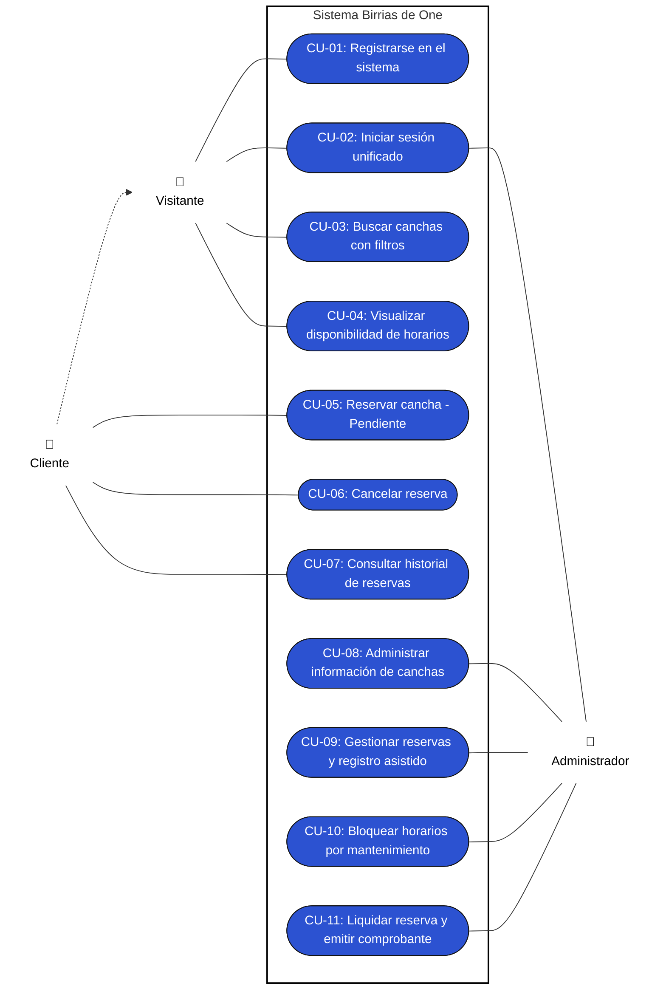
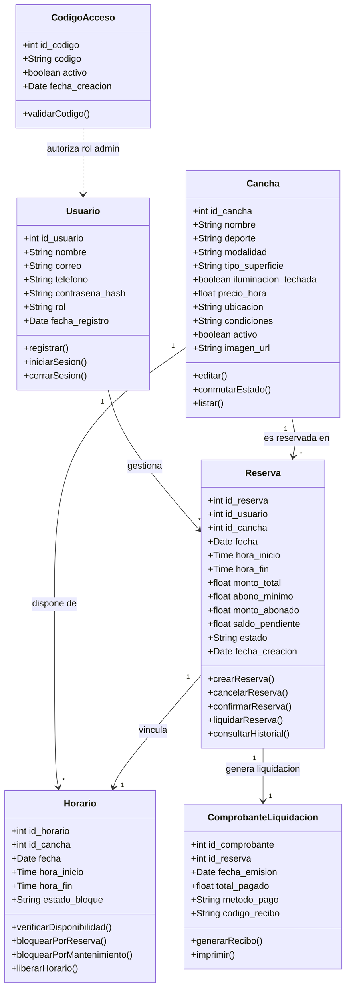
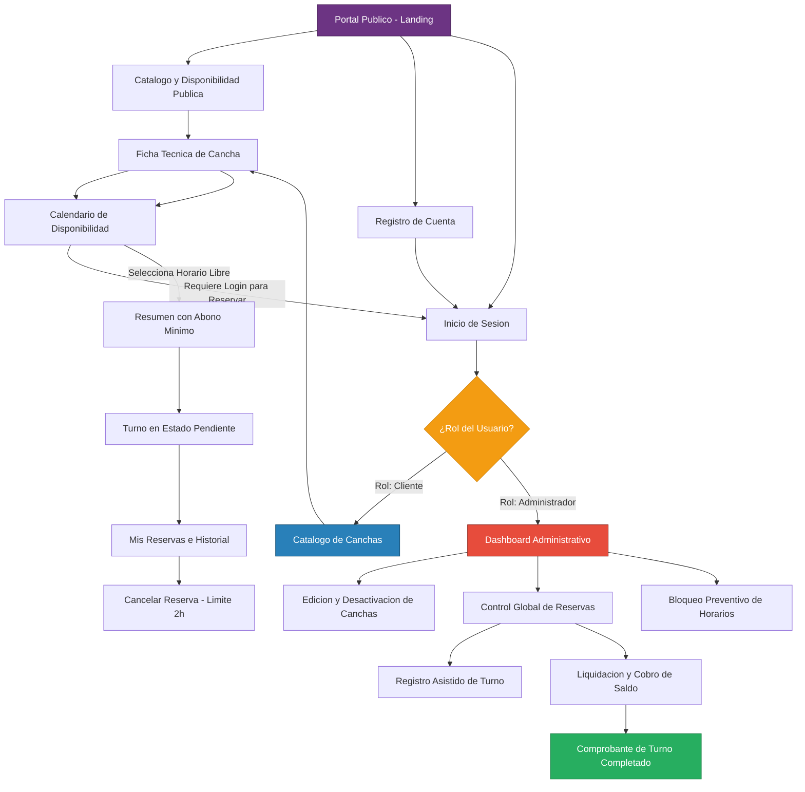
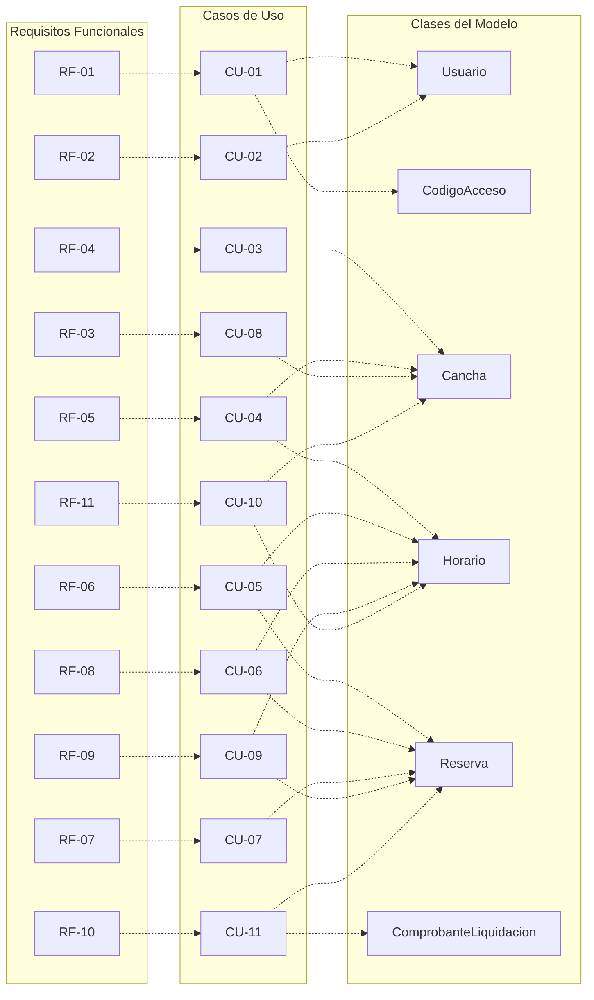

# UNIVERSIDAD TECNOLÓGICA DE PANAMÁ
## FACULTAD DE INGENIERÍA DE SISTEMAS COMPUTACIONALES
### DEPARTAMENTO DE INGENIERÍA DE SOFTWARE

**Materia:** Ingeniería Web  
**Grupo:** 1SF133  
**Docente:** Dra. Elba Valderrama Bahamóndez  
**Período:** II Semestre de 2026  
**Tema:** Proyecto Final (Fase 1) – Birrias de One: Sistema web para reserva de canchas e instalaciones deportivas  

**Integrantes:**
* Gonzalez, Walter — 8-1027-2220
* Sanchez, Jose — 8-1038-670
* Rozette, Jose — 8-1025-306
* Meneses, Alexander — 8-1035-623

---

### Avance del Proyecto
* **Enlace al repositorio (carpetas y estructura):** [https://github.com/WalterJoel18/Sw-para-reserva-de-canchas-e-instalaciones-deportivas](https://github.com/WalterJoel18/Sw-para-reserva-de-canchas-e-instalaciones-deportivas)
* **Enlace a la web (lectura del avance):** [https://walterjoel18.github.io/Sw-para-reserva-de-canchas-e-instalaciones-deportivas/](https://walterjoel18.github.io/Sw-para-reserva-de-canchas-e-instalaciones-deportivas/)

---

## 1. Descripción del proyecto

* **Nombre del Proyecto:** Birrias de One – Sistema web para reserva de canchas e instalaciones deportivas.
* **Problema o necesidad:** La dificultad y pérdida de tiempo que enfrentan los usuarios al intentar encontrar canchas disponibles debido a la falta de información centralizada. Asimismo, la ineficiencia de los administradores de los complejos deportivos al llevar el control de reservas, horarios y cancelaciones de manera manual.
* **Propósito:** Proporcionar un sistema digitalizado y centralizar la información respecto a la reserva de canchas.
* **Objetivo general:** Diseñar e implementar una página web centralizada que mejore la experiencia de los usuarios en la búsqueda y reserva de canchas deportivas, garantizando el acceso a información actualizada y detallada sobre las instalaciones en todo momento.
* **Alcance:** El proyecto abarcará el diseño y desarrollo de una aplicación web responsiva. Incluirá un catálogo digital de instalaciones deportivas con sus respectivos detalles (costos, ubicación, superficie y condiciones). Contará con un módulo de acceso público para consulta y disponibilidad, un módulo para clientes registrados (orientado a la generación de reservas con cálculo de abono mínimo sugerido) y un módulo administrativo (para control de estados, registro asistido y liquidación de reservas en sitio).
* **Principales funcionalidades (Consideradas hasta ahora):**
  * Registro y autenticación de usuarios (perfil cliente y perfil administrador).
  * Buscador de canchas con filtros por tipo de deporte y disponibilidad de fechas/horarios.
  * Calendario interactivo para visualizar horarios libres y ocupados en tiempo real.
  * Sistema de generación, confirmación y cancelación de reservas.
  * Panel de administración para agregar/editar la información de las canchas y gestionar el estado de las reservas.

---

## 2. Identificación de usuarios

### Cliente no registrado (Visitante)
* **Características:** Personas que acceden por primera vez al sitio web o usuarios recurrentes que no han iniciado sesión. Buscan conocer las instalaciones, comparar tarifas y verificar horarios libres antes de decidirse a crear una cuenta.
* **Necesidades:**
  * Explorar el catálogo completo de canchas y sus especificaciones técnicas.
  * Filtrar instalaciones por disciplina deportiva y rango de precios.
  * Consultar el calendario dinámico de disponibilidad en tiempo real.
* **Funciones principales en el sistema:**
  * Navegar en la página principal y catálogo.
  * Realizar búsquedas con filtros facetados.
  * Visualizar los bloques horarios libres y ocupados.
  * Ser redirigido al registro/inicio de sesión al intentar apartar un horario disponible.

### Cliente
* **Características:** Personas de diversas edades interesadas en practicar deportes o realizar actividades físicas. Por lo general, disponen de poco tiempo y buscan soluciones rápidas y convenientes.
* **Necesidades:**
  * Encontrar rápidamente una cancha disponible que se ajuste a su deporte, horario y presupuesto.
  * Conocer las características exactas de la instalación (ubicación, si es techada, tipo de piso, precio) antes de reservar.
  * Realizar una reserva de forma inmediata sin tener que hacer llamadas telefónicas, esperar confirmaciones por WhatsApp o ir presencialmente al lugar.
* **Funciones principales en el sistema:**
  * Registrarse e iniciar sesión.
  * Buscar y filtrar canchas (por deporte, fecha y hora).
  * Visualizar el calendario interactivo de disponibilidad.
  * Realizar la reserva de un horario específico.
  * Cancelar una reserva previamente hecha.
  * Ver su historial de reservas (pasadas y próximas).

### Administrador
* **Características:** Personal empleado por el complejo deportivo (recepcionistas, gerentes o dueños). Tienen conocimientos básicos o intermedios en el uso de sistemas informáticos y son los responsables directos de la atención al público, el cobro y el mantenimiento de las instalaciones.
* **Necesidades:**
  * Mantener un control organizado y centralizado de todas las reservas del día para evitar la sobreocupación de canchas (dos personas reservando la misma cancha).
  * Poder bloquear horarios si una cancha entra en reparación o mantenimiento.
  * Tener acceso a los datos de contacto del cliente en caso de que ocurra algún inconveniente con la reserva.
* **Funciones principales en el sistema:**
  * Iniciar sesión en un panel de control privado (Dashboard).
  * Gestionar el catálogo de instalaciones: editar la información de las canchas (precios, fotos, estado).
  * Visualizar un listado completo o calendario con todas las reservas agendadas por los clientes.
  * Cambiar el estado de las reservas.
  * Bloquear manualmente horarios de las canchas por motivos de cierre o mantenimiento.

---

## 3. Requisitos funcionales

| Código | Módulo | Descripción del Requisito | Usuario |
| :--- | :--- | :--- | :--- |
| **RF-01** | Seguridad | El sistema debe permitir a los usuarios registrarse ingresando sus datos personales (nombre, correo, teléfono y contraseña), asignando el rol de Cliente por defecto o el rol de Administrador si se introduce un código de acceso corporativo válido. | Visitante |
| **RF-02** | Seguridad | El sistema debe autenticar a los usuarios mediante correo y contraseña; tras validar las credenciales, debe redirigir al panel de administración si el rol es Administrador o al catálogo principal si el rol es Cliente. | Cliente / Administrador |
| **RF-03** | Catálogo | El sistema debe permitir al administrador consultar el catálogo de canchas, editar sus atributos (tarifas, condiciones, iluminación e imágenes) y modificar su estado a activo o inactivo. | Administrador |
| **RF-04** | Búsqueda | El sistema debe permitir buscar y filtrar canchas por disciplina deportiva, modalidad, tipo de superficie, ubicación y rango de precios. | Público |
| **RF-05** | Disponibilidad | El sistema debe presentar un calendario interactivo con la disponibilidad de cada cancha, diferenciando visualmente bloques libres, ocupados y bloqueados por mantenimiento. | Público |
| **RF-06** | Reservas | El sistema debe permitir al cliente seleccionar un bloque libre y generar una reserva en estado Pendiente, bloqueando inmediatamente el horario para evitar colisiones y mostrando el valor estimado de la reserva. | Cliente |
| **RF-07** | Perfil | El sistema debe permitir al cliente autenticado visualizar su historial de reservas, detallando cancha, fecha, rango horario, estado actual y valor estimado. | Cliente |
| **RF-08** | Reservas | El sistema debe permitir al cliente cancelar una reserva propia que se encuentre en estado Pendiente o Confirmada, siempre que falten más de 2 horas para su inicio, liberando el bloque horario automáticamente. | Cliente |
| **RF-09** | Gestión | El sistema debe permitir al administrador visualizar todas las reservas del complejo, registrar reservas realizadas de forma presencial o telefónica y actualizar su estado operativo: Confirmada, Cancelada o Completada. | Administrador |
| **RF-10** | Gestión | El sistema debe permitir al administrador consultar el valor estimado de cada reserva y registrar una observación relacionada con el pago presencial, sin procesar pagos dentro de la plataforma. | Administrador |
| **RF-11** | Mantenimiento | El sistema debe permitir al administrador bloquear rangos específicos de fechas y horas en una cancha por motivos de mantenimiento o cierre, impidiendo nuevas reservas en esos intervalos. | Administrador |

---

## 4. Requisitos no funcionales

| Código | Categoría | Descripción del Requisito |
| :--- | :--- | :--- |
| **RNF-01** | Usabilidad | La interfaz debe ser intuitiva, permitiendo que un usuario nuevo realice una reserva sin necesitar capacitación previa. |
| **RNF-02** | Responsive | El sistema debe adaptarse correctamente a dispositivos móviles, tablets y computadoras de escritorio. |
| **RNF-03** | Seguridad | Las contraseñas deben almacenarse mediante funciones de hash y las sesiones deben protegerse contra accesos no autorizados. |
| **RNF-04** | Rendimiento | El sistema debe cargar el calendario de disponibilidad en un máximo de 3 segundos bajo condiciones normales de red. |
| **RNF-05** | Disponibilidad | La plataforma debe permitir a los clientes consultar la disponibilidad y realizar reservas siempre que el sistema se encuentre operativo. |
| **RNF-06** | Compatibilidad | El sistema debe funcionar correctamente en los navegadores más usados (Chrome, Firefox, Edge y Safari). |
| **RNF-07** | Escalabilidad | El sistema debe permitir agregar nuevas canchas deportivas sin requerir cambios importantes en la estructura del sistema. |
| **RNF-08** | Mantenibilidad | El código debe estar documentado y modularizado para facilitar futuras actualizaciones o correcciones. |

---

## 5. Escenarios de uso

| Usuario | Objetivo | Contexto | Secuencia | Resultado esperado |
| :--- | :--- | :--- | :--- | :--- |
| **Visitante / Administrador** | Registrarse en el sistema | Un usuario nuevo o empleado del complejo desea crear una cuenta por primera vez. | Accede al formulario de registro → ingresa nombre, correo, teléfono, contraseña (y opcionalmente código corporativo de empleado) → confirma el registro. | Se crea la cuenta con el rol correspondiente ('Cliente' por defecto o 'Administrador' si el código es válido) y queda habilitado para iniciar sesión. |
| **Visitante / Cliente** | Consultar catálogo, filtros y disponibilidad | Una persona desea conocer las canchas disponibles, tarifas, especificaciones técnicas y horarios libres antes de decidir apartar un turno. | Ingresa a la página principal → aplica filtros facetados (deporte, modalidad, horario, precio) → abre la ficha de la cancha → revisa el calendario interactivo. | Visualiza las canchas filtradas y los horarios libres/ocupados en tiempo real sin requerir inicio de sesión previo. |
| **Cliente / Administrador** | Iniciar sesión en la plataforma | Usuario registrado necesita acceder a sus funciones según su rol. | Ingresa a Inicio de Sesión → introduce correo y contraseña → el sistema valida credenciales y evalúa el rol del usuario. | El sistema autentica al usuario; redirige al Cliente al catálogo principal y al Administrador al Dashboard administrativo. |
| **Cliente** | Agendar reserva con abono mínimo | Cliente autenticado desea apartar una cancha para el fin de semana. | Selecciona una cancha y un bloque horario libre en el calendario → revisa el resumen con tarifa total y abono mínimo estimado → confirma la solicitud. | Se genera la reserva en estado **Pendiente**, el horario se bloquea de inmediato para evitar colisiones y se despliegan los datos para depositar el abono. |
| **Cliente** | Cancelar reserva oportunamente | Un cliente con reserva no podrá asistir al partido agendado. | Accede a "Mis reservas" → selecciona una reserva activa con más de 2 horas de anticipación → presiona "Cancelar" → confirma la acción. | La reserva cambia a estado **Cancelada**, se registra el motivo de cancelación y el horario vuelve a estar disponible inmediatamente en el calendario. |
| **Cliente** | Consultar historial y estado de reservas | El cliente quiere revisar sus reservas activas, solicitudes pendientes y partidos pasados. | Inicia sesión → accede a la sección "Mis reservas / Historial" → visualiza el listado detallado con estado, abono registrado y saldo pendiente. | El cliente comprueba el estatus de sus reservas y el detalle de cada turno. |
| **Administrador** | Confirmar reserva pendiente | El administrador debe validar una reserva creada por un cliente tras verificar el abono recibido. | Accede al listado de reservas → filtra por estado 'Pendiente' → valida el comprobante del abono (vía recepción/Yappy) → cambia su estado a 'Confirmada'. | La reserva pasa a estado **Confirmada** y el cambio se refleja inmediatamente en el perfil del cliente. |
| **Administrador** | Registrar reserva asistida | Un cliente acude en persona a la recepción o llama por teléfono para apartar cancha sin usar la web directamente. | Accede al calendario administrativo → selecciona un bloque horario libre → ingresa los datos de contacto del cliente y el abono inicial recibido → guarda la reserva. | Se crea la reserva directamente en estado **Confirmada**, bloqueando el horario y asociando el turno al cliente. |
| **Administrador** | Liquidar y completar reserva en ventanilla | Los jugadores finalizaron el uso de la cancha o se presentan a liquidar el turno en recepción. | Selecciona la reserva confirmada → el sistema calcula automáticamente `Total - Abono = Saldo Pendiente` → admin recibe el pago completo en caja y marca el turno como 'Completada'. | La reserva finaliza en estado **Completada**, queda cerrada y el sistema genera el comprobante digital de liquidación. |
| **Administrador** | Editar información y disponibilidad de canchas | El administrador necesita actualizar precios, reglas de calzado o pausar temporalmente una cancha del catálogo. | Accede a gestión de canchas → selecciona la instalación → edita tarifas/condiciones o conmuta su estado a "Inactiva" (desactivación lógica) → guarda cambios. | El catálogo público se actualiza reflejando la nueva información o retirando la cancha de la búsqueda sin borrar su historial transaccional. |
| **Administrador** | Bloquear horarios por mantenimiento | Una cancha presenta daños, lluvia o mantenimiento preventivo de luminarias/césped. | Accede a la gestión de la cancha → selecciona la opción "Bloquear horarios" → indica el rango de fecha y horas → confirma bloqueo. | Los horarios seleccionados quedan inhabilitados en el calendario (color gris/bloqueado) impidiendo nuevas reservas. |

---

## 6. Casos de uso

### 6.1 Diagrama de casos de uso

---

### 6.2 Descripción de los principales casos de uso

#### CU-01: Registrarse en el sistema
| Campo | Descripción |
| :--- | :--- |
| **Código** | CU-01 |
| **Nombre** | Registrarse en el sistema |
| **Actor(es)** | Cliente, Administrador |
| **Precondición** | El usuario no tiene una cuenta en el sistema. |
| **Flujo principal** | 1. El usuario accede a la página de registro.   2. Completa los campos: nombre, correo, teléfono y contraseña.   3. (Opcional) Ingresa un código de acceso de empleado.   4. El sistema valida que el correo no esté registrado.   5. El sistema crea la cuenta con el rol correspondiente.   6. Se muestra un mensaje de confirmación. |
| **Flujo alterno** | 4a. Si el correo ya está registrado, el sistema muestra un error.   5a. Si el código de empleado es incorrecto, el sistema rechaza el rol de administrador. |
| **Postcondición** | La cuenta queda creada y el usuario puede iniciar sesión. |

#### CU-02: Iniciar sesión
| Campo | Descripción |
| :--- | :--- |
| **Código** | CU-02 |
| **Nombre** | Iniciar sesión |
| **Actor(es)** | Cliente, Administrador |
| **Precondición** | El usuario tiene una cuenta registrada en el sistema. |
| **Flujo principal** | 1. El usuario accede a la página de inicio de sesión.   2. Ingresa su correo y contraseña.   3. El sistema valida las credenciales.   4. Si el rol es "Cliente", se redirige a la página principal del catálogo.   5. Si el rol es "Administrador", se redirige al panel de gestión. |
| **Flujo alterno** | 3a. Si las credenciales son incorrectas, el sistema muestra un error de autenticación. |
| **Postcondición** | El usuario accede al sistema con los permisos de su rol. |

#### CU-03: Buscar canchas con filtros
| Campo | Descripción |
| :--- | :--- |
| **Código** | CU-03 |
| **Nombre** | Buscar canchas con filtros |
| **Actor(es)** | Visitante, Cliente |
| **Precondición** | Acceso público (no requiere inicio de sesión). |
| **Flujo principal** | 1. El usuario accede al buscador de canchas.   2. Aplica los filtros deseados: tipo de deporte, fecha, horario y/o precio.   3. El sistema consulta la base de datos y devuelve resultados.   4. Se muestran las canchas que cumplen con los criterios. |
| **Flujo alterno** | 3a. Si no se encuentran canchas, se sugiere eliminar algunos filtros. |
| **Postcondición** | El usuario visualiza una lista de canchas acordes a su búsqueda. |

#### CU-04: Visualizar disponibilidad de horarios
| Campo | Descripción |
| :--- | :--- |
| **Código** | CU-04 |
| **Nombre** | Visualizar disponibilidad de horarios |
| **Actor(es)** | Visitante, Cliente |
| **Precondición** | El usuario ha seleccionado una cancha específica. |
| **Flujo principal** | 1. El usuario entra a ver los detalles de la cancha.   2. El sistema muestra un calendario interactivo.   3. Los horarios libres se muestran en color verde y los ocupados en rojo. |
| **Flujo alterno** | 2a. Si la cancha no tiene horarios disponibles para esa fecha, se sugiere cambiar de día. |
| **Postcondición** | El usuario identifica qué horarios están libres para reservar. |

#### CU-05: Reservar una cancha
| Campo | Descripción |
| :--- | :--- |
| **Código** | CU-05 |
| **Nombre** | Reservar una cancha |
| **Actor(es)** | Cliente |
| **Precondición** | El cliente visualizó un horario libre y cuenta con sesión activa. |
| **Flujo principal** | 1. El cliente hace clic sobre un bloque horario disponible (en verde).   2. El sistema calcula y presenta la pantalla de confirmación con el resumen: cancha, fecha, rango de horas, tarifa total calculada y monto del abono mínimo sugerido para asegurar el turno.   3. El cliente confirma la reserva.   4. El sistema guarda la reserva asignándole el estado Pendiente y bloquea automáticamente el horario en el calendario de la cancha.   5. Se emite en pantalla el mensaje de confirmación con el número de reserva e instrucciones para el depósito del abono en la recepción o vía electrónica. |
| **Flujo alterno** | 4a. Si otro cliente reservó el mismo bloque un instante antes (conflicto), el sistema informa y solicita seleccionar otro horario. |
| **Postcondición** | La reserva queda registrada en estado Pendiente y el horario bloqueado para otros. |

#### CU-06: Cancelar una reserva
| Campo | Descripción |
| :--- | :--- |
| **Código** | CU-06 |
| **Nombre** | Cancelar una reserva |
| **Actor(es)** | Cliente |
| **Precondición** | El cliente tiene una reserva activa (Pendiente o Confirmada). |
| **Flujo principal** | 1. El cliente ingresa a su sección "Mis Reservas".   2. Selecciona la reserva que necesita suspender y presiona "Cancelar Reserva".   3. El sistema valida la regla de negocio temporal: verifica que falten más de 2 horas respecto a la hora pactada de inicio.   4. El sistema solicita confirmación.   5. El cliente confirma la cancelación.   6. El sistema cambia el estado de la reserva a Cancelada, registra la fecha de cancelación y libera el horario inmediatamente en el calendario. |
| **Flujo alterno** | 3a. Si faltan menos de 2 horas para el inicio del turno, el sistema deshabilita la acción y muestra: "No es posible cancelar en línea con menos de 2 horas de anticipación. Por favor comuníquese con la administración". |
| **Postcondición** | El horario vuelve a estar disponible para el público. |

#### CU-07: Consultar historial de reservas
| Campo | Descripción |
| :--- | :--- |
| **Código** | CU-07 |
| **Nombre** | Consultar historial de reservas |
| **Actor(es)** | Cliente |
| **Precondición** | El cliente ha iniciado sesión. |
| **Flujo principal** | 1. El cliente ingresa a la sección "Historial".   2. El sistema muestra las reservas pasadas y futuras con su estado actual (completada, cancelada, confirmada). |
| **Flujo alterno** | 2a. Si el cliente no tiene reservas, se muestra un mensaje informativo vacío. |
| **Postcondición** | El cliente queda informado sobre toda su actividad en la plataforma. |

#### CU-08: Gestionar canchas (CRUD)
| Campo | Descripción |
| :--- | :--- |
| **Código** | CU-08 |
| **Nombre** | Gestionar canchas (CRUD) |
| **Actor(es)** | Administrador |
| **Precondición** | El administrador ha iniciado sesión en el panel de gestión. |
| **Flujo principal** | 1. El administrador accede al catálogo interno de canchas.   2. Puede Agregar, Editar o Desactivar una cancha.   3. Ingresa o modifica los datos y guarda.   4. El sistema valida y actualiza la base de datos. |
| **Flujo alterno** | 4a. Faltan datos obligatorios al guardar. El sistema bloquea la operación y pide completarlos. |
| **Postcondición** | El catálogo público de canchas queda actualizado con los cambios. |

#### CU-09: Gestionar el estado de las reservas
| Campo | Descripción |
| :--- | :--- |
| **Código** | CU-09 |
| **Nombre** | Gestionar el estado de las reservas |
| **Actor(es)** | Administrador |
| **Precondición** | Existen reservas registradas por los clientes. |
| **Flujo principal** | 1. El administrador abre la lista general de reservas.   2. Selecciona una reserva y cambia su estado a «Completada» o «Cancelada».   3. Guarda los cambios.   4. El sistema actualiza el estado en la base de datos. |
| **Flujo alterno** | 1a. Si no hay reservas registradas, el sistema indica que no existen reservas para gestionar. |
| **Postcondición** | Los estados de las reservas quedan actualizados y se reflejan en el historial del cliente. |

#### CU-10: Bloquear horarios por mantenimiento
| Campo | Descripción |
| :--- | :--- |
| **Código** | CU-10 |
| **Nombre** | Bloquear horarios por mantenimiento |
| **Actor(es)** | Administrador |
| **Precondición** | El administrador ha iniciado sesión en el sistema. |
| **Flujo principal** | 1. El administrador selecciona la cancha que necesita reparación.   2. Selecciona el rango de fechas y horas a bloquear.   3. Confirma y guarda.   4. El sistema marca esos bloques como no disponibles para los clientes. |
| **Flujo alterno** | 3a. Ya existen reservas en el horario seleccionado. El sistema advierte que debe resolver las reservas existentes antes de bloquear. |
| **Postcondición** | Los horarios seleccionados quedan inhabilitados en el calendario público. |

#### CU-11: Liquidar reserva y emitir comprobante
| Campo | Descripción |
| :--- | :--- |
| **Código** | CU-11 |
| **Nombre** | Liquidar reserva y emitir comprobante |
| **Actor(es)** | Administrador |
| **Precondición** | La reserva se encuentra en estado confirmada y los jugadores se presentan al complejo. |
| **Flujo principal** | 1. El administrador localiza la reserva en el sistema al presentarse el cliente al partido.   2. Selecciona la opción "Liquidar / Cobro de Turno".   3. El sistema calcula automáticamente los valores económicos: `Tarifa Total - Abono Registrado = Saldo Pendiente`.   4. El administrador recibe el cobro presencial por el monto del saldo pendiente y presiona "Confirmar Pago Total".   5. El sistema actualiza el estado de la reserva a Completada y registra el cobro total.   6. El sistema genera en pantalla un comprobante digital de liquidación con el desglose de conceptos, número de turno y confirmación de pago para visualización o impresión del cliente. |
| **Flujo alterno** | 4a. Si el usuario no abona el total restante, el sistema no permite el cierre del turno, manteniendo la reserva en estado confirmada hasta su liquidación íntegra. |
| **Postcondición** | La reserva queda cerrada como 'Completada' y se genera el recibo de liquidación. |

---

## 7. Modelo de clases

Este modelo representa las entidades principales, sus atributos, métodos y la forma en que se relacionan dentro del sistema.

### Descripción de las clases del modelo

| Clase | Descripción |
| :--- | :--- |
| **Usuario** | Representa a cualquier persona registrada en el sistema (cliente o administrador). Almacena credenciales, datos personales y el rol asignado. |
| **Cancha** | Representa una instalación deportiva del complejo. Contiene toda la información visible para los clientes (nombre, deporte, precio, ubicación, condiciones y estado). |
| **Reserva** | Registra el vínculo entre un usuario y una cancha en un horario específico. Controla el ciclo de vida de la reserva (Pendiente, Confirmada, Completada o Cancelada). |
| **Horario** | Representa los bloques de tiempo disponibles para cada cancha. Permite al sistema gestionar la disponibilidad y aplicar bloqueos por mantenimiento. |
| **ComprobanteLiquidacion** | Entidad generada cuando el administrador finaliza y liquida la reserva en ventanilla, documentando el pago completo del saldo pendiente. |
| **CodigoAcceso** | Almacena los códigos secretos que permiten a los trabajadores del complejo registrarse con permisos de administrador. |

---

## 8. Modelo de navegación inicial

Diagrama que muestra la estructura del sitio y cómo los usuarios interactúan y se desplazan entre las pantallas principales de la aplicación.

### Descripción de pantallas principales

| Pantalla | Descripción | Usuario |
| :--- | :--- | :--- |
| **Página de Inicio** | Landing page pública con el acceso al registro e inicio de sesión. | Público |
| **Inicio de Sesión / Registro** | Formularios de autenticación para entrar a la plataforma. | Público |
| **Catálogo de Canchas** | Pantalla principal para clientes. Muestra las canchas y el buscador. | Cliente |
| **Calendario de Disponibilidad** | Vista interactiva que muestra bloques de tiempo libres y ocupados. | Cliente |
| **Mis Reservas / Historial** | Panel donde el cliente ve sus reservas pasadas/futuras y puede cancelar. | Cliente |
| **Panel de Administración** | Dashboard privado con acceso a gestión de canchas, reservas y bloqueos. | Administrador |
| **Agregar / Editar Cancha** | Formulario administrativo para actualizar los datos de las instalaciones. | Administrador |
| **Listado de Reservas** | Vista general donde el admin puede ver y cambiar el estado de cualquier reserva. | Administrador |

---

## 9. Matriz de trazabilidad

Esta matriz relaciona formalmente los Requisitos Funcionales con los Casos de Uso y las entidades del Modelo de Clases, garantizando la total cobertura funcional sin requisitos huérfanos.

| Código Req. | Descripción del Requisito | Caso de Uso Asignado | Clases Involucradas |
| :--- | :--- | :--- | :--- |
| **RF-01** | El sistema debe permitir registrar usuarios (Cliente y Administrador). | CU-01: Registrarse en el sistema | Usuario, CodigoAcceso |
| **RF-02** | El sistema debe permitir inicio de sesión seguro. | CU-02: Iniciar sesión unificado | Usuario |
| **RF-03** | Permitir consulta y edición de la información de las canchas. | CU-08: Administrar información de canchas | Cancha |
| **RF-04** | Buscar canchas filtrando por deporte, fecha, horario y precio. | CU-03: Buscar canchas con filtros | Cancha |
| **RF-05** | Mostrar interfaz de disponibilidad (calendario/horarios libres). | CU-04: Visualizar disponibilidad de horarios | Horario, Cancha |
| **RF-06** | Seleccionar bloque de tiempo y generar reserva en estado Pendiente. | CU-05: Reservar cancha | Reserva, Horario, Cancha |
| **RF-07** | Visualizar estado de reservas actuales y pasadas. | CU-07: Consultar historial de reservas | Reserva |
| **RF-08** | Permitir al cliente cancelar reservas activas con antelación mínima de 2 horas. | CU-06: Cancelar reserva | Reserva, Horario |
| **RF-09** | Administrador puede visualizar reservas, registrar reservas asistidas y actualizar estados. | CU-09: Gestionar reservas y registro asistido | Reserva, Horario |
| **RF-10** | Consultar valor estimado de reserva y liquidar con emisión de comprobante. | CU-11: Liquidar reserva y emitir comprobante | Reserva, ComprobanteLiquidacion |
| **RF-11** | Bloquear fechas/horarios por mantenimiento. | CU-10: Bloquear horarios por mantenimiento | Horario, Cancha |

### Trazabilidad gráfica

---

## 10. Auditoria y uso de ia

### Aportes individuales fase 1

| Integrantes | Cedula | Aporte individual |
| :--- | :--- | :--- |
| **Gonzalez, Walter** | 8-1027-2220 | Diseñó la arquitectura de la Fase 1 (Puntos 6 al 10): elaboración de los Casos de Uso (diagrama y descripción), diseño del Modelo de Clases, mapeo del Modelo de Navegación, estructuración de la Matriz de Trazabilidad y levantamiento de la auditoría de uso de Inteligencia Artificial para validación de procesos. |
| **Sanchez, Jose** | 8-1038-670 | Revisión de ortografía |
| **Rozette, Jose** | 8-1025-306 | Revisión de los requisitos |
| **Meneses, Alexander** | 8-1035-623 | Revisión de la estructura del documento |

### Registro de herramientas de ia utilizadas

| Herramienta | Aplicación Específica en la Fase 1 |
| :--- | :--- |
| **Gemini / Antigravity** | Utilizada como asistente de ingeniería de software para la revisión de consistencia lógica entre Requisitos Funcionales y Casos de Uso, verificación de la sintaxis de diagramas Mermaid y estructuración del documento técnico en formato Markdown para garantizar la máxima legibilidad visual y coherencia metodológica. |
| **Obsidian** | Plataforma de gestión de conocimiento y edición Markdown utilizada para el modelado estructurado de notas de requerimientos, esquemas y vinculación bidireccional entre fases del proyecto. |

