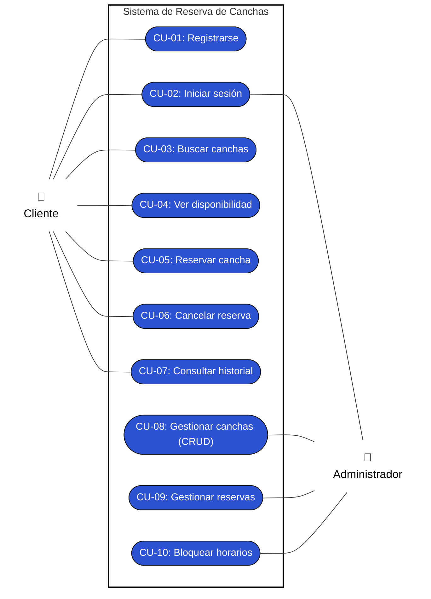
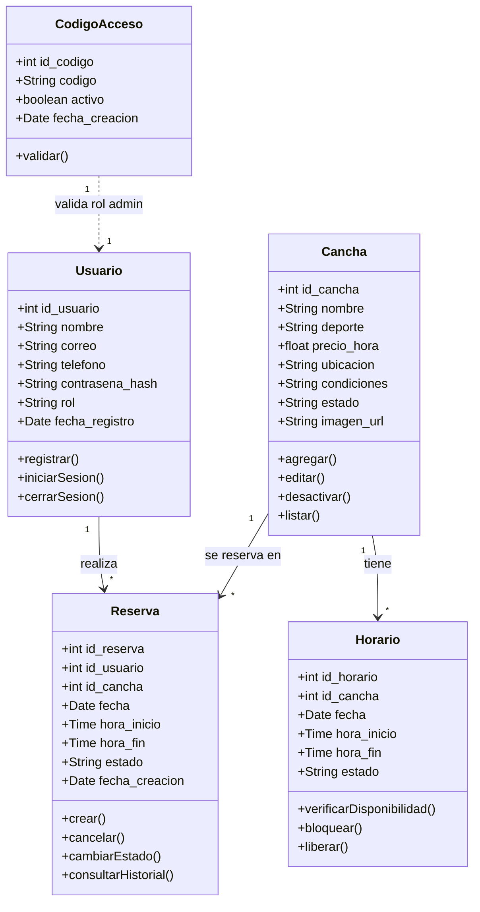
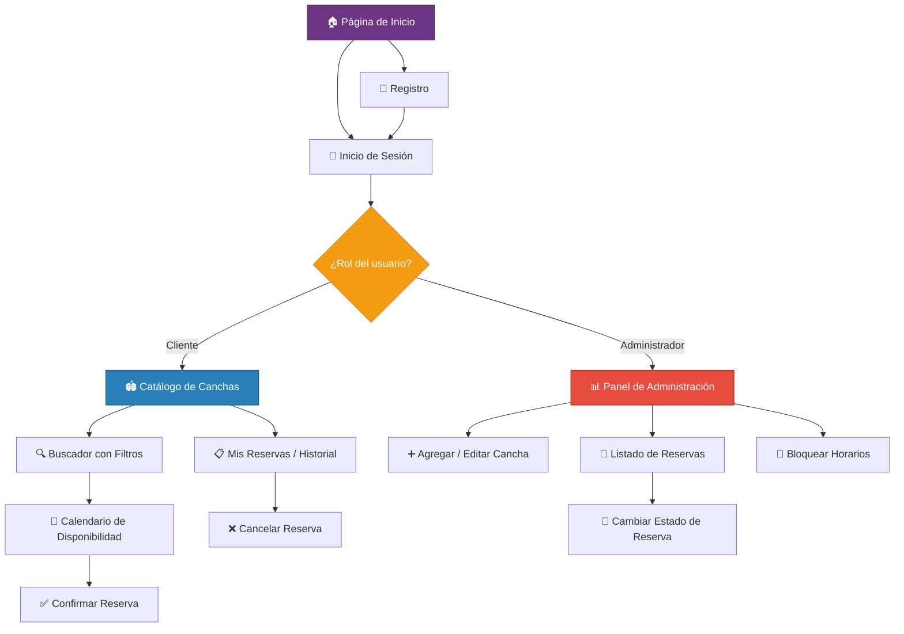
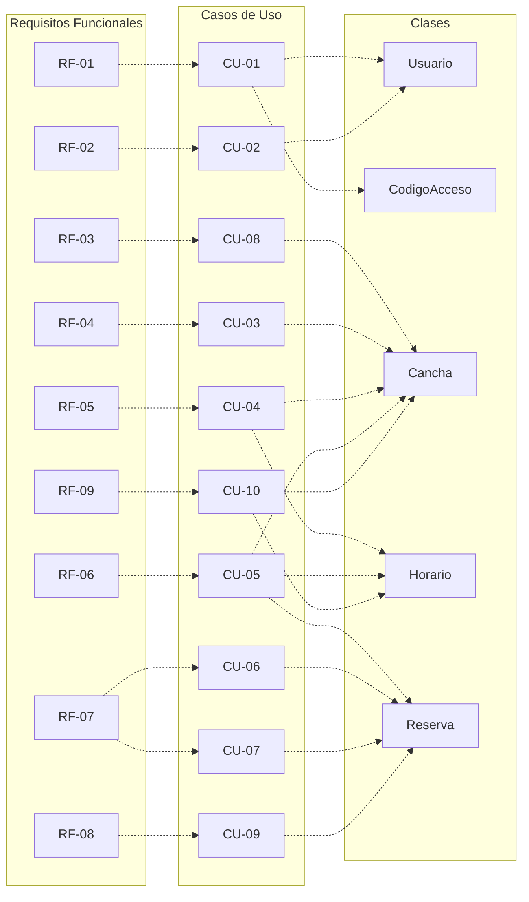

# Sistema Web para Reserva de Canchas e Instalaciones Deportivas

## 1. Descripción del proyecto
*   **Nombre del Proyecto:** Sistema web para reserva de canchas e instalaciones deportivas
*   **Problema o necesidad:** La dificultad y pérdida de tiempo que enfrentan los usuarios al intentar encontrar canchas disponibles debido a la falta de información centralizada. Asimismo, la ineficiencia de los administradores de los complejos deportivos al llevar el control de reservas, horarios y cancelaciones de manera manual.
*   **Propósito:** Proporcionar un sistema digitalizado y centralizar la información respecto a la reserva de canchas.
*   **Objetivo general:** Diseñar e implementar una plataforma web centralizada que mejore la experiencia de los usuarios en la búsqueda y reserva de canchas deportivas, garantizando el acceso a información actualizada y detallada sobre las instalaciones en todo momento.
*   **Alcance:** El proyecto abarcará el diseño y desarrollo de una aplicación web responsiva. Incluirá un catálogo digital de instalaciones deportivas con sus respectivos detalles (costos, ubicación y condiciones). Contará con un módulo para clientes (orientado a la consulta de disponibilidad y generación de reservas) y un módulo administrativo (para la gestión de canchas y control de las reservas agendadas).
*   **Principales funcionalidades:**
    *   Registro y autenticación de usuarios (perfil cliente y perfil administrador).
    *   Buscador de canchas con filtros por tipo de deporte y disponibilidad de fechas/horarios.
    *   Calendario interactivo para visualizar horarios libres y ocupados en tiempo real.
    *   Sistema de generación, confirmación y cancelación de reservas.
    *   Panel de administración para agregar/editar la información de las canchas y gestionar el estado de las reservas.

## 2. Identificación de usuarios

### Cliente
*   **Características:** Personas de diversas edades interesadas en practicar deportes o realizar actividades físicas. Por lo general, disponen de poco tiempo y buscan soluciones rápidas y convenientes.
*   **Necesidades:**
    *   Encontrar rápidamente una cancha disponible que se ajuste a su deporte, horario y presupuesto.
    *   Conocer las características exactas de la instalación (ubicación, si es techada, tipo de piso, precio) antes de reservar.
    *   Realizar una reserva de forma inmediata sin tener que hacer llamadas telefónicas, esperar confirmaciones por WhatsApp o ir presencialmente al lugar.
*   **Funciones principales en el sistema:**
    *   Registrarse e iniciar sesión.
    *   Buscar y filtrar canchas (por deporte, fecha y hora).
    *   Visualizar el calendario interactivo de disponibilidad.
    *   Realizar la reserva de un horario específico.
    *   Cancelar una reserva previamente hecha.
    *   Ver su historial de reservas (pasadas y próximas).

### Administrador
*   **Características:** Personal empleado por el complejo deportivo (recepcionistas, gerentes o dueños). Tienen conocimientos básicos o intermedios en el uso de sistemas informáticos y son los responsables directos de la atención al público, el cobro y el mantenimiento de las instalaciones.
*   **Necesidades:**
    *   Mantener un control organizado y centralizado de todas las reservas del día para evitar el "choque" o cruce de horarios (dos personas reservando la misma cancha).
    *   Poder bloquear horarios si una cancha entra en reparación o mantenimiento.
    *   Tener acceso a los datos de contacto del cliente en caso de que ocurra algún inconveniente con la reserva.
*   **Funciones principales en el sistema:**
    *   Iniciar sesión en un panel de control privado (Dashboard).
    *   Gestionar el catálogo de instalaciones: Agregar nuevas canchas, editar su información (precios, fotos, estado) o eliminarlas.
    *   Visualizar un listado completo o calendario con todas las reservas agendadas por los clientes.
    *   Cambiar el estado de las reservas (ej. confirmada, cancelada, completada).
    *   Bloquear manualmente horarios de las canchas por motivos de cierre o mantenimiento.

## 3. Requisitos funcionales

| Código | Módulo | Descripción del Requisito | Usuario |
| :--- | :--- | :--- | :--- |
| **RF-01** | Seguridad | El sistema debe permitir a los usuarios nuevos registrarse creando una cuenta con sus datos personales, asignando el rol de 'Cliente' por defecto, o el rol de 'Administrador' mediante el ingreso de un código de acceso especial. | Ambos |
| **RF-02** | Seguridad | El sistema debe permitir el inicio de sesión seguro utilizando el correo electrónico y contraseña. | Ambos |
| **RF-03** | Catálogo | El sistema debe permitir agregar, editar, visualizar y eliminar (CRUD) la información de las canchas deportivas, incluyendo nombre, deporte, precio, ubicación, condiciones y estado. | Administrador |
| **RF-04** | Búsqueda | El sistema debe permitir buscar canchas filtrando los resultados por tipo de deporte, fecha, horario y precio. | Cliente |
| **RF-05** | Reservas | El sistema debe mostrar una interfaz (calendario o bloques de tiempo) que indique claramente los horarios libres y ocupados de una cancha. | Cliente |
| **RF-06** | Reservas | El sistema debe permitir seleccionar un bloque de tiempo disponible y confirmar la reserva, guardando los datos en el sistema. | Cliente |
| **RF-07** | Perfil | El sistema debe permitir acceder a una sección donde se pueda visualizar el detalle y estado de las reservas actuales y pasadas. | Cliente |
| **RF-08** | Gestión | El sistema debe permitir al administrador visualizar un listado general de todas las reservas del complejo y cambiar su estado, como confirmada, cancelada o completada. | Administrador |
| **RF-09** | Gestión | El sistema debe permitir bloquear fechas u horarios específicos para que no puedan ser reservados en caso de mantenimiento o cierre de la cancha. | Administrador |

## 4. Requisitos no funcionales

| Código | Categoría | Descripción del Requisito |
| :--- | :--- | :--- |
| **RNF-01** | Usabilidad | La interfaz debe ser intuitiva, permitiendo que un usuario nuevo realice una reserva sin necesitar capacitación previa. |
| **RNF-02** | Responsive | El sistema debe adaptarse correctamente a dispositivos móviles, tablets y computadoras de escritorio. |
| **RNF-03** | Seguridad | Las contraseñas deben almacenarse mediante funciones de hash y las sesiones deben protegerse contra accesos no autorizados. |
| **RNF-04** | Rendimiento | El sistema debe cargar el calendario de disponibilidad en un máximo de 3 segundos bajo condiciones normales de red. |
| **RNF-05** | Disponibilidad | La plataforma debe permitir a los clientes consultar la disponibilidad y realizar reservas siempre que el sistema se encuentre operativo. |
| **RNF-06** | Compatibilidad | El sistema debe funcionar correctamente en los navegadores más usados (Chrome, Firefox, Edge y Safari). |
| **RNF-07** | Escalabilidad | El sistema debe permitir agregar nuevas canchas deportivas sin requerir cambios importantes en la estructura del sistema. |
| **RNF-08** | Mantenibilidad | El código debe estar documentado y modularizado para facilitar futuras actualizaciones o correcciones. |

## 5. Escenarios de uso

| Usuario | Objetivo | Contexto | Secuencia | Resultado esperado |
| :--- | :--- | :--- | :--- | :--- |
| **Cliente / Administrador** | Registrarse en el sistema | Un usuario nuevo (o trabajador) quiere usar la plataforma por primera vez | Accede al formulario de registro → ingresa nombre, correo, teléfono, contraseña (y opcionalmente código de empleado) → confirma el registro | Se crea la cuenta con el rol correspondiente y el usuario puede iniciar sesión |
| Cliente | Reservar una cancha | El cliente quiere jugar fútbol el sábado por la tarde | Inicia sesión → busca canchas filtrando por deporte y fecha → visualiza calendario → selecciona horario disponible → confirma reserva | La reserva queda registrada y el horario pasa a "ocupado" |
| Cliente | Cancelar una reserva | El cliente no podrá asistir al horario reservado | Inicia sesión → accede a "Mis reservas" → selecciona la reserva → elige cancelar → confirma | La reserva cambia a "cancelada" y el horario vuelve a estar disponible |
| Cliente | Consultar historial de reservas | El cliente quiere revisar sus reservas pasadas y próximas | Inicia sesión → accede a la sección "Historial" → visualiza lista de reservas con su estado | El cliente puede consultar el detalle y estado de cada reserva |
| Cliente | Filtrar canchas por precio y horario | El cliente tiene un presupuesto limitado y un horario específico disponible | Ingresa al buscador → aplica filtros de deporte, fecha, horario y precio → revisa resultados | Se muestra una lista de canchas que cumplen con los criterios seleccionados |
| Administrador | Iniciar sesión en el panel administrativo | El administrador necesita gestionar las canchas y reservas | Ingresa sus credenciales → el sistema valida el rol de administrador | Accede al panel administrativo con las opciones de gestión |
| Administrador | Agregar una nueva cancha | El complejo deportivo incorpora una nueva instalación | Accede al panel → selecciona "Agregar cancha" → completa nombre, deporte, precio, ubicación y condiciones → guarda | La nueva cancha aparece en el catálogo disponible para los clientes |
| Administrador | Editar información de una cancha | El administrador necesita cambiar el precio o las condiciones de una cancha existente | Accede al catálogo → selecciona la cancha → edita los campos necesarios → guarda los cambios | La información actualizada se refleja en el sistema |
| Administrador | Desactivar una cancha | Una cancha deja de estar disponible para los clientes | Accede al catálogo → selecciona la cancha → cambia su estado a no disponible → guarda | La cancha deja de aparecer como disponible para nuevas reservas |
| Administrador | Bloquear horario por mantenimiento | Una cancha presenta daños y debe repararse durante dos días | Accede a la gestión de la cancha → selecciona bloquear fechas u horarios → indica el rango → guarda | Los horarios bloqueados dejan de estar disponibles para nuevas reservas |
| Administrador | Cambiar el estado de una reserva | El administrador debe marcar una reserva como completada después de finalizar el uso de la cancha | Accede al listado de reservas → selecciona la reserva → cambia su estado (confirmada, cancelada o completada) → guarda | El estado de la reserva queda actualizado en el sistema |

## 6. Casos de uso

### 6.1 Diagrama de casos de uso

### 6.2 Descripción de casos de uso

#### CU-01: Registrarse en el sistema

| Campo | Descripción |
| :--- | :--- |
| **Código** | CU-01 |
| **Nombre** | Registrarse en el sistema |
| **Actor(es)** | Cliente, Administrador |
| **Precondición** | El usuario no tiene una cuenta en el sistema. |
| **Flujo principal** | 1. El usuario accede a la página de registro.   2. Completa los campos: nombre, correo, teléfono y contraseña.   3. (Opcional) Ingresa un código de acceso de empleado.   4. El sistema valida que el correo no esté registrado.   5. El sistema crea la cuenta con el rol correspondiente (Cliente por defecto, o Administrador si el código es válido).   6. Se muestra un mensaje de confirmación. |
| **Flujo alterno** | 4a. Si el correo ya está registrado, el sistema muestra un error: "Este correo ya tiene una cuenta asociada".   5a. Si el código de empleado es incorrecto, el sistema muestra un error: "Código de acceso inválido". |
| **Postcondición** | La cuenta queda creada y el usuario puede iniciar sesión. |
| **RF relacionado** | RF-01 |

#### CU-02: Iniciar sesión

| Campo | Descripción |
| :--- | :--- |
| **Código** | CU-02 |
| **Nombre** | Iniciar sesión |
| **Actor(es)** | Cliente, Administrador |
| **Precondición** | El usuario tiene una cuenta registrada en el sistema. |
| **Flujo principal** | 1. El usuario accede a la página de inicio de sesión.   2. Ingresa su correo y contraseña.   3. El sistema valida las credenciales.   4. Si el rol es "Cliente", se redirige a la página principal del catálogo.   5. Si el rol es "Administrador", se redirige al panel de gestión (Dashboard). |
| **Flujo alterno** | 3a. Si las credenciales son incorrectas, el sistema muestra un error: "Correo o contraseña incorrectos". |
| **Postcondición** | El usuario accede al sistema con los permisos de su rol. |
| **RF relacionado** | RF-02 |

#### CU-03: Buscar canchas con filtros

| Campo | Descripción |
| :--- | :--- |
| **Código** | CU-03 |
| **Nombre** | Buscar canchas con filtros |
| **Actor(es)** | Cliente |
| **Precondición** | El cliente ha iniciado sesión. |
| **Flujo principal** | 1. El cliente accede al buscador de canchas.   2. Aplica los filtros deseados: tipo de deporte, fecha, horario y/o rango de precio.   3. El sistema consulta la base de datos y devuelve las canchas que cumplen con los criterios.   4. Se muestran los resultados con nombre, deporte, precio y ubicación de cada cancha. |
| **Flujo alterno** | 3a. Si no se encuentran canchas que coincidan, se muestra el mensaje: "No se encontraron canchas con los filtros seleccionados". |
| **Postcondición** | El cliente visualiza una lista de canchas filtradas según sus criterios. |
| **RF relacionado** | RF-04 |

#### CU-04: Visualizar disponibilidad de horarios

| Campo | Descripción |
| :--- | :--- |
| **Código** | CU-04 |
| **Nombre** | Visualizar disponibilidad de horarios |
| **Actor(es)** | Cliente |
| **Precondición** | El cliente ha seleccionado una cancha de la lista de resultados. |
| **Flujo principal** | 1. El cliente selecciona una cancha específica.   2. El sistema muestra un calendario o bloques de tiempo con los horarios de la cancha.   3. Los horarios libres se muestran en un color (ej. verde) y los ocupados o bloqueados en otro (ej. rojo/gris). |
| **Flujo alterno** | 2a. Si la cancha no tiene horarios disponibles para la fecha seleccionada, se muestra: "No hay horarios disponibles para esta fecha". |
| **Postcondición** | El cliente puede identificar claramente qué horarios están libres para reservar. |
| **RF relacionado** | RF-05 |

#### CU-05: Reservar una cancha

| Campo | Descripción |
| :--- | :--- |
| **Código** | CU-05 |
| **Nombre** | Reservar una cancha |
| **Actor(es)** | Cliente |
| **Precondición** | El cliente ha iniciado sesión y ha visualizado un horario libre. |
| **Flujo principal** | 1. El cliente selecciona un bloque de tiempo disponible.   2. El sistema muestra un resumen de la reserva (cancha, fecha, hora, precio).   3. El cliente confirma la reserva.   4. El sistema guarda la reserva y cambia el estado del horario a "ocupado".   5. Se muestra un mensaje de confirmación con los detalles de la reserva. |
| **Flujo alterno** | 4a. Si el horario fue reservado por otro usuario justo antes (conflicto), el sistema muestra: "Este horario ya no está disponible. Seleccione otro." |
| **Postcondición** | La reserva queda registrada en el sistema y el horario ya no está disponible para otros clientes. |
| **RF relacionado** | RF-06 |

#### CU-06: Cancelar una reserva

| Campo | Descripción |
| :--- | :--- |
| **Código** | CU-06 |
| **Nombre** | Cancelar una reserva |
| **Actor(es)** | Cliente |
| **Precondición** | El cliente tiene al menos una reserva activa (estado: confirmada). |
| **Flujo principal** | 1. El cliente accede a "Mis reservas".   2. Selecciona la reserva que desea cancelar.   3. El sistema pide una confirmación: "¿Está seguro de que desea cancelar esta reserva?".   4. El cliente confirma.   5. El sistema cambia el estado de la reserva a "cancelada" y libera el horario. |
| **Flujo alterno** | 4a. Si el cliente no confirma, la reserva se mantiene sin cambios. |
| **Postcondición** | La reserva pasa a estado "cancelada" y el horario vuelve a estar disponible. |
| **RF relacionado** | RF-07 |

#### CU-07: Consultar historial de reservas

| Campo | Descripción |
| :--- | :--- |
| **Código** | CU-07 |
| **Nombre** | Consultar historial de reservas |
| **Actor(es)** | Cliente |
| **Precondición** | El cliente ha iniciado sesión. |
| **Flujo principal** | 1. El cliente accede a la sección "Historial".   2. El sistema muestra una lista con todas las reservas del cliente (pasadas y futuras).   3. Cada reserva muestra: cancha, fecha, hora y estado (confirmada, cancelada, completada). |
| **Flujo alterno** | 2a. Si el cliente no tiene reservas, se muestra: "Aún no tienes reservas registradas". |
| **Postcondición** | El cliente puede visualizar el detalle y estado de todas sus reservas. |
| **RF relacionado** | RF-07 |

#### CU-08: Gestionar canchas (CRUD)

| Campo | Descripción |
| :--- | :--- |
| **Código** | CU-08 |
| **Nombre** | Gestionar canchas (CRUD) |
| **Actor(es)** | Administrador |
| **Precondición** | El administrador ha iniciado sesión en el panel de gestión. |
| **Flujo principal** | 1. El administrador accede al catálogo de canchas del panel.   2. Puede:   &emsp; a) **Agregar:** Llena el formulario (nombre, deporte, precio, ubicación, condiciones) y guarda.   &emsp; b) **Editar:** Selecciona una cancha existente, modifica los campos necesarios y guarda.   &emsp; c) **Visualizar:** Revisa la lista completa de canchas registradas.   &emsp; d) **Eliminar/Desactivar:** Cambia el estado de la cancha a "no disponible". |
| **Flujo alterno** | 2a. Si intenta guardar con campos obligatorios vacíos, el sistema muestra: "Complete todos los campos requeridos". |
| **Postcondición** | El catálogo de canchas queda actualizado con los cambios realizados. |
| **RF relacionado** | RF-03 |

#### CU-09: Gestionar el estado de las reservas

| Campo | Descripción |
| :--- | :--- |
| **Código** | CU-09 |
| **Nombre** | Gestionar el estado de las reservas |
| **Actor(es)** | Administrador |
| **Precondición** | El administrador ha iniciado sesión y existen reservas en el sistema. |
| **Flujo principal** | 1. El administrador accede al listado general de reservas.   2. Selecciona una reserva específica.   3. Cambia su estado a: confirmada, cancelada o completada.   4. El sistema actualiza el estado y lo refleja en el historial del cliente. |
| **Flujo alterno** | 2a. Si no hay reservas registradas, se muestra: "No hay reservas en el sistema". |
| **Postcondición** | El estado de la reserva queda actualizado en todo el sistema. |
| **RF relacionado** | RF-08 |

#### CU-10: Bloquear horarios por mantenimiento

| Campo | Descripción |
| :--- | :--- |
| **Código** | CU-10 |
| **Nombre** | Bloquear horarios por mantenimiento |
| **Actor(es)** | Administrador |
| **Precondición** | El administrador ha iniciado sesión y selecciona una cancha. |
| **Flujo principal** | 1. El administrador accede a la gestión de una cancha.   2. Selecciona la opción "Bloquear horarios".   3. Define el rango de fechas y/u horarios a bloquear.   4. El sistema marca esos horarios como no disponibles.   5. Los horarios bloqueados se muestran como "no reservables" para los clientes. |
| **Flujo alterno** | 3a. Si ya existen reservas en el rango seleccionado, el sistema muestra una advertencia: "Existen reservas activas en este rango. Cancélelas antes de bloquear." |
| **Postcondición** | Los horarios bloqueados dejan de estar disponibles para nuevas reservas. |
| **RF relacionado** | RF-09 |

## 7. Modelo de clases

### Descripción de las clases

| Clase | Descripción |
| :--- | :--- |
| **Usuario** | Representa a cualquier persona registrada en el sistema (cliente o administrador). Almacena credenciales, datos personales y el rol asignado. |
| **Cancha** | Representa una instalación deportiva del complejo. Contiene toda la información visible para los clientes (nombre, deporte, precio, ubicación, condiciones y estado). |
| **Reserva** | Registra el vínculo entre un usuario y una cancha en un horario específico. Controla el ciclo de vida de la reserva (confirmada → completada o cancelada). |
| **Horario** | Representa los bloques de tiempo disponibles para cada cancha. Permite gestionar la disponibilidad y aplicar bloqueos por mantenimiento. |
| **CodigoAcceso** | Almacena los códigos especiales que permiten a los trabajadores del complejo registrarse como administradores. Puede activarse o desactivarse. |

## 8. Modelo de navegación inicial

### Descripción de las pantallas principales

| Pantalla | Descripción | Usuario |
| :--- | :--- | :--- |
| **Página de Inicio** | Landing page con acceso al registro e inicio de sesión. | Público |
| **Registro** | Formulario para crear una nueva cuenta (con campo opcional de código de empleado). | Público |
| **Inicio de Sesión** | Formulario de login con correo y contraseña. Redirige según el rol del usuario. | Público |
| **Catálogo de Canchas** | Lista de canchas disponibles con información resumida. Punto de entrada al buscador. | Cliente |
| **Buscador con Filtros** | Permite filtrar canchas por deporte, fecha, horario y precio. | Cliente |
| **Calendario de Disponibilidad** | Muestra los bloques de tiempo libres y ocupados de una cancha seleccionada. | Cliente |
| **Confirmar Reserva** | Resumen de la reserva (cancha, fecha, hora, precio) con botón de confirmación. | Cliente |
| **Mis Reservas / Historial** | Lista de reservas del cliente con su estado actual. Permite cancelar. | Cliente |
| **Panel de Administración** | Dashboard con acceso a gestión de canchas, reservas y bloqueos. | Administrador |
| **Agregar / Editar Cancha** | Formulario CRUD para las canchas del complejo. | Administrador |
| **Listado de Reservas** | Vista general de todas las reservas con opción de cambiar estado. | Administrador |
| **Bloquear Horarios** | Interfaz para seleccionar rangos de fecha/hora a bloquear por mantenimiento. | Administrador |

## 9. Matriz de trazabilidad

La siguiente matriz conecta los objetivos del proyecto con los requisitos funcionales, los usuarios responsables, los escenarios de uso, los casos de uso y las clases del modelo de datos. Esto demuestra que cada elemento del proyecto tiene una justificación y que no existen requisitos huérfanos.

| Objetivo | RF | Usuario | Escenario de Uso | Caso de Uso | Clase(s) |
| :--- | :--- | :--- | :--- | :--- | :--- |
| Permitir el acceso seguro a la plataforma | RF-01 | Ambos | Registrarse en el sistema | CU-01 | Usuario, CodigoAcceso |
| Permitir el acceso seguro a la plataforma | RF-02 | Ambos | Iniciar sesión (Cliente / Admin) | CU-02 | Usuario |
| Gestionar el catálogo de instalaciones | RF-03 | Administrador | Agregar / Editar / Desactivar cancha | CU-08 | Cancha |
| Facilitar la búsqueda de canchas | RF-04 | Cliente | Filtrar canchas por precio y horario | CU-03 | Cancha |
| Mostrar la disponibilidad en tiempo real | RF-05 | Cliente | Reservar una cancha (paso de visualización) | CU-04 | Horario, Cancha |
| Permitir la reserva de canchas | RF-06 | Cliente | Reservar una cancha | CU-05 | Reserva, Horario |
| Consultar el historial de reservas | RF-07 | Cliente | Consultar historial / Cancelar reserva | CU-06, CU-07 | Reserva |
| Gestionar las reservas del complejo | RF-08 | Administrador | Cambiar el estado de una reserva | CU-09 | Reserva |
| Bloquear horarios por mantenimiento | RF-09 | Administrador | Bloquear horario por mantenimiento | CU-10 | Horario, Cancha |

### Trazabilidad visual

## 10. Auditoria y uso de ia

### Aportes individuales fase 1 (Mini avance 1)

| Integrante | Cédula | Aporte individual en este mini avance |
| :--- | :--- | :--- |
| Gonzalez, Walter | 8-1027-2220 | Se encargó de montar el repositorio en GitHub y dejarlo organizado por carpetas, además de subir la página con GitHub Pages para que se pudiera ver el avance en línea. También ayudó a redactar la parte de la descripción del proyecto (el problema que resuelve, el propósito y hasta dónde llega el alcance). |
| Sanchez, Jose | 8-1038-670 | Trabajó en la parte de los usuarios del sistema, pensando en cómo es un cliente típico y un administrador, qué necesitan y qué deberían poder hacer cada uno dentro de la plataforma. |
| Rozette, Jose | 8-1025-306 | Se metió de lleno en los requisitos funcionales, armando la tabla completa con lo que el sistema debe hacer (registro, búsqueda, reservas, gestión de canchas, etc.) y a qué usuario le corresponde cada uno. |
| Meneses, Alexander | 8-1035-623 | Redactó los requisitos no funcionales (usabilidad, rendimiento, seguridad, etc.) y armó los escenarios de uso, describiendo paso a paso cómo un cliente o un administrador usaría el sistema en distintas situaciones. |

### Aportes individuales fase 1 (Parte 2)

| Integrante | Cedula | Aporte individual |
| :--- | :--- | :--- |
| Gonzalez, Walter | 8-1027-2220 | Diseñó la arquitectura de la Fase 1 (Puntos 6 al 10): elaboración de los Casos de Uso (diagrama y descripción), diseño del Modelo de Clases, mapeo del Modelo de Navegación, estructuración de la Matriz de Trazabilidad y levantamiento de la auditoría de uso de Inteligencia Artificial para validación de procesos. |
| Sanchez, Jose | 8-1038-670 | Revisión de ortografía |
| Rozette, Jose | 8-1025-306 | Revisión de los requisitos |
| Meneses, Alexander | 8-1035-623 | Revisión de la estructura del documento |

### Registro de herramientas de ia utilizadas

| Herramientas | Aporte de la ia |
| :--- | :--- |
| Gemini y antigravity | Ayudaron estructurar el diagrama de clases en formato Mermaid y a revisar la coherencia de la descripción de los Casos de Uso con los Requisitos Funcionales. La ayuda mas relevante fue pasar al estructura del pdf al read.me (Para que se fuera visualmente atractivo). |
| Obsidian | No es una herramienta IA, pero si ayudó a diagramar mejor y mas rápido. |
