# Sistema Web para Reserva de Canchas e Instalaciones Deportivas

**Curso:** Ingeniería Web  
**Grupo:** 1SF133  
**Docente:** Dra. Elba Valderrama Bahamóndez  
**Período:** II Semestre de 2026  

**Integrantes:**
* Gonzalez, Walter — 8-1027-2220
* Sanchez, Jose — 8-1038-670
* Rozette, Jose — 8-1025-306
* Meneses, Alexander — 8-1035-623

---

# Fase 1: Definición, Requisitos y Modelado Web

## 1. Descripción del proyecto
* **Nombre del Proyecto:** Sistema web para reserva de canchas e instalaciones deportivas.
* **Problema o necesidad:** La dificultad y pérdida de tiempo que enfrentan los usuarios al intentar encontrar canchas disponibles debido a la falta de información centralizada. Asimismo, la ineficiencia de los administradores de los complejos deportivos al llevar el control de reservas, horarios y cancelaciones de manera manual.
* **Propósito:** Proporcionar un sistema digitalizado y centralizar la información respecto a la reserva de canchas.
* **Objetivo general:** Diseñar e implementar una plataforma web centralizada que mejore la experiencia de los usuarios en la búsqueda y reserva de canchas deportivas, garantizando el acceso a información actualizada y detallada sobre las instalaciones en todo momento.
* **Alcance:** El proyecto abarcará el diseño y desarrollo de una aplicación web responsiva. Incluirá un catálogo digital de instalaciones deportivas con sus respectivos detalles (costos, ubicación y condiciones). Contará con un módulo para clientes (orientado a la consulta de disponibilidad y generación de reservas) y un módulo administrativo (para la gestión de canchas y control de las reservas agendadas). No incluirá pasarelas de pago integradas en esta fase inicial.
* **Principales funcionalidades:**
  * Registro y autenticación de usuarios (perfil cliente y perfil administrador).
  * Buscador de canchas con filtros por tipo de deporte y disponibilidad de fechas/horarios.
  * Calendario interactivo para visualizar horarios libres y ocupados en tiempo real.
  * Sistema de generación, confirmación y cancelación de reservas.
  * Panel de administración para agregar/editar la información de las canchas y gestionar el estado de las reservas.

---

## 2. Identificación de usuarios

### Cliente
* **Características:** Personas de diversas edades interesadas en practicar deportes o realizar actividades físicas. Por lo general, disponen de poco tiempo y buscan soluciones rápidas y convenientes.
* **Necesidades:**
  * Encontrar rápidamente una cancha disponible que se ajuste a su deporte, horario y presupuesto.
  * Conocer las características exactas de la instalación (ubicación, si es techada, tipo de piso, precio) antes de reservar.
  * Realizar una reserva de forma inmediata sin tener que hacer llamadas telefónicas, esperar confirmaciones por WhatsApp o ir presencialmente al lugar.
* **Funciones principales en el sistema:**
  * Registrarse e iniciar sesión.
  * Buscar y filtrar canchas (por deporte, fecha y hora).
  * Visualizar el calendario interactivo de disponibilidad.
  * Realizar la reserva de un horario específico.
  * Cancelar una reserva previamente hecha.
  * Ver su historial de reservas (pasadas y próximas).

### Administrador
* **Características:** Personal empleado por el complejo deportivo (recepcionistas, gerentes o dueños). Tienen conocimientos básicos o intermedios en el uso de sistemas informáticos y son los responsables directos de la atención al público, el cobro y el mantenimiento de las instalaciones.
* **Necesidades:**
  * Mantener un control organizado y centralizado de todas las reservas del día para evitar el choque o cruce de horarios.
  * Poder bloquear horarios si una cancha entra en reparación o mantenimiento.
  * Tener acceso a los datos de contacto del cliente en caso de que ocurra algún inconveniente con la reserva.
* **Funciones principales en el sistema:**
  * Iniciar sesión en un panel de control privado (Dashboard).
  * Gestionar el catálogo de instalaciones: Agregar nuevas canchas, editar su información (precios, fotos, estado) o eliminarlas.
  * Visualizar un listado completo o calendario con todas las reservas agendadas por los clientes.
  * Cambiar el estado de las reservas (confirmada, cancelada, completada).
  * Bloquear manualmente horarios de las canchas por motivos de cierre o mantenimiento.

---

## 3. Requisitos funcionales

| Código | Módulo | Descripción del Requisito | Usuario |
| :--- | :--- | :--- | :--- |
| **RF-01** | Seguridad | El sistema debe permitir a los usuarios nuevos registrarse creando una cuenta con sus datos personales, asignando el rol de 'Cliente' por defecto, o el rol de 'Administrador' mediante el ingreso de un código de acceso especial. | Ambos |
| **RF-02** | Seguridad | El sistema debe permitir el inicio de sesión seguro utilizando el correo electrónico y contraseña. | Ambos |
| **RF-03** | Catálogo | El sistema debe permitir agregar, editar, visualizar y eliminar (CRUD) la información de las canchas deportivas, incluyendo nombre, deporte, precio, ubicación, condiciones y estado. | Administrador |
| **RF-04** | Búsqueda | El sistema debe permitir buscar canchas filtrando los resultados por tipo de deporte, fecha, horario y precio. | Cliente |
| **RF-05** | Reservas | El sistema debe mostrar una interfaz (calendario o bloques de tiempo) que indique claramente los horarios libres y ocupados de una cancha. | Cliente |
| **RF-06** | Reservas | El sistema debe permitir seleccionar un bloque de tiempo disponible y confirmar la reserva, guardando los datos en el sistema. | Cliente |
| **RF-07** | Perfil | El sistema debe permitir acceder a una sección donde se pueda visualizar el detalle y estado de las reservas actuales y pasadas. | Cliente |
| **RF-08** | Gestión | El sistema debe permitir al administrador visualizar un listado general de todas las reservas del complejo y cambiar su estado, como confirmada, cancelada o completada. | Administrador |
| **RF-09** | Gestión | El sistema debe permitir bloquear fechas u horarios específicos para que no puedan ser reservados en caso de mantenimiento o cierre de la cancha. | Administrador |

---

## 4. Requisitos no funcionales

| Código | Categoría | Descripción del Requisito |
| :--- | :--- | :--- |
| **RNF-01** | Usabilidad | La interfaz debe ser intuitiva, permitiendo que un usuario nuevo realice una reserva sin necesitar capacitación previa. |
| **RNF-02** | Responsive | El sistema debe adaptarse correctamente a dispositivos móviles, tablets y computadoras de escritorio. |
| **RNF-03** | Seguridad | Las contraseñas deben almacenarse mediante funciones de hash y las sesiones deben protegerse contra accesos no autorizados. |
| **RNF-04** | Rendimiento | El sistema debe cargar el calendario de disponibilidad en un máximo de 3 segundos bajo condiciones normales de red. |
| **RNF-05** | Disponibilidad | La plataforma debe permitir a los clientes consultar la disponibilidad y realizar reservas siempre que el sistema se encuentre operativo. |
| **RNF-06** | Compatibilidad | El sistema debe funcionar correctamente en los navegadores más usados (Chrome, Firefox, Edge y Safari). |
| **RNF-07** | Escalabilidad | El sistema debe permitir agregar nuevas canchas deportivas sin requerir cambios importantes en la estructura del sistema. |
| **RNF-08** | Mantenibilidad | El código debe estar documentado y modularizado para facilitar futuras actualizaciones o correcciones. |

---

## 5. Escenarios de uso

| Usuario | Objetivo | Contexto | Secuencia | Resultado esperado |
| :--- | :--- | :--- | :--- | :--- |
| **Cliente / Administrador** | Registrarse en el sistema | Un usuario nuevo (o trabajador) quiere usar la plataforma por primera vez | Accede al formulario de registro -> ingresa nombre, correo, teléfono, contraseña (y opcionalmente código de empleado) -> confirma el registro | Se crea la cuenta con el rol correspondiente y el usuario puede iniciar sesión |
| **Cliente** | Reservar una cancha | El cliente quiere jugar fútbol el sábado por la tarde | Inicia sesión -> busca canchas filtrando por deporte y fecha -> visualiza calendario -> selecciona horario disponible -> confirma reserva | La reserva queda registrada y el horario pasa a ocupado |
| **Cliente** | Cancelar una reserva | El cliente no podrá asistir al horario reservado | Inicia sesión -> accede a "Mis reservas" -> selecciona la reserva -> elige cancelar -> confirma | La reserva cambia a cancelada y el horario vuelve a estar disponible |
| **Cliente** | Consultar historial de reservas | El cliente quiere revisar sus reservas pasadas y próximas | Inicia sesión -> accede a la sección "Historial" -> visualiza lista de reservas con su estado | El cliente puede consultar el detalle y estado de cada reserva |
| **Cliente** | Filtrar canchas por precio y horario | El cliente tiene un presupuesto limitado y un horario específico disponible | Ingresa al buscador -> aplica filtros de deporte, fecha, horario y precio -> revisa resultados | Se muestra una lista de canchas que cumplen con los criterios seleccionados |
| **Administrador** | Iniciar sesión en el panel administrativo | El administrador necesita gestionar las canchas y reservas | Ingresa sus credenciales -> el sistema valida el rol de administrador | Accede al panel administrativo con las opciones de gestión |
| **Administrador** | Agregar una nueva cancha | El complejo deportivo incorpora una nueva instalación | Accede al panel -> selecciona "Agregar cancha" -> completa nombre, deporte, precio, ubicación y condiciones -> guarda | La nueva cancha aparece en el catálogo disponible para los clientes |
| **Administrador** | Editar información de una cancha | El administrador necesita cambiar el precio o las condiciones de una cancha existente | Accede al catálogo -> selecciona la cancha -> edita los campos necesarios -> guarda los cambios | La información actualizada se refleja en el sistema |
| **Administrador** | Desactivar una cancha | Una cancha deja de estar disponible para los clientes | Accede al catálogo -> selecciona la cancha -> cambia su estado a no disponible -> guarda | La cancha deja de aparecer como disponible para nuevas reservas |
| **Administrador** | Bloquear horario por mantenimiento | Una cancha presenta daños y debe repararse durante dos días | Accede a la gestión de la cancha -> selecciona bloquear fechas u horarios -> indica el rango -> guarda | Los horarios bloqueados dejan de estar disponibles para nuevas reservas |
| **Administrador** | Cambiar el estado de una reserva | El administrador debe marcar una reserva como completada después de finalizar el uso de la cancha | Accede al listado de reservas -> selecciona la reserva -> cambia su estado (confirmada, cancelada o completada) -> guarda | El estado de la reserva queda actualizado en el sistema |

---

## 6. Casos de uso

### 6.1 Diagrama de casos de uso

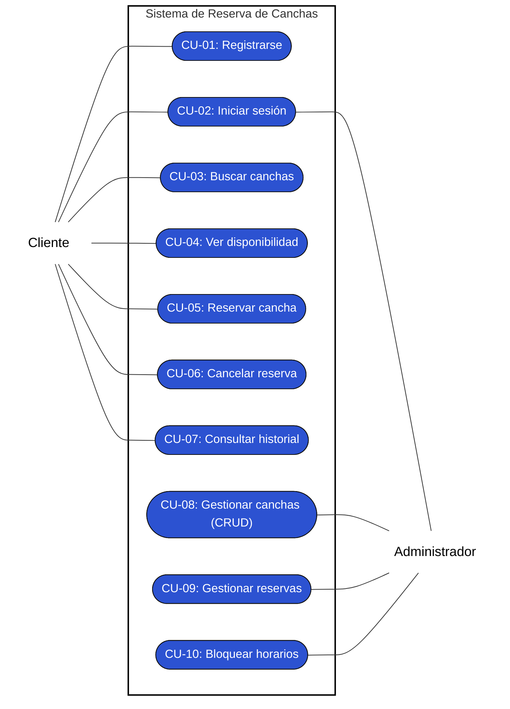

### 6.2 Descripción de casos de uso

#### CU-01: Registrarse en el sistema
* **Actor(es):** Cliente, Administrador
* **Precondición:** El usuario no tiene una cuenta en el sistema.
* **Flujo principal:**
  1. El usuario accede a la página de registro.
  2. Completa los campos: nombre, correo, teléfono y contraseña.
  3. (Opcional) Ingresa un código de acceso de empleado.
  4. El sistema valida que el correo no esté registrado.
  5. El sistema crea la cuenta con el rol correspondiente (Cliente por defecto, o Administrador si el código es válido).
  6. Se muestra un mensaje de confirmación.
* **Flujo alterno:**
  * 4a. Si el correo ya está registrado, el sistema muestra un error: "Este correo ya tiene una cuenta asociada".
  * 5a. Si el código de empleado es incorrecto, el sistema muestra un error: "Código de acceso inválido".
* **Postcondición:** La cuenta queda creada y el usuario puede iniciar sesión.
* **RF relacionado:** RF-01

#### CU-02: Iniciar sesión
* **Actor(es):** Cliente, Administrador
* **Precondición:** El usuario tiene una cuenta registrada en el sistema.
* **Flujo principal:**
  1. El usuario accede a la página de inicio de sesión.
  2. Ingresa su correo y contraseña.
  3. El sistema valida las credenciales.
  4. Si el rol es "Cliente", se redirige a la página principal del catálogo.
  5. Si el rol es "Administrador", se redirige al panel de gestión (Dashboard).
* **Flujo alterno:**
  * 3a. Si las credenciales son incorrectas, el sistema muestra un error: "Correo o contraseña incorrectos".
* **Postcondición:** El usuario accede al sistema con los permisos de su rol.
* **RF relacionado:** RF-02

#### CU-03: Buscar canchas con filtros
* **Actor(es):** Cliente
* **Precondición:** El cliente accede al catálogo.
* **Flujo principal:**
  1. El cliente accede al buscador de canchas.
  2. Aplica los filtros deseados: tipo de deporte, fecha, horario y/o rango de precio.
  3. El sistema consulta la base de datos y devuelve las canchas que cumplen con los criterios.
  4. Se muestran los resultados con nombre, deporte, precio y ubicación de cada cancha.
* **Flujo alterno:**
  * 3a. Si no se encuentran canchas que coincidan, se muestra el mensaje: "No se encontraron canchas con los filtros seleccionados".
* **Postcondición:** El cliente visualiza una lista de canchas filtradas según sus criterios.
* **RF relacionado:** RF-04

#### CU-04: Visualizar disponibilidad de horarios
* **Actor(es):** Cliente
* **Precondición:** El cliente ha seleccionado una cancha de la lista de resultados.
* **Flujo principal:**
  1. El cliente selecciona una cancha específica.
  2. El sistema muestra un calendario con los horarios de la cancha.
  3. Los horarios libres se muestran diferenciados de los ocupados o bloqueados mediante texto, color e iconos.
* **Flujo alterno:**
  * 2a. Si la cancha no tiene horarios disponibles para la fecha seleccionada, se muestra: "No hay horarios disponibles para esta fecha".
* **Postcondición:** El cliente puede identificar claramente qué horarios están libres para reservar.
* **RF relacionado:** RF-05

#### CU-05: Reservar una cancha
* **Actor(es):** Cliente
* **Precondición:** El cliente ha iniciado sesión y ha visualizado un horario libre.
* **Flujo principal:**
  1. El cliente selecciona un bloque de tiempo disponible.
  2. El sistema muestra un resumen de la reserva (cancha, fecha, hora, precio).
  3. El cliente confirma la reserva.
  4. El sistema guarda la reserva y cambia el estado del horario a ocupado.
  5. Se muestra un mensaje de confirmación con los detalles de la reserva.
* **Flujo alterno:**
  * 4a. Si el horario fue reservado por otro usuario de forma concurrente, el sistema muestra: "Este horario ya no está disponible. Seleccione otro."
* **Postcondición:** La reserva queda registrada en el sistema y el horario deja de estar disponible.
* **RF relacionado:** RF-06

#### CU-06: Cancelar una reserva
* **Actor(es):** Cliente
* **Precondición:** El cliente tiene al menos una reserva activa (estado: confirmada).
* **Flujo principal:**
  1. El cliente accede a "Mis reservas".
  2. Selecciona la reserva que desea cancelar.
  3. El sistema pide confirmación: "¿Está seguro de que desea cancelar esta reserva?".
  4. El cliente confirma.
  5. El sistema cambia el estado de la reserva a "cancelada" y libera el horario.
* **Flujo alterno:**
  * 4a. Si el cliente no confirma, la reserva se mantiene sin cambios.
* **Postcondición:** La reserva pasa a estado cancelada y el horario vuelve a estar libre.
* **RF relacionado:** RF-07

#### CU-07: Consultar historial de reservas
* **Actor(es):** Cliente
* **Precondición:** El cliente ha iniciado sesión.
* **Flujo principal:**
  1. El cliente accede a la sección "Historial".
  2. El sistema muestra una lista con todas las reservas del cliente.
  3. Cada reserva muestra: cancha, fecha, hora y estado (confirmada, cancelada, completada).
* **Flujo alterno:**
  * 2a. Si el cliente no tiene reservas, se muestra: "Aún no tienes reservas registradas".
* **Postcondición:** El cliente puede visualizar el detalle y estado de todas sus reservas.
* **RF relacionado:** RF-07

#### CU-08: Gestionar canchas (CRUD)
* **Actor(es):** Administrador
* **Precondición:** El administrador ha iniciado sesión en el panel de gestión.
* **Flujo principal:**
  1. El administrador accede al catálogo de canchas del panel.
  2. Puede:
     * Agregar: Completa el formulario y guarda.
     * Editar: Modifica los campos requeridos y guarda.
     * Visualizar: Revisa la lista completa de canchas.
     * Desactivar: Cambia el estado de la cancha a no disponible.
* **Flujo alterno:**
  * 2a. Si intenta guardar con campos obligatorios vacíos, el sistema muestra: "Complete todos los campos requeridos".
* **Postcondición:** El catálogo de canchas queda actualizado con los cambios realizados.
* **RF relacionado:** RF-03

#### CU-09: Gestionar el estado de las reservas
* **Actor(es):** Administrador
* **Precondición:** El administrador ha iniciado sesión y existen reservas en el sistema.
* **Flujo principal:**
  1. El administrador accede al listado general de reservas.
  2. Selecciona una reserva específica.
  3. Cambia su estado a: confirmada, cancelada o completada.
  4. El sistema actualiza el estado y lo refleja en el historial del cliente.
* **Flujo alterno:**
  * 2a. Si no hay reservas registradas, se muestra: "No hay reservas en el sistema".
* **Postcondición:** El estado de la reserva queda actualizado en todo el sistema.
* **RF relacionado:** RF-08

#### CU-10: Bloquear horarios por mantenimiento
* **Actor(es):** Administrador
* **Precondición:** El administrador ha iniciado sesión y selecciona una cancha.
* **Flujo principal:**
  1. El administrador accede a la gestión de una cancha.
  2. Selecciona la opción "Bloquear horarios".
  3. Define el rango de fechas u horarios a bloquear.
  4. El sistema marca esos horarios como no disponibles.
  5. Los horarios bloqueados se muestran como no reservables para los clientes.
* **Flujo alterno:**
  * 3a. Si existen reservas activas en el rango seleccionado, el sistema muestra una advertencia.
* **Postcondición:** Los horarios bloqueados dejan de estar disponibles para nuevas reservas.
* **RF relacionado:** RF-09

---

## 7. Modelo de clases

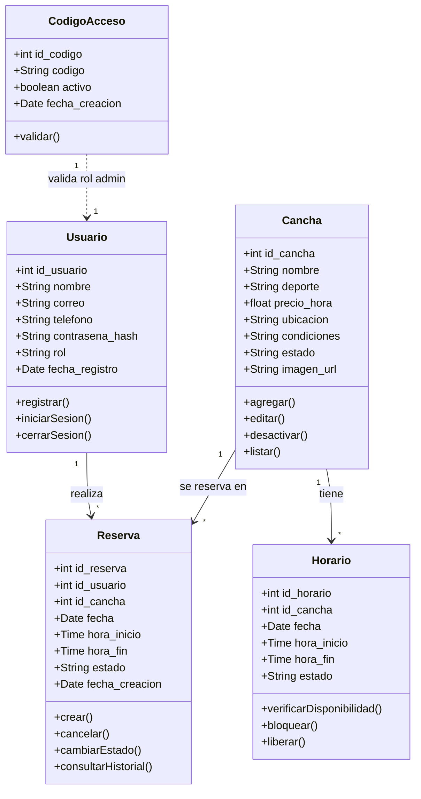

---

## 8. Modelo de navegación inicial

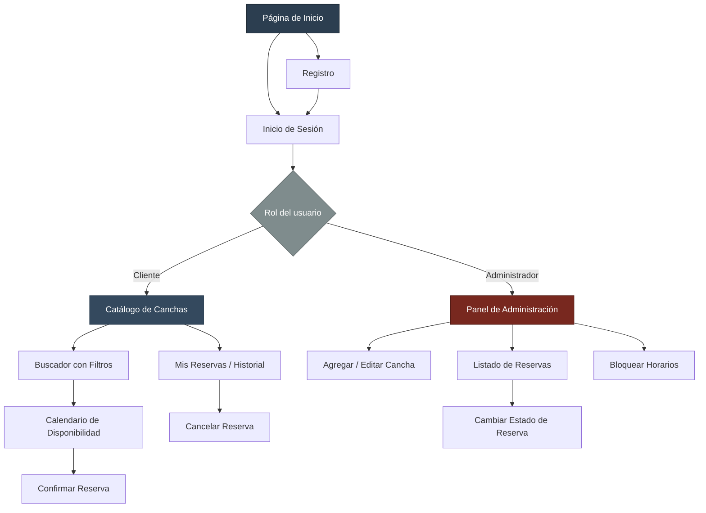

---

## 9. Matriz de trazabilidad

| Objetivo | RF | Usuario | Escenario de Uso | Caso de Uso | Clase(s) |
| :--- | :--- | :--- | :--- | :--- | :--- |
| Permitir el acceso seguro a la plataforma | RF-01 | Ambos | Registrarse en el sistema | CU-01 | Usuario, CodigoAcceso |
| Permitir el acceso seguro a la plataforma | RF-02 | Ambos | Iniciar sesión (Cliente / Admin) | CU-02 | Usuario |
| Gestionar el catálogo de instalaciones | RF-03 | Administrador | Agregar / Editar / Desactivar cancha | CU-08 | Cancha |
| Facilitar la búsqueda de canchas | RF-04 | Cliente | Filtrar canchas por precio y horario | CU-03 | Cancha |
| Mostrar la disponibilidad en tiempo real | RF-05 | Cliente | Reservar una cancha (paso de visualización) | CU-04 | Horario, Cancha |
| Permitir la reserva de canchas | RF-06 | Cliente | Reservar una cancha | CU-05 | Reserva, Horario |
| Consultar el historial de reservas | RF-07 | Cliente | Consultar historial / Cancelar reserva | CU-06, CU-07 | Reserva |
| Gestionar las reservas del complejo | RF-08 | Administrador | Cambiar el estado de una reserva | CU-09 | Reserva |
| Bloquear horarios por mantenimiento | RF-09 | Administrador | Bloquear horario por mantenimiento | CU-10 | Horario, Cancha |

---

# Fase 2: Arquitectura de Información y Diseño de Interfaz

## 1. Arquitectura de Información (AI)

### 1.1 Contenido Principal (Inventario de Contenidos)
El inventario de la plataforma se organiza en tres tipologías de contenido: informativo, funcional y mixto.

#### A. Contenido Informativo
* **Presentación del Complejo (Landing):** Identidad del centro deportivo, resumen de servicios e instalaciones, y accesos directos al catálogo.
* **Guía de Uso ("¿Cómo funciona?"):** Secuencia explicativa de cuatro pasos orientada a nuevos usuarios (exploración del catálogo, selección de cancha, consulta de disponibilidad en tiempo real y confirmación de la reserva).
* **Normativa y Equipamiento por Superficie:**
  * *Césped Sintético:* Uso exclusivo de calzado con suela tipo turf o multitaco; restricción estricta de tacos de aluminio y calzado de suela lisa.
  * *Fútbol Sala (Cemento / Tabloncillo):* Uso obligatorio de suela de goma lisa (non-marking) para preservación de la superficie y prevención de deslizamientos.
  * *Pádel / Tenis:* Calzado con suela de espiga (clay) o suela mixta; requerimientos reglamentarios para palas y raquetas.
* **Información General y Contacto:** Horarios de operación del complejo, ubicación física, canales de atención al cliente y políticas de cancelación y tolerancia horaria.

#### B. Contenido Funcional
* **Explorador Visual (Collage):** Navegación visual estructurada mediante paneles fotográficos organizados por disciplinas deportivas y tipos de instalación.
* **Buscador con Filtros Facetados y Ordenamiento:** Motor de búsqueda que opera sobre las dimensiones taxonómicas del sistema (deporte, modalidad, superficie, entorno y rango de precio).
* **Calendario de Disponibilidad:** Componente temporal dinámico que refleja los intervalos libres, ocupados o inhabilitados para cada instalación deportiva individual.
* **Módulo de Confirmación y Agendamiento de Reserva:** Interfaz para la selección de bloques horarios, revisión del resumen del turno (cancha, fecha, hora y tarifa) y registro formal de la reserva en el sistema (sin pasarelas de pago externas, conforme al alcance establecido).
* **Panel de Usuario ("Mi Cuenta"):** Interfaz para la consulta del historial de reservas del cliente (activas, completadas y canceladas) y gestión de cancelaciones para turnos vigentes.
* **Panel Administrativo (Dashboard):**
  * Gestión de Canchas (CRUD): Registro de nuevas instalaciones, actualización de especificaciones técnicas y tarifas, y desactivación lógica de canchas del catálogo público preservando la integridad del historial transaccional.
  * Control de Reservas: Supervisión global de turnos agendados y actualización de estados operativos (confirmada, completada, cancelada).
  * Reserva Asistida: Módulo para registrar reservas gestionadas por canales presenciales, telefónicos o mensajería directa, asociando los datos del solicitante al bloque horario.
  * Bloqueo Preventivo: Inhabilitación manual de fechas y horarios por mantenimiento, reparaciones o factores climáticos.

#### C. Contenido Mixto
* **Ficha de Detalle de Cancha:** Vista que integra la especificación técnica de la instalación (galería fotográfica, características de la superficie, normativa de calzado y tarifa horaria) con el componente interactivo de calendario para la consulta y selección de turnos.

---

### 1.2 Agrupaciones, Categorías y Taxonomía del Catálogo

#### A. Agrupación Temática General
1. **Exploración e Instalaciones:** Catálogo general, taxonomía deportiva y fichas individuales de cada cancha.
2. **Agendamiento y Reservas:** Consulta de disponibilidad horaria, confirmación de turno y seguimiento personal en la sección de reservas.
3. **Guía y Normativas:** Instrucciones operativas del sistema, reglamento general y especificaciones de indumentaria por cancha.
4. **Administración y Control:** Gestión de catálogo (CRUD), control de turnos, registro asistido y bloqueo de horarios.

#### B. Taxonomía Multidimensional del Catálogo
Para garantizar una categorización normalizada que facilite tanto la experiencia de filtrado del usuario como la estructuración relacional en la base de datos, el catálogo desacopla la información en cuatro dimensiones independientes:

1. **Disciplina Deportiva:** Deporte principal practicado en la instalación (Fútbol, Pádel, Baloncesto, Tenis).
2. **Modalidad y Formato:** Configuración de juego admitida por las dimensiones de la cancha:
   * *Fútbol:* Fútbol 5, Fútbol 7, Fútbol 9.
   * *Pádel / Tenis:* Individual, Dobles.
   * *Baloncesto:* Media cancha (3x3), Cancha completa (5x5).
3. **Tipo de Superficie:** Material constructivo del suelo, determinante para la normativa de calzado:
   * Césped sintético (fibras con relleno de caucho/arena).
   * Tabloncillo / Parqué de madera tratada.
   * Concreto pulido / Cemento sintético.
   * Arcilla / Tierra batida.
4. **Entorno de la Instalación (Cubierta):** Condición estructural frente al clima:
   * Techada / Cubierta cerrada.
   * Al aire libre / Exterior.

Cada cancha física representa una instancia concreta que combina estas cuatro dimensiones, vinculando un sector específico dentro del complejo deportivo y una tarifa horaria base.

---

### 1.3 Jerarquía de la Información y Arquitectura de Pantallas

La arquitectura de información distribuye el sistema en tres niveles de profundidad, diferenciando páginas independientes de componentes modales:

* **Nivel 1 (Acceso Global - Páginas Independientes):**
  * Inicio (Landing page), Catálogo / Explorar Canchas, ¿Cómo Funciona?, Normas de Cancha, e Iniciar Sesión / Registro.
* **Nivel 2 (Vistas de Contenido y Gestión - Páginas Independientes):**
  * *Vistas de Cliente:* Resultados del Buscador con Filtros, Ficha de Detalle de Cancha y Mis Reservas (Historial).
  * *Vistas de Administrador:* Dashboard de Gestión, Formulario para Agregar / Editar Cancha y Listado General de Reservas.
* **Nivel 3 (Componentes de Interacción Contextual - Modales en Capa de Interfaz):**
  * Los modales no constituyen nodos de navegación ni poseen URLs independientes; operan como capas sobrepuestas en las pantallas de Nivel 2:
    * **Modal de Confirmación de Reserva:** Disparado desde la Ficha de Detalle de Cancha al seleccionar un bloque horario; procesa el agendamiento sin abandonar la vista del calendario.
    * **Modal de Cancelación:** Disparado desde Mis Reservas; solicita validación explícita antes de liberar el registro.
    * **Modal de Bloqueo de Horarios:** Disparado desde Gestión de Canchas; define intervalos de inhabilitación por mantenimiento.
    * **Modal de Cambio de Estado:** Disparado desde el Listado de Reservas; actualiza el ciclo de vida del turno.
    * **Modal de Reserva Asistida:** Disparado desde el Listado de Reservas; permite al personal administrativo agendar turnos presenciales o telefónicos.

---

### 1.4 Sistema de Etiquetas, Accesibilidad y Disponibilidad Dinámica

#### A. Estandarización de Etiquetas

| Etiqueta en Interfaz | Propósito / Acción | Tipo de Elemento | Nivel de Acceso |
| :--- | :--- | :--- | :--- |
| **Explorar Canchas** | Acceso al catálogo y cuadrícula visual de instalaciones. | Menú / Navegación | Público |
| **¿Cómo Funciona?** | Guía de cuatro pasos para el proceso de reserva. | Enlace Informativo | Público |
| **Normas de Cancha** | Requisitos de calzado y reglamento por tipo de superficie. | Enlace Informativo | Público |
| **Consultar Disponibilidad** | Visualización de la matriz horaria por fecha. | Sección Funcional | Público |
| **Reservar Horario** | Acción principal para confirmar el turno seleccionado. | Botón de Acción | Cliente autenticado |
| **Mis Reservas** | Consulta de turnos vigentes e historial de reservas. | Menú de Cuenta | Cliente |
| **Panel de Control** | Acceso al módulo de administración operativa. | Menú Privado | Administrador |
| **Bloquear Horarios** | Acción para inhabilitar intervalos por mantenimiento. | Botón Funcional | Administrador |

#### B. Accesibilidad Web (WCAG 2.1 Nivel AA) y Diseño Responsivo
En cumplimiento del requisito RNF-01 (Usabilidad) y del estándar de accesibilidad WCAG 2.1 Nivel AA, la interfaz adopta las siguientes especificaciones técnicas:

1. **Contraste Cromático:** Todos los elementos textuales e indicadores de interfaz mantienen un contraste mínimo de 4.5:1 respecto a su fondo para texto estándar, y de 3:1 para componentes gráficos interactivos.
2. **Identificación Multimodal de Estados:** La disponibilidad horaria no se transmite únicamente mediante color, combinando tres señales simultáneas:
   * *Intervalo Libre:* Fondo verde accesible (#2E7D32), texto legible "Libre" e icono de confirmación con atributo `aria-label="Horario disponible"`.
   * *Intervalo Ocupado:* Fondo gris neutro (#616161), texto "Ocupado", icono de bloqueo y atributo accesible `aria-disabled="true"`.
   * *Intervalo en Mantenimiento:* Fondo amarillo advertencia (#F57F17) con trama rayada de alto contraste, texto "Mantenimiento" e icono de alerta.
3. **Navegación Asistida por Teclado:** Toda la matriz de turnos y formularios admiten navegación secuencial lógica mediante la tecla Tab, con indicadores visuales de foco activos (`:focus-visible`).
4. **Adaptabilidad del Calendario en Dispositivos Móviles:**
   * En resoluciones de escritorio (> 768px), el calendario se renderiza como una cuadrícula matricial de bloques horarios.
   * En pantallas móviles (<= 768px), la vista colapsa a un carrusel selector de fecha superior combinado con un listado vertical de tarjetas horarias.

#### C. Dinámica de Disponibilidad y Control de Concurrencia
La disponibilidad de los horarios opera bajo un modelo de sincronización y validación transaccional:
1. **Consulta Asíncrona:** La carga de disponibilidad en la ficha de cancha se ejecuta mediante peticiones asíncronas al servidor (AJAX/Fetch) al seleccionar la fecha deseada.
2. **Validación Transaccional en Dos Pasos:** Al presionar "Reservar Horario", el backend ejecuta una verificación de disponibilidad inmediata en la base de datos justo antes de asentar el registro (`COMMIT`).
3. **Manejo de Condiciones de Carrera:** Si dos clientes intentan reservar el mismo intervalo simultáneamente, la transacción que se procese primero bloquea el registro; la segunda es rechazada de forma controlada por el backend, emitiendo un mensaje descriptivo conforme al flujo alterno de CU-05.

---

### 1.5 Mecanismos de Acceso y Reglas de Autenticación

#### A. Regla Operativa de Acceso: Refinamiento de Experiencia de Usuario (UX)
El sistema implementa un modelo de acceso y navegación estructurado para optimizar la experiencia de usuario (UX):
1. **Navegación y Consulta Pública (Visitante):** Cualquier usuario puede explorar el catálogo, utilizar el buscador facetado y consultar la disponibilidad horaria sin registro previo.
2. **Intercepción de Autenticación en el Agendamiento:** Al pulsar "Reservar Horario", si no existe una sesión activa, el sistema intercepta el flujo y redirige al formulario de acceso, reteniendo en memoria los parámetros de la reserva para reanudar el proceso tras autenticarse (conforme a CU-05 y RF-06).

#### B. Mecanismos de Búsqueda y Navegación
1. **Navegación Jerárquica Visual:** Acceso estructurado a través del collage fotográfico principal.
2. **Búsqueda Facetada:** Filtrado cruzado por disciplina, modalidad, superficie, entorno y precio, con opciones de ordenamiento por tarifa y sector.
3. **Navegación Global (Barra Superior):** Menú persistente con enlaces directos a las páginas de Nivel 1 y control de sesión.
4. **Navegación Contextual:** Menú lateral operativo en el panel administrativo y pestañas organizadoras dentro de la ficha de detalle de cancha.
5. **Navegación Suplementaria:** Migas de pan estructurales (ejemplo: Inicio > Fútbol > Césped Sintético > Cancha 1) y pie de página institucional.

---

## 2. Sitemap (Mapa del Sitio)

### 2.1 Estructura Jerárquica del Sitio (Diagrama Mermaid)

El siguiente diagrama modela la estructura de páginas y rutas navegables del sistema (los componentes modales se integran en la capa de interfaz descrita en la sección 1.3):

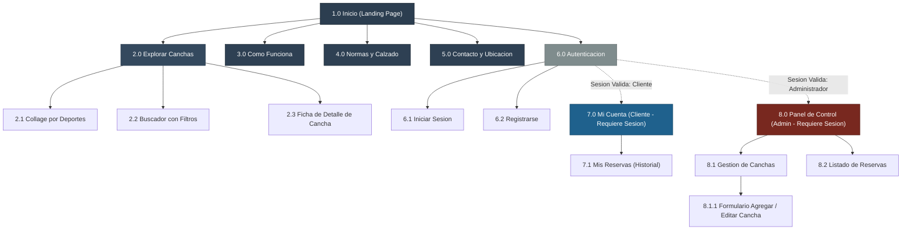

---

### 2.2 Desglose Estructurado de Páginas y Secciones

#### Nivel 0: Raíz Pública
* **1.0 Inicio (Landing Page):** Página principal. Presenta la identidad institucional, acceso al collage deportivo, llamadas a la acción para agendamiento y menús globales.

#### Nivel 1: Secciones Públicas y Catálogo
* **2.0 Explorar Canchas:** Sección contenedora del catálogo general de instalaciones deportivas.
* **3.0 ¿Cómo Funciona?:** Guía conceptual explicativa del proceso de reserva de canchas.
* **4.0 Normas y Calzado:** Especificaciones reglamentarias de indumentaria y calzado admitido según la superficie.
* **5.0 Contacto y Ubicación:** Mapa físico, canales de atención al cliente y horarios generales de funcionamiento.
* **6.0 Autenticación:** Módulo de control de acceso y registro de cuentas de usuario.

#### Nivel 2: Subpáginas y Vistas de Gestión
* **2.1 Collage por Deportes:** Vista de navegación visual guiada que desglosa disciplinas e instalaciones.
* **2.2 Buscador con Filtros:** Vista de catálogo con interfaz de búsqueda facetada por dimensiones técnicas y tarifarias.
* **2.3 Ficha de Detalle de Cancha:** Página individual que integra las especificaciones de la cancha, fotos, requisitos de calzado y el componente interactivo de calendario de disponibilidad.
* **6.1 Iniciar Sesión:** Formulario de autenticación mediante correo y contraseña, con redirección condicionada por rol.
* **6.2 Registrarse:** Formulario de alta para clientes nuevos, con campo para código de acceso de empleados.
* **7.1 Mis Reservas:** Interfaz de control del cliente que lista sus turnos activos e histórico de reservas pasadas.
* **8.1 Gestión de Canchas:** Tabla de inventario de instalaciones con opciones operativas de edición y desactivación.
  * **8.1.1 Formulario Agregar / Editar Cancha:** Página independiente para la captura y actualización de datos técnicos, fotos y tarifas de cada instalación.
* **8.2 Listado de Reservas:** Vista cronológica y tabular de todas las reservas registradas en el sistema, permitiendo filtrado y supervisión operativa.

---

### 2.3 Matriz de Accesibilidad por Tipo de Usuario

| Código | Página / Sección | Visitante (Público) | Cliente Autenticado | Administrador |
| :--- | :--- | :---: | :---: | :---: |
| **1.0** | Inicio | Permitido | Permitido | Permitido |
| **2.0** | Explorar Canchas (Collage / Buscador) | Permitido | Permitido | Permitido |
| **2.3** | Ficha de Detalle de Cancha (con Calendario) | Permitido (Consulta) | Permitido (Consulta) | Permitido (Consulta) |
| **3.0** | ¿Cómo Funciona? | Permitido | Permitido | Permitido |
| **4.0** | Normas y Calzado | Permitido | Permitido | Permitido |
| **5.0** | Contacto y Ubicación | Permitido | Permitido | Permitido |
| **6.0** | Autenticación (Login / Registro) | Permitido | Redirige a Perfil | Redirige a Panel |
| **7.0** | Mi Cuenta (7.1 Mis Reservas) | Restringido | Permitido | Restringido |
| **8.0** | Panel de Control (8.1 Canchas / 8.2 Reservas) | Restringido | Restringido | Permitido |
| **8.1.1** | Formulario Agregar / Editar Cancha | Restringido | Restringido | Permitido |

---

## 3. Modelo de Navegación Refinado

### 3.1 Diagrama de Navegación

El siguiente diagrama modela las rutas disponibles, transiciones entre vistas y accesos según el rol del usuario:

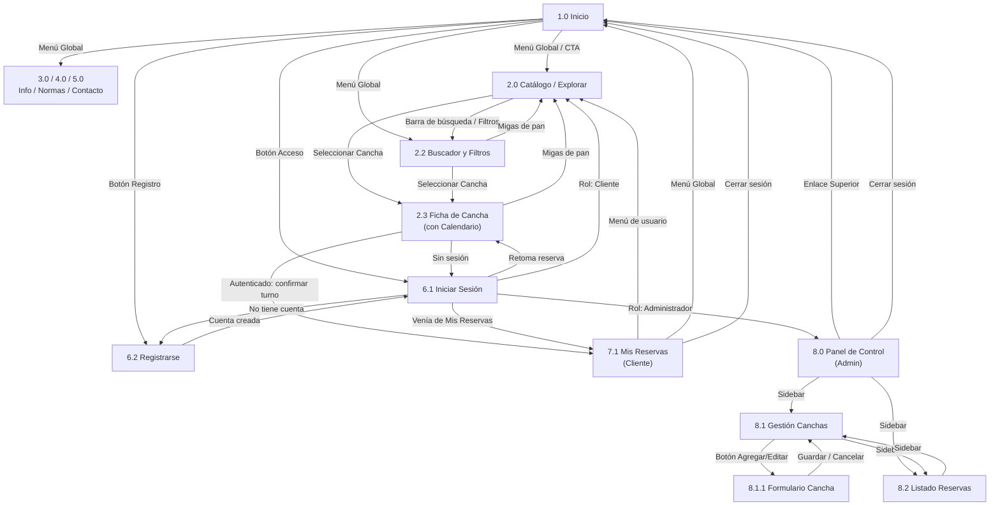

---

### 3.2 Pantallas del Sistema

| Código | Pantalla | Descripción | Acceso |
| :--- | :--- | :--- | :--- |
| **1.0** | Inicio | Página de entrada con llamada a la acción, collage deportivo y acceso a registro e inicio de sesión. | Público |
| **2.0** | Catálogo / Explorar | Listado de canchas disponibles. | Público |
| **2.2** | Buscador y Filtros | Barra de búsqueda y panel lateral de filtros (deporte, modalidad, superficie, entorno y precio). | Público |
| **2.3** | Ficha de Cancha | Detalle de la cancha con calendario de disponibilidad. Para reservar se requiere sesión. | Público (reservar: Cliente) |
| **3.0 / 4.0 / 5.0** | Info / Normas / Contacto | Páginas informativas del complejo. | Público |
| **6.1** | Iniciar Sesión | Autenticación; redirige según el rol. | Público |
| **6.2** | Registrarse | Creación de cuenta de cliente (o de administrador con código de acceso). | Público |
| **7.1** | Mis Reservas | Historial de reservas y cancelación. | Cliente |
| **8.0** | Panel de Control | Inicio del área administrativa. | Administrador |
| **8.1** | Gestión de Canchas | Tabla del catálogo, alta, edición, desactivación y bloqueo de horarios. | Administrador |
| **8.1.1** | Formulario de Cancha | Formulario para agregar o editar una cancha. | Administrador |
| **8.2** | Listado de Reservas | Todas las reservas del complejo, cambio de estado y reserva asistida. | Administrador |

---

### 3.3 Navegación Principal y Secundaria por Rol

| Elemento | Visitante | Cliente | Administrador |
| :--- | :--- | :--- | :--- |
| **Navegación principal (menú global)** | Inicio, Catálogo, Info / Normas / Contacto | Inicio, Catálogo, Info / Normas / Contacto | Enlace superior a Inicio |
| **Menú de usuario** | Botones Acceso (6.1) y Registro (6.2) | Mis Reservas (7.1) y Cerrar sesión | Cerrar sesión |
| **Navegación secundaria** | Filtros y buscador (2.2); calendario de la Ficha (2.3) | Filtros y buscador (2.2); calendario; botón Cancelar reserva en 7.1 | Sidebar: Gestión de Canchas (8.1) y Listado de Reservas (8.2) |
| **Migas de pan** | Inicio > Catálogo > Ficha | Inicio > Catálogo > Ficha | Panel > Gestión de Canchas > Formulario |
| **Acciones contextuales (modales)** | Intercepción de sesión al reservar | Confirmación de turno; cancelación de reserva | Bloqueo de horarios; reserva asistida |
| **Pantallas restringidas** | 7.1 y 8.x redirigen a Iniciar Sesión | 8.x no accesible | 7.1 no aplica |

---

## 4. Flujos de Navegación

Cada flujo modela el recorrido de una tarea crítica en 5 a 7 pasos principales, con nodos de decisión (rombos) para la sesión activa, los campos obligatorios y la colisión de reservas.

### Flujo 1: Búsqueda, Selección y Agendamiento de una Cancha

| Campo | Descripción |
| :--- | :--- |
| **Actor** | Cliente (o visitante) |
| **Objetivo** | Buscar una cancha, elegir un horario libre y confirmar la reserva. |
| **Precondición** | El usuario está en el Catálogo (2.0). Si es visitante, el sistema lo intercepta antes de confirmar. |
| **Resultado esperado** | La reserva queda registrada, el horario pasa a Ocupado y se muestra Mis Reservas (7.1). |
| **Excepción principal** | Si otro usuario confirmó el mismo bloque antes, se muestra «Este horario ya no está disponible. Seleccione otro.» y se actualiza el calendario. |

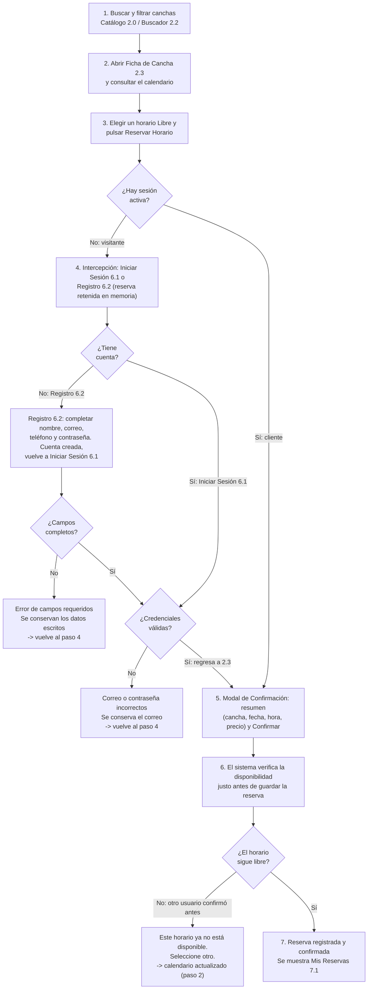

---

### Flujo 2: Consulta de Historial y Cancelación de una Reserva Vigente

| Campo | Descripción |
| :--- | :--- |
| **Actor** | Cliente |
| **Objetivo** | Revisar el historial de reservas y cancelar una reserva vigente. |
| **Precondición** | El cliente tiene sesión activa (si es visitante, se redirige a Iniciar Sesión 6.1 y regresa a Mis Reservas) y accede desde el menú de usuario. |
| **Resultado esperado** | La reserva cambia a Cancelada, el horario queda libre y la tarjeta se actualiza en Mis Reservas (7.1). |
| **Excepción principal** | Si el cliente no tiene reservas se muestra un mensaje informativo; si no confirma la cancelación, la reserva se mantiene sin cambios. |

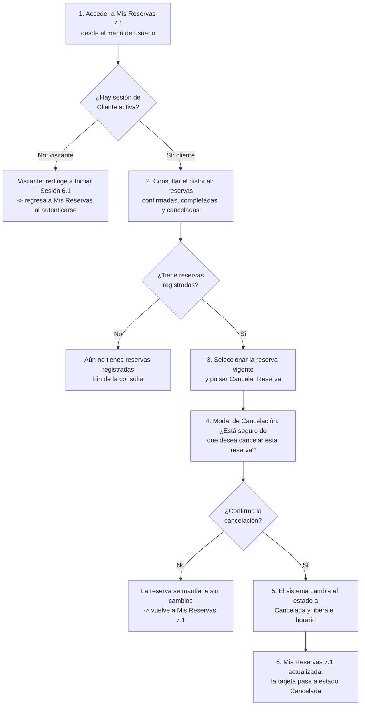

---

### Flujo 3: Registro de una Nueva Cancha en el Catálogo (CRUD)

| Campo | Descripción |
| :--- | :--- |
| **Actor** | Administrador |
| **Objetivo** | Agregar una nueva cancha con su información técnica y tarifa. |
| **Precondición** | El administrador inició sesión y está en el Panel de Control (8.0). |
| **Resultado esperado** | La nueva cancha aparece en la tabla de Gestión de Canchas (8.1) y en el catálogo público. |
| **Excepción principal** | Si faltan campos obligatorios, se muestra el error sin borrar lo ya escrito. |

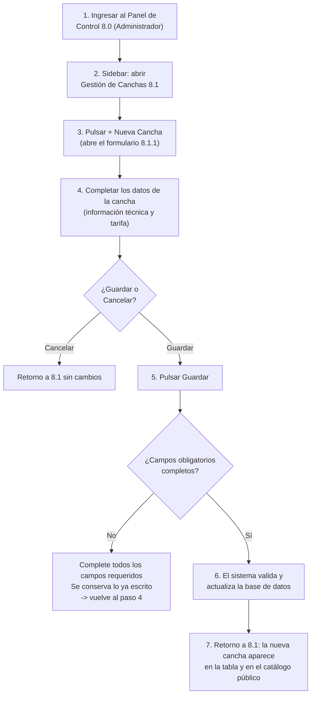

---

### Flujo 4: Bloqueo Manual de Horarios por Mantenimiento o Lluvia

| Campo | Descripción |
| :--- | :--- |
| **Actor** | Administrador |
| **Objetivo** | Bloquear un rango de fechas y horas de una cancha por mantenimiento o lluvia. |
| **Precondición** | El administrador inició sesión y está en Gestión de Canchas (8.1). |
| **Resultado esperado** | Los bloques quedan no disponibles y el calendario público (2.3) los muestra como Mantenimiento. |
| **Excepción principal** | Si hay reservas activas en el rango, no se bloquea y se pide resolverlas primero en el Listado de Reservas (8.2). |

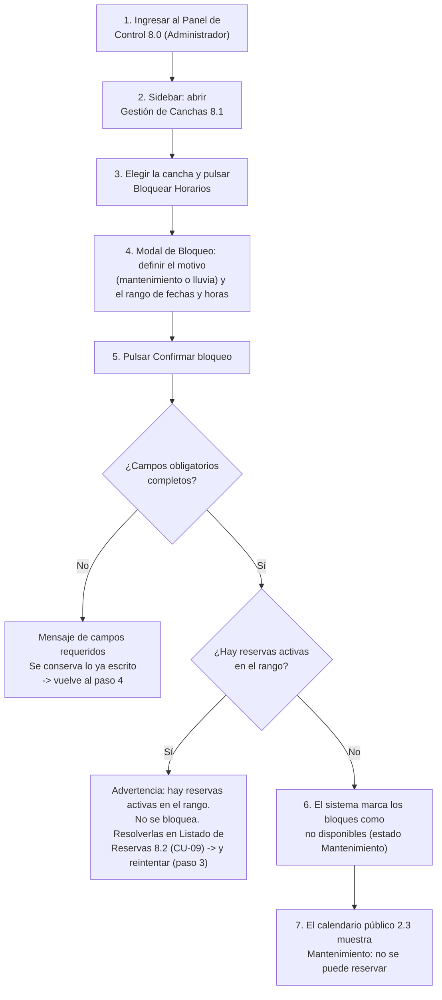

---

### Flujo 5: Registro de una Reserva Asistida (Atención Presencial o Telefónica)

| Campo | Descripción |
| :--- | :--- |
| **Actor** | Administrador |
| **Objetivo** | Registrar una reserva a nombre de un solicitante que llegó o llamó al complejo. |
| **Precondición** | El administrador inició sesión y está en el Listado de Reservas (8.2). |
| **Resultado esperado** | La reserva queda registrada, el horario pasa a Ocupado y aparece en el Listado de Reservas (8.2). |
| **Excepción principal** | Si faltan campos obligatorios se conserva lo escrito; si el bloque ya fue reservado, se pide elegir otro. |

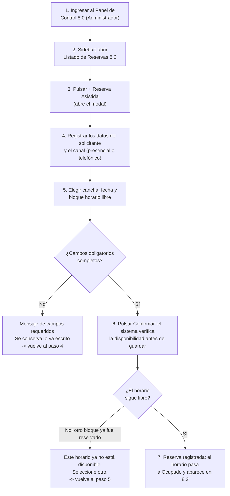
# 5️. Wireframes

A continuación se presentan los seis wireframes aprobados, con sus descripciones
funcionales y los criterios de accesibilidad..

---

## Vista 1 – Página de inicio

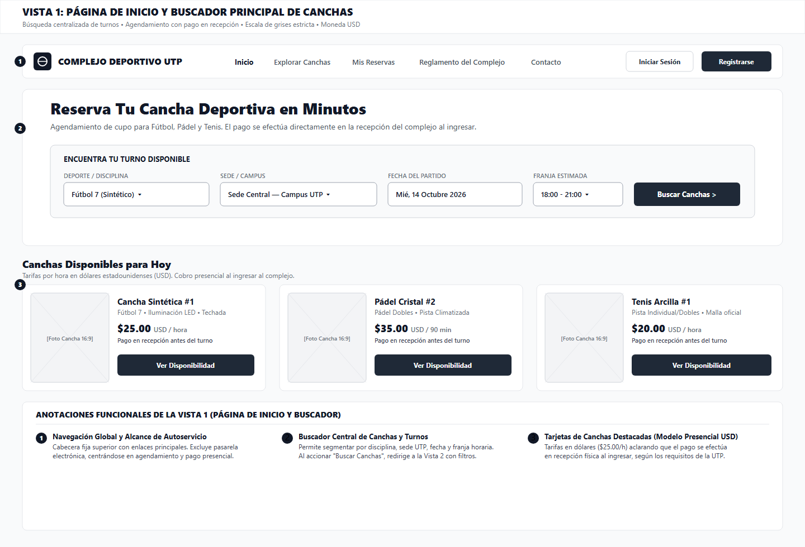

**Propósito** – Dar la bienvenida al usuario y ofrecer el **buscador rápido**
(deporte / fecha / horario) junto a accesos directos a las secciones
principales (*Catálogo*, *¿Cómo funciona?*, *Contacto*).  
El botón de acción principal es **“Buscar canchas”**.

---

## Vista 2 – Catálogo de canchas

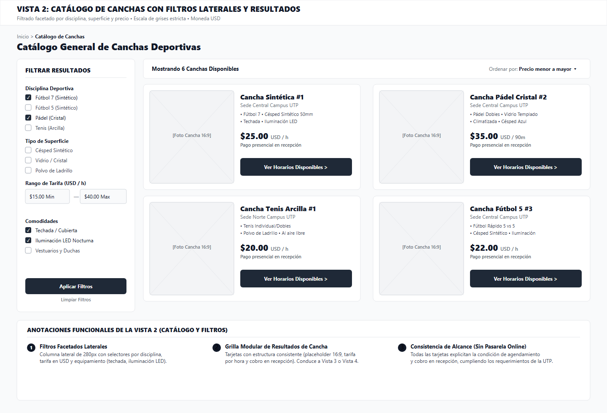

**Propósito** – Permitir la exploración del inventario mediante filtros
laterales (deporte, superficie, precio en USD, entorno) y ordenamiento.
Los resultados aparecen en **tarjetas** con nombre, deporte, precio y una
imagen de placeholder.

---

## Vista 3 – Detalle de cancha (Desktop)

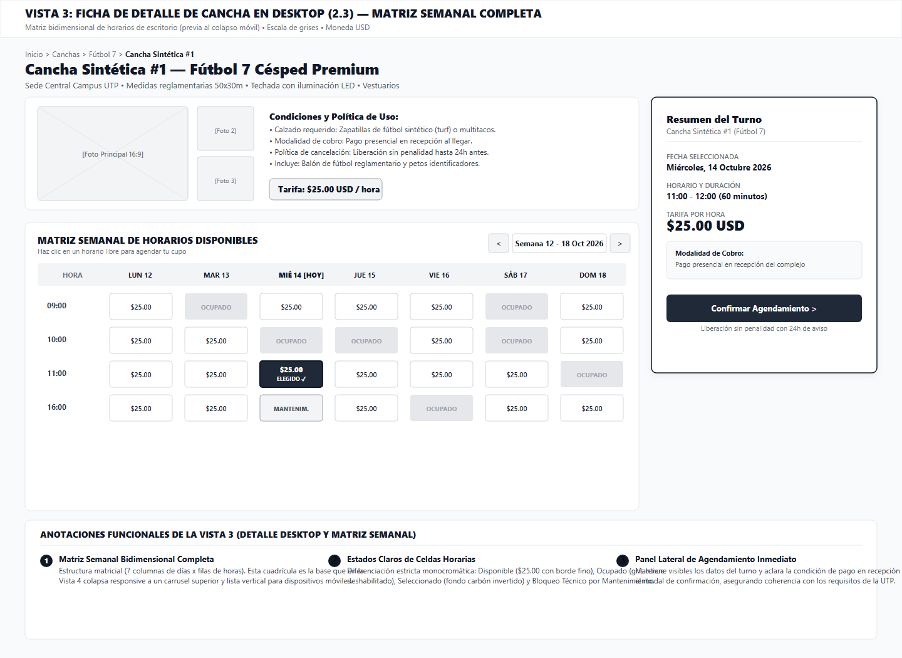

**Propósito** – Mostrar la ficha completa de la cancha con galería,
especificaciones técnicas y una **matriz semanal** de disponibilidad.
Los bloques horarios libres aparecen en blanco; los ocupados, con
trazado atenuado. El botón de confirmación dice **“Reservar”**.

---

## Vista 4 – Detalle de cancha (Mobile)

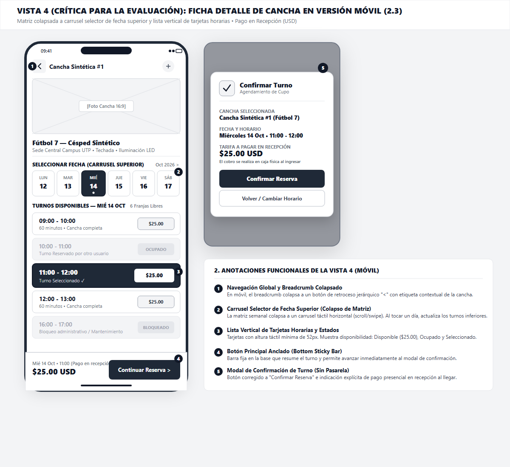

**Propósito** – Versión móvil del detalle: carrusel de días en la parte
superior, lista vertical de horarios libres y un **modal de confirmación**
con el mensaje:

> *“Confirmar Reserva – Pago en Recepción (USD $)”.*

No se muestra ninguna referencia a pagos online ni a reembolsos.

---

## Vista 5 – Mis reservas (Cliente)

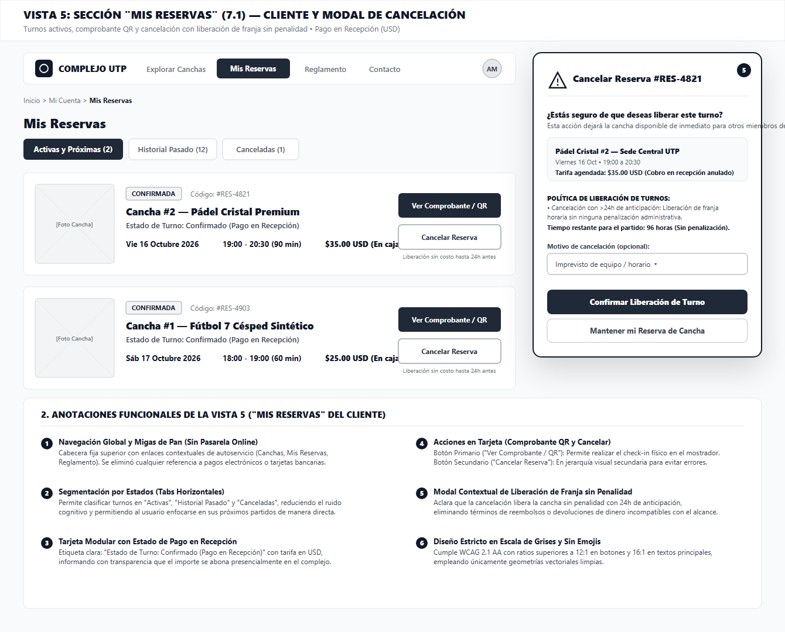

**Propósito** – Área del cliente donde aparecen tarjetas con la reserva
actual. Cada tarjeta indica **“Estado: Confirmado (Pago en Recepción)”**.
Al pulsar **“Cancelar Reserva”** se abre un modal que pregunta:

> *“¿Está seguro de que desea cancelar esta reserva? La franja horaria
> quedará libre sin penalización.”*

---

## Vista 6 – Panel de administración

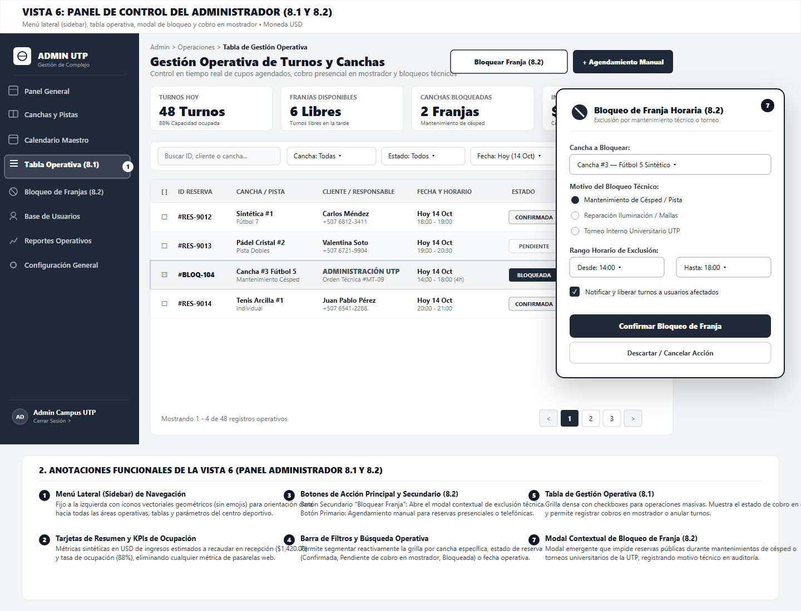

**Propósito** – Dashboard para el administrador: sidebar vectorial,
KPIs (canchas operativas, turnos del día, ocupación), tabla de reservas y
un **modal de bloqueo técnico** para inhabilitar horarios por mantenimiento.

---

# Auditoría y Uso de la IA

## Tabla 1. Auditoría y Uso de la IA - Fase 1 (Mini Avance 1)

| Sección | Integrante(s) | Herramienta y Link al prompt utilizado | Aporte de la IA | Aporte Intelectual del equipo |
| :--- | :--- | :--- | :--- | :--- |
| Repositorio, Despliegue y Descripción del Proyecto | Gonzalez, Walter | Antigravity / Gemini — [Ver prompts en Auditoria/prompts.md](./Auditoria/prompts.md) | Asistió en la estructuración del README en formato Markdown y corrección de coherencia en la redacción inicial. | Configuración del repositorio en GitHub, despliegue en GitHub Pages, y formulación del problema, propósito, objetivo general y alcance del sistema. |
| Identificación de Usuarios | Sanchez, Jose | Ninguna | Ninguno | Análisis y caracterización de los perfiles de Cliente y Administrador, identificando sus necesidades y funciones clave en el sistema. |
| Requisitos Funcionales | Rozette, Jose | Ninguna | Ninguno | Definición técnica y tabulación completa de los requisitos funcionales del sistema (RF-01 a RF-09). |
| Requisitos No Funcionales y Escenarios de Uso | Meneses, Alexander | Ninguna | Ninguno | Formulación de los requisitos no funcionales (RNF-01 a RNF-08) y desarrollo estructurado de los escenarios de uso paso a paso. |

---

## Tabla 2. Auditoría y Uso de la IA - Fase 1 (Parte 2)

| Sección | Integrante(s) | Herramienta y Link al prompt utilizado | Aporte de la IA | Aporte Intelectual del equipo |
| :--- | :--- | :--- | :--- | :--- |
| Casos de Uso, Modelo de Clases, Navegación y Trazabilidad | Gonzalez, Walter | Antigravity / Gemini — [Ver prompts en Auditoria/prompts.md](./Auditoria/prompts.md) | Asistió en la estructuración técnica del README y en la revisión de coherencia de los modelos. | Diseño de casos de uso (flujo principal y excepciones), modelado de clases del dominio, arquitectura de navegación y matriz de trazabilidad. |
| Revisión de Ortografía y Redacción | Sanchez, Jose | Ninguna | Ninguno | Revisión de ortografía, estilo y redacción técnica de los entregables de la parte 2. |
| Validación de Requisitos | Rozette, Jose | Ninguna | Ninguno | Verificación cruzada para asegurar la cobertura de todos los requisitos funcionales en las clases y casos de uso. |
| Control de Estructura | Meneses, Alexander | Ninguna | Ninguno | Inspección de la estructura documental conforme a los criterios de evaluación de la cátedra. |

---

## Tabla 3. Auditoría y Uso de la IA - Fase 2 (Avance Actual)

| Sección | Integrante(s) | Herramienta y Link al prompt utilizado | Aporte de la IA | Aporte Intelectual del equipo |
| :--- | :--- | :--- | :--- | :--- |
| Arquitectura de Información y Sitemap | Gonzalez, Walter | Antigravity / Gemini — [Ver prompts en Auditoria/prompts.md](./Auditoria/prompts.md) | Asistió en la maquetación del documento en formato Markdown y en la revisión de coherencia técnica entre las especificaciones de arquitectura y navegación. | Definición de las reglas de negocio, taxonomía multidimensional del catálogo, especificaciones de accesibilidad WCAG 2.1 AA, lógica de concurrencia y diseño jerárquico del sitemap. |
| Modelo de Navegación Refinado y Flujos de Navegación | Sanchez, Jose | Gemini — [Ver prompts en Auditoria/prompts.md](./Auditoria/prompts.md) | Asistió en la estructuración de los diagramas de flujo de tareas críticas y en la depuración de pasos redundantes e inconsistencias lógicas. | Elaboración del diagrama de navegación general, estructuración de las matrices de pantallas y roles, y modelado detallado de los cinco flujos de tareas críticas con manejo de decisiones, intercepción de sesión y excepciones. |
| Wireframes | Rozette, Jose | En desarrollo | En desarrollo | Asignado para el diseño estructural de las pantallas principales en media fidelidad. |
| Prototipo de Alta Fidelidad | Meneses, Alexander | En desarrollo | En desarrollo | Asignado para la construcción visual interactiva y componentes en Figma. |
