# UNIVERSIDAD TECNOLÓGICA DE PANAMÁ
## FACULTAD DE INGENIERÍA DE SISTEMAS COMPUTACIONALES
### DEPARTAMENTO DE INGENIERÍA DE SOFTWARE

**Materia:** Ingeniería Web  
**Grupo:** 1SF133  
**Docente:** Dra. Elba Valderrama Bahamóndez  
**Período:** II Semestre de 2026  
**Tema:** Proyecto Final (Fase 1) – Birrias de One: Sistema web para reserva de canchas e instalaciones deportivas  

**Integrantes:**
* Gonzalez, Walter — 8-1027-2220
* Sanchez, Jose — 8-1038-670
* Rozette, Jose — 8-1025-306
* Meneses, Alexander — 8-1035-623

---

### Avance del Proyecto
* **Enlace al repositorio (carpetas y estructura):** [https://github.com/WalterJoel18/Sw-para-reserva-de-canchas-e-instalaciones-deportivas](https://github.com/WalterJoel18/Sw-para-reserva-de-canchas-e-instalaciones-deportivas)
* **Enlace a la web (lectura del avance):** [https://walterjoel18.github.io/Sw-para-reserva-de-canchas-e-instalaciones-deportivas/](https://walterjoel18.github.io/Sw-para-reserva-de-canchas-e-instalaciones-deportivas/)

---

# Fase 1: Definición, Requisitos y Modelado Web

## 1. Descripción del proyecto

* **Nombre del Proyecto:** Birrias de One – Sistema web para reserva de canchas e instalaciones deportivas.
* **Problema o necesidad:** La dificultad y pérdida de tiempo que enfrentan los usuarios al intentar encontrar canchas disponibles debido a la falta de información centralizada. Asimismo, la ineficiencia de los administradores de los complejos deportivos al llevar el control de reservas, horarios y cancelaciones de manera manual.
* **Propósito:** Proporcionar un sistema digitalizado y centralizar la información respecto a la reserva de canchas.
* **Objetivo general:** Diseñar e implementar una página web centralizada que mejore la experiencia de los usuarios en la búsqueda y reserva de canchas deportivas, garantizando el acceso a información actualizada y detallada sobre las instalaciones en todo momento.
* **Alcance:** El proyecto abarcará el diseño y desarrollo de una aplicación web responsiva. Incluirá un catálogo digital de instalaciones deportivas con sus respectivos detalles (costos, ubicación, superficie y condiciones). Contará con un módulo de acceso público para consulta y disponibilidad, un módulo para clientes registrados (orientado a la generación de reservas con cálculo de abono mínimo sugerido) y un módulo administrativo (para control de estados, registro asistido y liquidación de reservas en sitio).
* **Principales funcionalidades (Consideradas hasta ahora):**
  * Registro y autenticación de usuarios (perfil cliente y perfil administrador).
  * Buscador de canchas con filtros por tipo de deporte y disponibilidad de fechas/horarios.
  * Calendario interactivo para visualizar horarios libres y ocupados en tiempo real.
  * Sistema de generación, confirmación y cancelación de reservas.
  * Panel de administración para agregar/editar la información de las canchas y gestionar el estado de las reservas.

---

## 2. Identificación de usuarios

### Cliente no registrado (Visitante)
* **Características:** Personas que acceden por primera vez al sitio web o usuarios recurrentes que no han iniciado sesión. Buscan conocer las instalaciones, comparar tarifas y verificar horarios libres antes de decidirse a crear una cuenta.
* **Necesidades:**
  * Explorar el catálogo completo de canchas y sus especificaciones técnicas.
  * Filtrar instalaciones por disciplina deportiva y rango de precios.
  * Consultar el calendario dinámico de disponibilidad en tiempo real.
* **Funciones principales en el sistema:**
  * Navegar en la página principal y catálogo.
  * Realizar búsquedas con filtros facetados.
  * Visualizar los bloques horarios libres y ocupados.
  * Ser redirigido al registro/inicio de sesión al intentar apartar un horario disponible.

### Cliente
* **Características:** Personas de diversas edades interesadas en practicar deportes o realizar actividades físicas. Por lo general, disponen de poco tiempo y buscan soluciones rápidas y convenientes.
* **Necesidades:**
  * Encontrar rápidamente una cancha disponible que se ajuste a su deporte, horario y presupuesto.
  * Conocer las características exactas de la instalación (ubicación, si es techada, tipo de piso, precio) antes de reservar.
  * Realizar una reserva de forma inmediata sin tener que hacer llamadas telefónicas, esperar confirmaciones por WhatsApp o ir presencialmente al lugar.
* **Funciones principales en el sistema:**
  * Registrarse e iniciar sesión.
  * Buscar y filtrar canchas (por deporte, fecha y hora).
  * Visualizar el calendario interactivo de disponibilidad.
  * Realizar la reserva de un horario específico.
  * Cancelar una reserva previamente hecha.
  * Ver su historial de reservas (pasadas y próximas).

### Administrador
* **Características:** Personal empleado por el complejo deportivo (recepcionistas, gerentes o dueños). Tienen conocimientos básicos o intermedios en el uso de sistemas informáticos y son los responsables directos de la atención al público, el cobro y el mantenimiento de las instalaciones.
* **Necesidades:**
  * Mantener un control organizado y centralizado de todas las reservas del día para evitar la sobreocupación de canchas (dos personas reservando la misma cancha).
  * Poder bloquear horarios si una cancha entra en reparación o mantenimiento.
  * Tener acceso a los datos de contacto del cliente en caso de que ocurra algún inconveniente con la reserva.
* **Funciones principales en el sistema:**
  * Iniciar sesión en un panel de control privado (Dashboard).
  * Gestionar el catálogo de instalaciones: editar la información de las canchas (precios, fotos, estado).
  * Visualizar un listado completo o calendario con todas las reservas agendadas por los clientes.
  * Cambiar el estado de las reservas.
  * Bloquear manualmente horarios de las canchas por motivos de cierre o mantenimiento.

---

## 3. Requisitos funcionales

| Código | Módulo | Descripción del Requisito | Usuario |
| :--- | :--- | :--- | :--- |
| **RF-01** | Seguridad | El sistema debe permitir a los usuarios registrarse ingresando sus datos personales (nombre, correo, teléfono y contraseña), asignando el rol de Cliente por defecto o el rol de Administrador si se introduce un código de acceso corporativo válido. | Visitante |
| **RF-02** | Seguridad | El sistema debe autenticar a los usuarios mediante correo y contraseña; tras validar las credenciales, debe redirigir al panel de administración si el rol es Administrador o al catálogo principal si el rol es Cliente. | Cliente / Administrador |
| **RF-03** | Catálogo | El sistema debe permitir al administrador consultar el catálogo de canchas, editar sus atributos (tarifas, condiciones, iluminación e imágenes) y modificar su estado a activo o inactivo. | Administrador |
| **RF-04** | Búsqueda | El sistema debe permitir buscar y filtrar canchas por disciplina deportiva, modalidad, tipo de superficie, ubicación y rango de precios. | Público |
| **RF-05** | Disponibilidad | El sistema debe presentar un calendario interactivo con la disponibilidad de cada cancha, diferenciando visualmente bloques libres, ocupados y bloqueados por mantenimiento. | Público |
| **RF-06** | Reservas | El sistema debe permitir al cliente seleccionar un bloque libre y generar una reserva en estado Pendiente, bloqueando inmediatamente el horario para evitar colisiones y mostrando el valor estimado de la reserva. | Cliente |
| **RF-07** | Perfil | El sistema debe permitir al cliente autenticado visualizar su historial de reservas, detallando cancha, fecha, rango horario, estado actual y valor estimado. | Cliente |
| **RF-08** | Reservas | El sistema debe permitir al cliente cancelar una reserva propia que se encuentre en estado Pendiente o Confirmada, siempre que falten más de 2 horas para su inicio, liberando el bloque horario automáticamente. | Cliente |
| **RF-09** | Gestión | El sistema debe permitir al administrador visualizar todas las reservas del complejo, registrar reservas realizadas de forma presencial o telefónica y actualizar su estado operativo: Confirmada, Cancelada o Completada. | Administrador |
| **RF-10** | Gestión | El sistema debe permitir al administrador consultar el valor estimado de cada reserva y registrar una observación relacionada con el pago presencial, sin procesar pagos dentro de la plataforma. | Administrador |
| **RF-11** | Mantenimiento | El sistema debe permitir al administrador bloquear rangos específicos de fechas y horas en una cancha por motivos de mantenimiento o cierre, impidiendo nuevas reservas en esos intervalos. | Administrador |

---

## 4. Requisitos no funcionales

| Código | Categoría | Descripción del Requisito |
| :--- | :--- | :--- |
| **RNF-01** | Usabilidad | La interfaz debe ser intuitiva, permitiendo que un usuario nuevo realice una reserva sin necesitar capacitación previa. |
| **RNF-02** | Responsive | El sistema debe adaptarse correctamente a dispositivos móviles, tablets y computadoras de escritorio. |
| **RNF-03** | Seguridad | Las contraseñas deben almacenarse mediante funciones de hash y las sesiones deben protegerse contra accesos no autorizados. |
| **RNF-04** | Rendimiento | El sistema debe cargar el calendario de disponibilidad en un máximo de 3 segundos bajo condiciones normales de red. |
| **RNF-05** | Disponibilidad | La plataforma debe permitir a los clientes consultar la disponibilidad y realizar reservas siempre que el sistema se encuentre operativo. |
| **RNF-06** | Compatibilidad | El sistema debe funcionar correctamente en los navegadores más usados (Chrome, Firefox, Edge y Safari). |
| **RNF-07** | Escalabilidad | El sistema debe permitir agregar nuevas canchas deportivas sin requerir cambios importantes en la estructura del sistema. |
| **RNF-08** | Mantenibilidad | El código debe estar documentado y modularizado para facilitar futuras actualizaciones o correcciones. |

---

## 5. Escenarios de uso

| Usuario | Objetivo | Contexto | Secuencia | Resultado esperado |
| :--- | :--- | :--- | :--- | :--- |
| **Visitante / Administrador** | Registrarse en el sistema | Un usuario nuevo o empleado del complejo desea crear una cuenta por primera vez. | Accede al formulario de registro → ingresa nombre, correo, teléfono, contraseña (y opcionalmente código corporativo de empleado) → confirma el registro. | Se crea la cuenta con el rol correspondiente ('Cliente' por defecto o 'Administrador' si el código es válido) y queda habilitado para iniciar sesión. |
| **Visitante / Cliente** | Consultar catálogo, filtros y disponibilidad | Una persona desea conocer las canchas disponibles, tarifas, especificaciones técnicas y horarios libres antes de decidir apartar un turno. | Ingresa a la página principal → aplica filtros facetados (deporte, modalidad, horario, precio) → abre la ficha de la cancha → revisa el calendario interactivo. | Visualiza las canchas filtradas y los horarios libres/ocupados en tiempo real sin requerir inicio de sesión previo. |
| **Cliente / Administrador** | Iniciar sesión en la plataforma | Usuario registrado necesita acceder a sus funciones según su rol. | Ingresa a Inicio de Sesión → introduce correo y contraseña → el sistema valida credenciales y evalúa el rol del usuario. | El sistema autentica al usuario; redirige al Cliente al catálogo principal y al Administrador al Dashboard administrativo. |
| **Cliente** | Agendar reserva con abono mínimo | Cliente autenticado desea apartar una cancha para el fin de semana. | Selecciona una cancha y un bloque horario libre en el calendario → revisa el resumen con tarifa total y abono mínimo estimado → confirma la solicitud. | Se genera la reserva en estado **Pendiente**, el horario se bloquea de inmediato para evitar colisiones y se despliegan los datos para depositar el abono. |
| **Cliente** | Cancelar reserva oportunamente | Un cliente con reserva no podrá asistir al partido agendado. | Accede a "Mis reservas" → selecciona una reserva activa con más de 2 horas de anticipación → presiona "Cancelar" → confirma la acción. | La reserva cambia a estado **Cancelada**, se registra el motivo de cancelación y el horario vuelve a estar disponible inmediatamente en el calendario. |
| **Cliente** | Consultar historial y estado de reservas | El cliente quiere revisar sus reservas activas, solicitudes pendientes y partidos pasados. | Inicia sesión → accede a la sección "Mis reservas / Historial" → visualiza el listado detallado con estado, abono registrado y saldo pendiente. | El cliente comprueba el estatus de sus reservas y el detalle de cada turno. |
| **Administrador** | Confirmar reserva pendiente | El administrador debe validar una reserva creada por un cliente tras verificar el abono recibido. | Accede al listado de reservas → filtra por estado 'Pendiente' → valida el comprobante del abono (vía recepción/Yappy) → cambia su estado a 'Confirmada'. | La reserva pasa a estado **Confirmada** y el cambio se refleja inmediatamente en el perfil del cliente. |
| **Administrador** | Registrar reserva asistida | Un cliente acude en persona a la recepción o llama por teléfono para apartar cancha sin usar la web directamente. | Accede al calendario administrativo → selecciona un bloque horario libre → ingresa los datos de contacto del cliente y el abono inicial recibido → guarda la reserva. | Se crea la reserva directamente en estado **Confirmada**, bloqueando el horario y asociando el turno al cliente. |
| **Administrador** | Liquidar y completar reserva en ventanilla | Los jugadores finalizaron el uso de la cancha o se presentan a liquidar el turno en recepción. | Selecciona la reserva confirmada → el sistema calcula automáticamente `Total - Abono = Saldo Pendiente` → admin recibe el pago completo en caja y marca el turno como 'Completada'. | La reserva finaliza en estado **Completada**, queda cerrada y el sistema genera el comprobante digital de liquidación. |
| **Administrador** | Editar información y disponibilidad de canchas | El administrador necesita actualizar precios, reglas de calzado o pausar temporalmente una cancha del catálogo. | Accede a gestión de canchas → selecciona la instalación → edita tarifas/condiciones o conmuta su estado a "Inactiva" (desactivación lógica) → guarda cambios. | El catálogo público se actualiza reflejando la nueva información o retirando la cancha de la búsqueda sin borrar su historial transaccional. |
| **Administrador** | Bloquear horarios por mantenimiento | Una cancha presenta daños, lluvia o mantenimiento preventivo de luminarias/césped. | Accede a la gestión de la cancha → selecciona la opción "Bloquear horarios" → indica el rango de fecha y horas → confirma bloqueo. | Los horarios seleccionados quedan inhabilitados en el calendario (color gris/bloqueado) impidiendo nuevas reservas. |

---

## 6. Casos de uso

### 6.1 Diagrama de casos de uso

---

### 6.2 Descripción de los principales casos de uso

#### CU-01: Registrarse en el sistema
| Campo | Descripción |
| :--- | :--- |
| **Código** | CU-01 |
| **Nombre** | Registrarse en el sistema |
| **Actor(es)** | Cliente, Administrador |
| **Precondición** | El usuario no tiene una cuenta en el sistema. |
| **Flujo principal** | 1. El usuario accede a la página de registro.   2. Completa los campos: nombre, correo, teléfono y contraseña.   3. (Opcional) Ingresa un código de acceso de empleado.   4. El sistema valida que el correo no esté registrado.   5. El sistema crea la cuenta con el rol correspondiente.   6. Se muestra un mensaje de confirmación. |
| **Flujo alterno** | 4a. Si el correo ya está registrado, el sistema muestra un error.   5a. Si el código de empleado es incorrecto, el sistema rechaza el rol de administrador. |
| **Postcondición** | La cuenta queda creada y el usuario puede iniciar sesión. |

#### CU-02: Iniciar sesión
| Campo | Descripción |
| :--- | :--- |
| **Código** | CU-02 |
| **Nombre** | Iniciar sesión |
| **Actor(es)** | Cliente, Administrador |
| **Precondición** | El usuario tiene una cuenta registrada en el sistema. |
| **Flujo principal** | 1. El usuario accede a la página de inicio de sesión.   2. Ingresa su correo y contraseña.   3. El sistema valida las credenciales.   4. Si el rol es "Cliente", se redirige a la página principal del catálogo.   5. Si el rol es "Administrador", se redirige al panel de gestión. |
| **Flujo alterno** | 3a. Si las credenciales son incorrectas, el sistema muestra un error de autenticación. |
| **Postcondición** | El usuario accede al sistema con los permisos de su rol. |

#### CU-03: Buscar canchas con filtros
| Campo | Descripción |
| :--- | :--- |
| **Código** | CU-03 |
| **Nombre** | Buscar canchas con filtros |
| **Actor(es)** | Visitante, Cliente |
| **Precondición** | Acceso público (no requiere inicio de sesión). |
| **Flujo principal** | 1. El usuario accede al buscador de canchas.   2. Aplica los filtros deseados: tipo de deporte, fecha, horario y/o precio.   3. El sistema consulta la base de datos y devuelve resultados.   4. Se muestran las canchas que cumplen con los criterios. |
| **Flujo alterno** | 3a. Si no se encuentran canchas, se sugiere eliminar algunos filtros. |
| **Postcondición** | El usuario visualiza una lista de canchas acordes a su búsqueda. |

#### CU-04: Visualizar disponibilidad de horarios
| Campo | Descripción |
| :--- | :--- |
| **Código** | CU-04 |
| **Nombre** | Visualizar disponibilidad de horarios |
| **Actor(es)** | Visitante, Cliente |
| **Precondición** | El usuario ha seleccionado una cancha específica. |
| **Flujo principal** | 1. El usuario entra a ver los detalles de la cancha.   2. El sistema muestra un calendario interactivo.   3. Los horarios libres se muestran en color verde y los ocupados en rojo. |
| **Flujo alterno** | 2a. Si la cancha no tiene horarios disponibles para esa fecha, se sugiere cambiar de día. |
| **Postcondición** | El usuario identifica qué horarios están libres para reservar. |

#### CU-05: Reservar una cancha
| Campo | Descripción |
| :--- | :--- |
| **Código** | CU-05 |
| **Nombre** | Reservar una cancha |
| **Actor(es)** | Cliente |
| **Precondición** | El cliente visualizó un horario libre y cuenta con sesión activa. |
| **Flujo principal** | 1. El cliente hace clic sobre un bloque horario disponible (en verde).   2. El sistema calcula y presenta la pantalla de confirmación con el resumen: cancha, fecha, rango de horas, tarifa total calculada y monto del abono mínimo sugerido para asegurar el turno.   3. El cliente confirma la reserva.   4. El sistema guarda la reserva asignándole el estado Pendiente y bloquea automáticamente el horario en el calendario de la cancha.   5. Se emite en pantalla el mensaje de confirmación con el número de reserva e instrucciones para el depósito del abono en la recepción o vía electrónica. |
| **Flujo alterno** | 4a. Si otro cliente reservó el mismo bloque un instante antes (conflicto), el sistema informa y solicita seleccionar otro horario. |
| **Postcondición** | La reserva queda registrada en estado Pendiente y el horario bloqueado para otros. |

#### CU-06: Cancelar una reserva
| Campo | Descripción |
| :--- | :--- |
| **Código** | CU-06 |
| **Nombre** | Cancelar una reserva |
| **Actor(es)** | Cliente |
| **Precondición** | El cliente tiene una reserva activa (Pendiente o Confirmada). |
| **Flujo principal** | 1. El cliente ingresa a su sección "Mis Reservas".   2. Selecciona la reserva que necesita suspender y presiona "Cancelar Reserva".   3. El sistema valida la regla de negocio temporal: verifica que falten más de 2 horas respecto a la hora pactada de inicio.   4. El sistema solicita confirmación.   5. El cliente confirma la cancelación.   6. El sistema cambia el estado de la reserva a Cancelada, registra la fecha de cancelación y libera el horario inmediatamente en el calendario. |
| **Flujo alterno** | 3a. Si faltan menos de 2 horas para el inicio del turno, el sistema deshabilita la acción y muestra: "No es posible cancelar en línea con menos de 2 horas de anticipación. Por favor comuníquese con la administración". |
| **Postcondición** | El horario vuelve a estar disponible para el público. |

#### CU-07: Consultar historial de reservas
| Campo | Descripción |
| :--- | :--- |
| **Código** | CU-07 |
| **Nombre** | Consultar historial de reservas |
| **Actor(es)** | Cliente |
| **Precondición** | El cliente ha iniciado sesión. |
| **Flujo principal** | 1. El cliente ingresa a la sección "Historial".   2. El sistema muestra las reservas pasadas y futuras con su estado actual (completada, cancelada, confirmada). |
| **Flujo alterno** | 2a. Si el cliente no tiene reservas, se muestra un mensaje informativo vacío. |
| **Postcondición** | El cliente queda informado sobre toda su actividad en la plataforma. |

#### CU-08: Gestionar canchas (CRUD)
| Campo | Descripción |
| :--- | :--- |
| **Código** | CU-08 |
| **Nombre** | Gestionar canchas (CRUD) |
| **Actor(es)** | Administrador |
| **Precondición** | El administrador ha iniciado sesión en el panel de gestión. |
| **Flujo principal** | 1. El administrador accede al catálogo interno de canchas.   2. Puede Agregar, Editar o Desactivar una cancha.   3. Ingresa o modifica los datos y guarda.   4. El sistema valida y actualiza la base de datos. |
| **Flujo alterno** | 4a. Faltan datos obligatorios al guardar. El sistema bloquea la operación y pide completarlos. |
| **Postcondición** | El catálogo público de canchas queda actualizado con los cambios. |

#### CU-09: Gestionar el estado de las reservas
| Campo | Descripción |
| :--- | :--- |
| **Código** | CU-09 |
| **Nombre** | Gestionar el estado de las reservas |
| **Actor(es)** | Administrador |
| **Precondición** | Existen reservas registradas por los clientes. |
| **Flujo principal** | 1. El administrador abre la lista general de reservas.   2. Selecciona una reserva y cambia su estado a «Completada» o «Cancelada».   3. Guarda los cambios.   4. El sistema actualiza el estado en la base de datos. |
| **Flujo alterno** | 1a. Si no hay reservas registradas, el sistema indica que no existen reservas para gestionar. |
| **Postcondición** | Los estados de las reservas quedan actualizados y se reflejan en el historial del cliente. |

#### CU-10: Bloquear horarios por mantenimiento
| Campo | Descripción |
| :--- | :--- |
| **Código** | CU-10 |
| **Nombre** | Bloquear horarios por mantenimiento |
| **Actor(es)** | Administrador |
| **Precondición** | El administrador ha iniciado sesión en el sistema. |
| **Flujo principal** | 1. El administrador selecciona la cancha que necesita reparación.   2. Selecciona el rango de fechas y horas a bloquear.   3. Confirma y guarda.   4. El sistema marca esos bloques como no disponibles para los clientes. |
| **Flujo alterno** | 3a. Ya existen reservas en el horario seleccionado. El sistema advierte que debe resolver las reservas existentes antes de bloquear. |
| **Postcondición** | Los horarios seleccionados quedan inhabilitados en el calendario público. |

#### CU-11: Liquidar reserva y emitir comprobante
| Campo | Descripción |
| :--- | :--- |
| **Código** | CU-11 |
| **Nombre** | Liquidar reserva y emitir comprobante |
| **Actor(es)** | Administrador |
| **Precondición** | La reserva se encuentra en estado confirmada y los jugadores se presentan al complejo. |
| **Flujo principal** | 1. El administrador localiza la reserva en el sistema al presentarse el cliente al partido.   2. Selecciona la opción "Liquidar / Cobro de Turno".   3. El sistema calcula automáticamente los valores económicos: `Tarifa Total - Abono Registrado = Saldo Pendiente`.   4. El administrador recibe el cobro presencial por el monto del saldo pendiente y presiona "Confirmar Pago Total".   5. El sistema actualiza el estado de la reserva a Completada y registra el cobro total.   6. El sistema genera en pantalla un comprobante digital de liquidación con el desglose de conceptos, número de turno y confirmación de pago para visualización o impresión del cliente. |
| **Flujo alterno** | 4a. Si el usuario no abona el total restante, el sistema no permite el cierre del turno, manteniendo la reserva en estado confirmada hasta su liquidación íntegra. |
| **Postcondición** | La reserva queda cerrada como 'Completada' y se genera el recibo de liquidación. |

---

## 7. Modelo de clases

Este modelo representa las entidades principales, sus atributos, métodos y la forma en que se relacionan dentro del sistema.

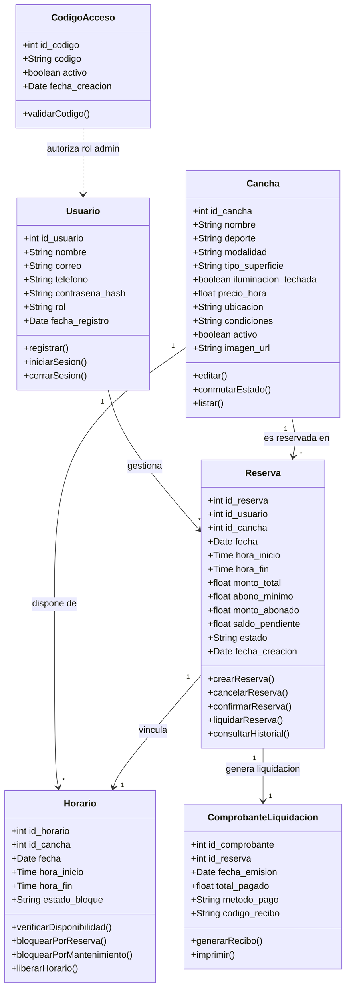

### Descripción de las clases del modelo

| Clase | Descripción |
| :--- | :--- |
| **Usuario** | Representa a cualquier persona registrada en el sistema (cliente o administrador). Almacena credenciales, datos personales y el rol asignado. |
| **Cancha** | Representa una instalación deportiva del complejo. Contiene toda la información visible para los clientes (nombre, deporte, precio, ubicación, condiciones y estado). |
| **Reserva** | Registra el vínculo entre un usuario y una cancha en un horario específico. Controla el ciclo de vida de la reserva (Pendiente, Confirmada, Completada o Cancelada). |
| **Horario** | Representa los bloques de tiempo disponibles para cada cancha. Permite al sistema gestionar la disponibilidad y aplicar bloqueos por mantenimiento. |
| **ComprobanteLiquidacion** | Entidad generada cuando el administrador finaliza y liquida la reserva en ventanilla, documentando el pago completo del saldo pendiente. |
| **CodigoAcceso** | Almacena los códigos secretos que permiten a los trabajadores del complejo registrarse con permisos de administrador. |

---

## 8. Modelo de navegación inicial

Diagrama que muestra la estructura del sitio y cómo los usuarios interactúan y se desplazan entre las pantallas principales de la aplicación.

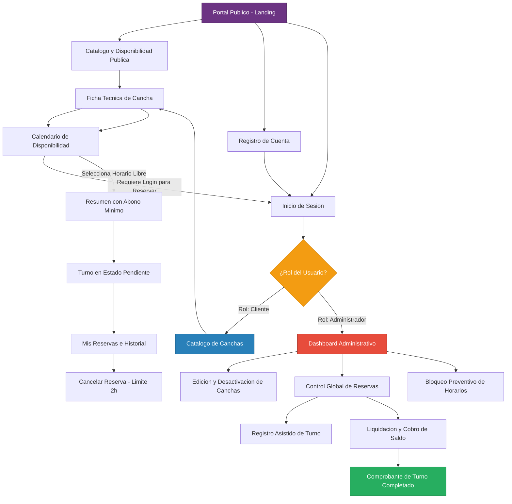

### Descripción de pantallas principales

| Pantalla | Descripción | Usuario |
| :--- | :--- | :--- |
| **Página de Inicio** | Landing page pública con el acceso al registro e inicio de sesión. | Público |
| **Inicio de Sesión / Registro** | Formularios de autenticación para entrar a la plataforma. | Público |
| **Catálogo de Canchas** | Pantalla principal para clientes. Muestra las canchas y el buscador. | Cliente |
| **Calendario de Disponibilidad** | Vista interactiva que muestra bloques de tiempo libres y ocupados. | Cliente |
| **Mis Reservas / Historial** | Panel donde el cliente ve sus reservas pasadas/futuras y puede cancelar. | Cliente |
| **Panel de Administración** | Dashboard privado con acceso a gestión de canchas, reservas y bloqueos. | Administrador |
| **Agregar / Editar Cancha** | Formulario administrativo para actualizar los datos de las instalaciones. | Administrador |
| **Listado de Reservas** | Vista general donde el admin puede ver y cambiar el estado de cualquier reserva. | Administrador |

---

## 9. Matriz de trazabilidad

Esta matriz relaciona formalmente los Requisitos Funcionales con los Casos de Uso y las entidades del Modelo de Clases, garantizando la total cobertura funcional sin requisitos huérfanos.

| Código Req. | Descripción del Requisito | Caso de Uso Asignado | Clases Involucradas |
| :--- | :--- | :--- | :--- |
| **RF-01** | El sistema debe permitir registrar usuarios (Cliente y Administrador). | CU-01: Registrarse en el sistema | Usuario, CodigoAcceso |
| **RF-02** | El sistema debe permitir inicio de sesión seguro. | CU-02: Iniciar sesión unificado | Usuario |
| **RF-03** | Permitir consulta y edición de la información de las canchas. | CU-08: Administrar información de canchas | Cancha |
| **RF-04** | Buscar canchas filtrando por deporte, fecha, horario y precio. | CU-03: Buscar canchas con filtros | Cancha |
| **RF-05** | Mostrar interfaz de disponibilidad (calendario/horarios libres). | CU-04: Visualizar disponibilidad de horarios | Horario, Cancha |
| **RF-06** | Seleccionar bloque de tiempo y generar reserva en estado Pendiente. | CU-05: Reservar cancha | Reserva, Horario, Cancha |
| **RF-07** | Visualizar estado de reservas actuales y pasadas. | CU-07: Consultar historial de reservas | Reserva |
| **RF-08** | Permitir al cliente cancelar reservas activas con antelación mínima de 2 horas. | CU-06: Cancelar reserva | Reserva, Horario |
| **RF-09** | Administrador puede visualizar reservas, registrar reservas asistidas y actualizar estados. | CU-09: Gestionar reservas y registro asistido | Reserva, Horario |
| **RF-10** | Consultar valor estimado de reserva y liquidar con emisión de comprobante. | CU-11: Liquidar reserva y emitir comprobante | Reserva, ComprobanteLiquidacion |
| **RF-11** | Bloquear fechas/horarios por mantenimiento. | CU-10: Bloquear horarios por mantenimiento | Horario, Cancha |

### Trazabilidad gráfica

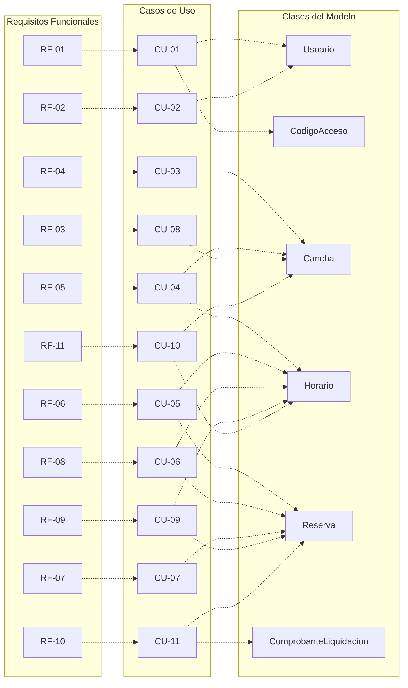

---

## 10. Auditoria y uso de ia

### Aportes individuales fase 1

| Integrantes | Cedula | Aporte individual |
| :--- | :--- | :--- |
| **Gonzalez, Walter** | 8-1027-2220 | Diseñó la arquitectura de la Fase 1 (Puntos 6 al 10): elaboración de los Casos de Uso (diagrama y descripción), diseño del Modelo de Clases, mapeo del Modelo de Navegación, estructuración de la Matriz de Trazabilidad y levantamiento de la auditoría de uso de Inteligencia Artificial para validación de procesos. |
| **Sanchez, Jose** | 8-1038-670 | Revisión de ortografía |
| **Rozette, Jose** | 8-1025-306 | Revisión de los requisitos |
| **Meneses, Alexander** | 8-1035-623 | Revisión de la estructura del documento |

### Registro de herramientas de ia utilizadas

| Herramienta | Aplicación Específica en la Fase 1 |
| :--- | :--- |
| **Gemini / Antigravity** | Utilizada como asistente de ingeniería de software para la revisión de consistencia lógica entre Requisitos Funcionales y Casos de Uso, verificación de la sintaxis de diagramas Mermaid y estructuración del documento técnico en formato Markdown para garantizar la máxima legibilidad visual y coherencia metodológica. |
| **Obsidian** | Plataforma de gestión de conocimiento y edición Markdown utilizada para el modelado estructurado de notas de requerimientos, esquemas y vinculación bidireccional entre fases del proyecto. |

---

# Fase 2: Arquitectura de Información y Diseño de Interfaz

# 1. Arquitectura de Información (AI)

## 1.1 Contenido Principal (Inventario de Contenidos)

El inventario de la plataforma se organiza en tres tipologías de contenido: informativo, funcional y mixto.

### A. Contenido Informativo

- **Presentación del Complejo (Landing):** Identidad del centro multideportivo, resumen de servicios e infraestructura para 6 disciplinas deportivas (fútbol, básquetbol, tenis, pádel, voleibol y bádminton), y accesos directos al catálogo general.
- **Guía de Uso ("¿Cómo funciona?"):** Secuencia explicativa de cuatro pasos orientada a nuevos usuarios:
  1. Exploración del catálogo y selección de instalación.
  2. Consulta de disponibilidad horaria en tiempo real.
  3. Generación de reserva web preliminar (estado *Pendiente*).
  4. Confirmación del turno mediante transferencia de abono (Yappy / Banco) y envío de comprobante vía WhatsApp.
- **Normativa y Equipamiento por Superficie:**
  - *Césped Sintético (Fútbol 5, 7 y 9):* Uso exclusivo de calzado con suela tipo turf o multitaco; restricción estricta de tacos de aluminio y calzado de suela lisa para evitar desgaste y lesiones.
  - *Fútbol Sala (Cemento / Tabloncillo):* Uso obligatorio de zapatillas con suela de goma lisa (*non-marking*) para preservación de la duela y prevención de deslizamientos.
  - *Pádel / Tenis (Césped sintético fibrilado / Arcilla / Sintético):* Calzado con suela de espiga (*clay*) o suela mixta omni; requerimientos reglamentarios para palas de pádel con cordón de seguridad y raquetas encordadas.
  - *Básquetbol (Techado / Cemento):* Calzado deportivo con soporte de tobillo y amortiguación de impacto; exigencia mandatoria de suela de goma limpia (*non-marking*) en tabloncillos de madera tratada.
  - *Voleibol (Techado / Cemento / Aire libre):* Calzado deportivo con adherencia lateral; suela *non-marking* en pista interior de tabloncillo. Uso de rodilleras reglamentarias y balones con presión estándar de competencia.
  - *Bádminton (Tabloncillo / Sintético interior):* Zapatillas livianas indoor con suela de agarre antideslizante (*non-marking*). Uso obligatorio de volantes reglamentarios (nylon o pluma) y raquetas certificadas.
- **Información General y Contacto:** Horarios de operación física, geolocalización, canales de atención al cliente (WhatsApp institucional habilitado para recepción de comprobantes de abono), políticas de cancelación (cancelable únicamente si faltan más de 2 horas para el inicio del turno; a las 2 horas exactas o menos no se permite la cancelación ni la creación de reservas) y tolerancia de llegada.

### B. Contenido Funcional

- **Explorador Visual (Collage):** Navegación visual estructurada mediante cuadrículas fotográficas organizadas por disciplinas deportivas y tipos de instalación (techadas y al aire libre).
- **Buscador con Filtros Facetados y Ordenamiento:** Motor de búsqueda que opera sobre las dimensiones taxonómicas del sistema: deporte, modalidad/formato, superficie, entorno de cubierta y rango de precio por hora.
- **Calendario de Disponibilidad Dinámica:** Componente temporal reactivo que presenta los intervalos horarios según el rol del usuario. La vista pública y de cliente muestra tres estados: *Libre*, *No disponible temporalmente* (agrupa reservas en estado *Pendiente* sin revelar datos del cliente ni importes) y *Ocupado* (reservas *Confirmadas*). La vista del Administrador amplía la información mostrando: *Libre*, *Pendiente de Abono* (con datos del cliente y temporizador TTL), *Ocupado (Confirmado)* e *Inhabilitado por Mantenimiento*. Cuando el TTL expira, el bloque retorna automáticamente a *Libre* en ambas vistas.
- **Módulo de Confirmación y Agendamiento de Reserva:** Interfaz para la selección de bloques horarios, revisión del desglose económico y registro formal de la orden preliminar (*Pendiente*). El cálculo financiero opera dinámicamente según la duración del turno: `Tarifa Total = Tarifa Base/hora × Horas reservadas`; el abono mínimo corresponde al 30 % de la tarifa total como valor fijo del sistema (`Abono 30 % = Tarifa Total × 0.30`); y el saldo pendiente a liquidar en caja es `Saldo = Tarifa Total − Abono`. Ejemplo de referencia para 1 hora con tarifa de $25.00/h: Tarifa total = $25.00, Abono mínimo (30 %) = $7.50, Saldo en caja = $17.50; si el turno es de 2 horas a $25.00/h: Tarifa total = $50.00, Abono mínimo (30 %) = $15.00 y Saldo en caja = $35.00. Al completar el registro preliminar, el sistema despliega un **resumen de reserva e instrucciones de abono** (no un comprobante financiero) con los datos de transferencia (cuenta bancaria, Yappy comercial) y botón a WhatsApp para remitir el comprobante. El sistema distingue dos comprobantes formales: la **constancia / comprobante digital de abono** (emitido al validar el abono del 30 % y pasar a *Confirmada*) y el **comprobante digital de liquidación final** (emitido en recepción al saldar el remanente en caja).
- **Panel de Usuario ("Mi Cuenta"):** Interfaz para la consulta del historial de turnos (activos, completados y cancelados). Cada tarjeta de reserva incorpora un desglose financiero claro:
  - *Estado del turno:* Pendiente / Confirmada / Completada / Cancelada (con registro del motivo, incluyendo *Vencimiento del TTL* si aplicó).
  - *Tarifa total:* Monto estipulado de la cancha.
  - *Abono registrado:* Importe validado por administración.
  - *Saldo por pagar en caja:* Monto exacto a liquidar en ventanilla antes del inicio del turno.
  - *Acción de cancelación:* Habilitada con registro obligatorio de motivo; cancelable únicamente si faltan más de 2 horas para el inicio del turno; a las 2 horas exactas o menos no se permite la cancelación.
- **Panel Administrativo (Dashboard):**
  - *Gestión de canchas precargadas:* El administrador puede consultar las canchas existentes y cambiar su estado entre Activa e Inactiva mediante un interruptor (*toggle switch*). No puede agregar, eliminar ni editar los datos de las canchas.
  - *Control de Reservas y Validación de Abonos:* Supervisión global de turnos agendados, verificación manual de comprobantes remitidos por los clientes, cambio de estado de *Pendiente* a *Confirmada*, y acceso al módulo POS de liquidación.
  - *Módulo POS de Liquidación en Sitio:* Interfaz tipo punto de venta que se dispara al presentarse el cliente a la instalación; muestra el saldo restante adeudado y permite registrar el método de cobro presencial (Efectivo o Yappy en ventanilla). Al registrar el pago, el saldo pendiente queda en cero ($0.00) y se emite el **comprobante digital de liquidación final** (diferenciado de la constancia digital de abono previa). La reserva permanece en estado *Confirmada* mientras se realiza el turno y pasa automáticamente a *Completada* cuando el turno termina.
  - *Reserva Asistida:* Módulo para registrar turnos presenciales o telefónicos. Permite registrar un abono (30 %) o el pago completo (100 %). Si se recibe el pago completo, el saldo queda en cero ($0.00) y no se vuelve a cobrar en el POS; si se recibe un abono, solo se cobrará el saldo restante en caja al presentarse el cliente. En ambos casos, la reserva queda en estado *Confirmada* y permanece así hasta que termine el turno (momento en que pasa a *Completada*).
  - *Bloqueo Preventivo de Horarios:* Inhabilitación manual de rangos horarios por mantenimiento, reparaciones o factores meteorológicos adversos.

### C. Contenido Mixto

- **Ficha de Detalle de Cancha:** Vista que integra la especificación técnica de la instalación (galería fotográfica, tipo de superficie, condición de cubierta, normativa de calzado, tarifa base por hora y abono mínimo obligatorio correspondiente al 30 % de la tarifa total acumulada según la duración del turno como valor fijo del sistema: ej. 1 hora a $25.00/h requiere $7.50 de abono; 2 horas requieren $15.00 de abono) con el componente interactivo de calendario para la consulta y selección de turnos.

---

## 1.2 Agrupaciones, Categorías y Taxonomía del Catálogo

### A. Agrupación Temática General

1. **Exploración e Instalaciones:** Catálogo general, collage deportivo y fichas individuales de cada cancha.
2. **Agendamiento y Reservas:** Consulta de disponibilidad horaria, generación de reserva preliminar, envío de comprobante y seguimiento personal en la sección de reservas.
3. **Guía y Normativas:** Instrucciones operativas del sistema, reglas de anticipación para cancelaciones (el sistema no permite crear ni cancelar reservas cuando faltan 2 horas o menos para el inicio del turno; estas acciones solo se permiten con más de 2 horas de anticipación) y requerimientos de indumentaria por superficie.
4. **Administración y Control:** Gestión de canchas precargadas (consulta y alternancia de estado Activa / Inactiva mediante interruptor, sin agregar, eliminar ni editar canchas), validación de abonos, control de turnos, liquidación presencial en caja (POS) con cierre al finalizar el turno, registro asistido y bloqueo de horarios.

### B. Taxonomía Multidimensional del Catálogo

Para garantizar una categorización normalizada que facilite tanto el filtrado como la estructuración relacional en base de datos, el catálogo desacopla la información en cuatro dimensiones independientes:

1. **Disciplina Deportiva:** Deporte principal practicado en la instalación:
   - Fútbol
   - Básquetbol
   - Tenis
   - Pádel
   - Voleibol
   - Bádminton
2. **Modalidad y Formato:** Configuración de juego admitida según las dimensiones y marcación:
   - *Fútbol:* Fútbol 5, Fútbol 7, Fútbol 9, Fútbol Sala.
   - *Básquetbol:* Media cancha (3x3), Cancha completa (5x5).
   - *Tenis:* Individual (Singles), Dobles.
   - *Pádel:* Dobles (estándar), Individual.
   - *Voleibol:* Voleibol de Sala 6v6, Voleibol Exterior / Recreativo (2v2 / 4v4).
   - *Bádminton:* Individual, Dobles.
3. **Tipo de Superficie:** Material constructivo del suelo, condicionante directo del calzado:
   - Césped sintético (fibras con relleno de caucho/arena).
   - Tabloncillo / Parqué de madera tratada.
   - Concreto pulido / Cemento sintético.
   - Arcilla / Tierra batida.
4. **Entorno de la Instalación (Cubierta):** Condición estructural frente al clima:
   - Techada / Cubierta cerrada.
   - Al aire libre / Exterior.

Cada cancha física representa una instancia concreta que combina estas cuatro dimensiones, asociando un sector físico dentro del complejo deportivo y una tarifa horaria base.

---

## 1.3 Jerarquía de la Información y Arquitectura de Pantallas

La arquitectura de información distribuye el sistema en tres niveles de profundidad:

- **Nivel 1 (Acceso Global - Páginas Independientes):**
  - Inicio (Landing page), Catálogo / Explorar Canchas, ¿Cómo Funciona?, Normas de Cancha, e Iniciar Sesión / Registro.
- **Nivel 2 (Vistas de Contenido y Gestión - Páginas Independientes):**
  - *Vistas de Cliente:* Resultados del Buscador con Filtros, Ficha de Detalle de Cancha y Mis Reservas (Historial con desglose financiero).
  - *Vistas de Administrador:* Dashboard de Gestión, Gestión de Canchas Precargadas y Listado General de Reservas.
- **Nivel 3 (Componentes de Interacción Contextual - Modales en Capa de Interfaz):**
  - Los modales no constituyen nodos de navegación ni poseen URLs independientes; operan como capas sobrepuestas en las pantallas de Nivel 2:
    - **Modal de Confirmación de Reserva:** Disparado desde la Ficha de Cancha al seleccionar un bloque horario; emite la reserva en estado *Pendiente* y muestra el resumen de reserva e instrucciones de abono con datos de transferencia Yappy/banco, desglose según duración y enlace a WhatsApp.
    - **Modal de Validación de Abono:** Disparado desde el Listado de Reservas por el Administrador; permite corroborar el comprobante recibido, registrar la validación del 30 %, emitir la constancia digital de abono y actualizar la reserva de *Pendiente* a *Confirmada*.
    - **Modal de Liquidación y Cobro en Sitio (POS):** Disparado desde el Listado de Reservas al presentarse el cliente; permite registrar el cobro del saldo restante adeudado (Efectivo o Yappy presencial), dejando el saldo en cero ($0.00) y emitiendo el comprobante digital de liquidación final. La reserva permanece en estado *Confirmada* mientras se realiza el turno y pasa a *Completada* cuando el turno termina.
    - **Modal de Cancelación:** Disparado desde Mis Reservas; verifica que la reserva sea cancelable únicamente si faltan más de 2 horas para el inicio (a las 2 horas exactas o menos no se permite), solicita seleccionar o escribir el motivo obligatorio de la cancelación, registra el motivo en el sistema, cambia el estado a *Cancelada* y libera el turno.
    - **Modal de Bloqueo de Horarios:** Disparado desde Gestión de Canchas Precargadas; define intervalos de inhabilitación por factores climáticos o reparaciones.
    - **Modal de Reserva Asistida:** Disparado desde el Listado de Reservas; permite al personal administrativo registrar turnos presenciales o telefónicos, admitiendo abono (30 %) o pago completo (100 %). Si se recibe el pago completo, el saldo queda en cero ($0.00) y no se vuelve a cobrar en el POS; si se recibe un abono, solo se cobrará el saldo restante en caja al presentarse el cliente. En ambos casos, la reserva queda en estado *Confirmada* hasta que termine el turno (momento en que pasa a *Completada*).

---

## 1.4 Sistema de Etiquetas, Accesibilidad y Disponibilidad Dinámica

### A. Estandarización de Etiquetas

| Etiqueta en Interfaz         | Propósito / Acción                                                                      | Tipo de Elemento   | Nivel de Acceso     |
| :--------------------------- | :-------------------------------------------------------------------------------------- | :----------------- | :------------------ |
| **Explorar Canchas**         | Acceso al catálogo y cuadrícula visual de instalaciones.                                | Menú / Navegación  | Público             |
| **¿Cómo Funciona?**          | Guía de cuatro pasos para el proceso de reserva y abono.                                | Enlace Informativo | Público             |
| **Normas de Cancha**         | Requisitos de calzado y reglamento por tipo de superficie.                              | Enlace Informativo | Público             |
| **Consultar Disponibilidad** | Visualización de la matriz horaria por fecha.                                           | Sección Funcional  | Público             |
| **Reservar Horario**         | Acción interactiva para iniciar el agendamiento del turno.                              | Botón de Acción    | Cliente autenticado |
| **Mis Reservas**             | Consulta de turnos agendados, estados y desgloses de saldo.                             | Menú de Cuenta     | Cliente             |
| **Panel de Control**         | Acceso al módulo de administración operativa (Dashboard).                               | Menú Privado       | Administrador       |
| **Bloquear Horarios**        | Acción para inhabilitar intervalos por mantenimiento o lluvia.                          | Botón Funcional    | Administrador       |
| **Validar Abono**            | Acción para confirmar la recepción del comprobante de abono.                            | Botón de Acción    | Administrador       |
| **Cobrar Saldo / Liquidar**  | Interfaz POS para cobrar el remanente al recibir al cliente.                            | Botón de Acción    | Administrador       |
| **Activa / Inactiva**        | Interruptor (*toggle*) para cambiar el estado de disponibilidad de canchas precargadas. | Control de Estado  | Administrador       |

### B. Accesibilidad Web (WCAG 2.1 Nivel AA) y Diseño Responsivo

En cumplimiento del requisito RNF-01 (Usabilidad) y del estándar WCAG 2.1 Nivel AA, la interfaz adopta las siguientes especificaciones técnicas:

1. **Contraste Cromático:** Todos los elementos textuales e indicadores de interfaz mantienen un contraste mínimo de 4.5:1 respecto a su fondo para texto estándar, y de 3:1 para componentes interactivos.
2. **Identificación Multimodal de Estados:** La disponibilidad horaria no se transmite únicamente mediante color, combinando tres señales simultáneas. Los estados visuales del calendario se corresponden con los estados internos de reserva de la siguiente forma:
   - *Intervalo Libre (sin reserva):* Fondo verde accesible (#2E7D32), texto legible "Libre" e icono de confirmación con atributo `aria-label="Horario disponible"`.
   - *Intervalo No Disponible Temporalmente (vista pública — estado interno: Pendiente):* Fondo ámbar/naranja (#E65100), texto "No disponible", icono de reloj de espera y atributo `aria-label="Horario reservado provisionalmente"`. No expone datos del cliente ni importes al público.
   - *Intervalo Pendiente de Abono (solo vista administrativa — estado interno: Pendiente):* Fondo ámbar/naranja (#E65100), texto "Pendiente", icono de reloj con temporizador TTL visible y datos del solicitante.
   - *Intervalo Ocupado (estado interno: Confirmada):* Fondo gris neutro (#616161), texto "Ocupado", icono de candado y atributo `aria-disabled="true"`.
   - *Intervalo en Mantenimiento (bloqueo administrativo):* Fondo amarillo advertencia (#F57F17) con trama rayada diagonal de alto contraste, texto "Mantenimiento" e icono de alerta.
3. **Navegación Asistida por Teclado:** Toda la matriz de turnos y formularios admiten navegación secuencial lógica mediante la tecla Tab, con indicadores visuales de foco activos (`:focus-visible`).
4. **Adaptabilidad del Calendario en Dispositivos Móviles:**
   - En resoluciones de escritorio (> 768px), el calendario se renderiza como una cuadrícula matricial de bloques horarios.
   - En pantallas móviles (<= 768px), la vista colapsa a un carrusel selector de fecha superior combinado con un listado vertical de tarjetas horarias.

### C. Dinámica de Disponibilidad y Control de Concurrencia

La disponibilidad de los horarios opera bajo un modelo de sincronización y validación transaccional:

1. **Consulta Asíncrona:** La carga de disponibilidad en la ficha de cancha se ejecuta mediante peticiones asíncronas al servidor (AJAX/Fetch) al seleccionar la fecha deseada, asegurando que el cliente visualice el estado más reciente del sistema.
2. **Validación Transaccional en Dos Pasos:** Al presionar "Reservar Horario", el sistema no confía únicamente en la vista del cliente. El backend ejecuta una verificación de disponibilidad inmediata en la base de datos justo antes de asentar el registro (`COMMIT`), previniendo colisiones de horario.
3. **Manejo de Condiciones de Carrera:** Si dos clientes intentan apartar el mismo bloque simultáneamente, la transacción que se complete primero registra el turno en estado *Pendiente*; la segunda es rechazada de forma controlada por el backend con el mensaje: *"El horario seleccionado acaba de ser reservado por otro usuario. Por favor, seleccione un bloque alternativo"*.
4. **Política de Caducidad de Reservas Pendientes (Time-To-Live - TTL):** Para evitar bloqueos permanentes de canchas sin confirmación económica (reservas fantasma), toda reserva en estado *Pendiente* activa un temporizador de caducidad cuyas reglas son:
   - **Inicio del temporizador:** El TTL comienza en el instante exacto en que el sistema registra la reserva preliminar (*timestamp* de creación).
   - **Duración estándar:** 45 minutos desde la creación.
   - **Regla de confirmación dentro del TTL:** La reserva permanece en estado *Pendiente* hasta que el administrador valide el abono en el sistema. Si no queda *Confirmada* dentro del TTL, se cancela y se libera el horario automáticamente. Si el cliente envía el comprobante a tiempo pero el administrador aún no lo valida antes de vencer el temporizador, el sistema cancela la reserva por expiración y libera la franja horaria para proteger la concurrencia; ante este escenario excepcional, el administrador atenderá al usuario mediante una reserva asistida acreditando el abono ya verificado.
   - **Regla estricta de anticipación y tope máximo:** El sistema no permite crear ni cancelar reservas cuando faltan 2 horas o menos para el inicio del turno; estas acciones son cancelables o agendables únicamente si faltan más de 2 horas (a las 2 horas exactas o menos no se permite). Por ende, el temporizador nunca puede extenderse más allá del límite de 2 horas antes del inicio del turno. Si la reserva se crea cuando faltan entre 2 horas y 45 minutos para el turno, el TTL se reduce automáticamente al tiempo exacto que reste hasta el límite de 2 horas previas (`TTL = hora_inicio - 2 horas - hora_creación`).
   - **Expiración automática:** Si no se convalida dentro de la ventana de tiempo, un proceso automático del sistema cambia el estado a **Cancelada**, registrando como motivo formal **Vencimiento del TTL**, y devuelve el bloque horario a estado *Libre*.
   - **Cancelación voluntaria de reservas Pendientes:** El cliente puede cancelar una reserva en estado *Pendiente* únicamente si faltan más de 2 horas para el inicio del turno; a las 2 horas exactas o menos no se permite. Al cancelar, el sistema solicita y almacena obligatoriamente el motivo de la cancelación.

---

## 1.5 Mecanismos de Acceso y Reglas de Autenticación

### A. Regla Operativa de Acceso: Refinamiento de Experiencia de Usuario (UX)

El sistema implementa un modelo de acceso optimizado:

1. **Navegación y Consulta Pública (Visitante):** Cualquier usuario puede explorar el catálogo, utilizar el buscador facetado y consultar la disponibilidad de cualquier cancha sin necesidad de registro previo, reduciendo la fricción inicial.
2. **Intercepción de Autenticación en el Agendamiento:** Al pulsar "Reservar Horario", si no existe sesión activa, el sistema intercepta el flujo y redirige al formulario de acceso/registro, reteniendo temporalmente en memoria los parámetros del turno para reanudar el agendamiento inmediatamente tras autenticarse con éxito.

### B. Mecanismos de Búsqueda y Navegación

1. **Navegación Jerárquica Visual:** Acceso estructurado a través del collage fotográfico principal.
2. **Búsqueda Facetada:** Filtrado cruzado por disciplina, modalidad, superficie, entorno y precio, con opciones de ordenamiento por tarifa y sector.
3. **Navegación Global Adaptativa (Barra Superior):** 
   - *Visitantes y Clientes:* Menú público con enlaces directos a Inicio, Explorar Canchas, Normas, Contacto y *Mis Reservas*.
   - *Administrador (Rol asignado mediante Código Corporativo al registrarse):* Tras el registro con código corporativo, el administrador inicia sesión exclusivamente con correo y contraseña, como cualquier usuario. La barra superior conmuta dinámicamente según el rol del usuario autenticado, sustituyendo las opciones de cliente por el acceso persistente al *Panel de Control (Dashboard)*.
4. **Navegación Contextual:** Menú lateral operativo (*Sidebar*) exclusivo del Administrador para alternar entre Gestión de Canchas Precargadas, Listado de Reservas y Reportes de Liquidación; y pestañas organizadoras dentro de la ficha técnica de cancha.
5. **Navegación Suplementaria:** Migas de pan estructurales (ejemplo: Inicio > Fútbol > Césped Sintético > Cancha 1) y pie de página institucional.

---

# 2. Sitemap (Mapa del Sitio)

## 2.1 Estructura Jerárquica del Sitio (Diagrama Mermaid)

El siguiente diagrama modela la taxonomía formal de páginas navegables y rutas del sistema:

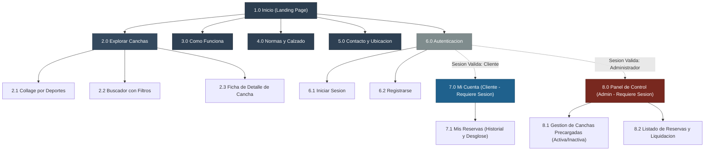

---

## 2.2 Desglose Estructurado de Páginas y Secciones

### Nivel 0: Raíz Pública

- **1.0 Inicio (Landing Page):** Presenta la propuesta del complejo, acceso rápido al collage multideportivo, accesos directos al buscador y menús globales.

---

### Nivel 1: Secciones Públicas y Catálogo

- **2.0 Explorar Canchas:** Sección contenedora del catálogo general de instalaciones deportivas (Fútbol, Básquetbol, Tenis, Pádel, Voleibol y Bádminton).
- **3.0 ¿Cómo Funciona?:** Guía conceptual explicativa del proceso de reserva web, políticas de abono y confirmación en caja.
- **4.0 Normas y Calzado:** Requisitos reglamentarios de indumentaria y calzado admitido según la superficie.
- **5.0 Contacto y Ubicación:** Mapa físico, canales de atención al cliente (WhatsApp para comprobantes) y horarios de servicio.
- **6.0 Autenticación:** Módulo de control de acceso y registro de cuentas de usuario con opción de código de empleado.

---

### Nivel 2: Subpáginas y Vistas de Gestión

#### Rama 2.0: Explorar Canchas

- **2.1 Collage por Deportes:** Vista de navegación visual guiada organizada por las 6 disciplinas deportivas.
- **2.2 Buscador con Filtros:** Vista de catálogo con interfaz facetada por deporte, modalidad, superficie, cubierta y precio.
- **2.3 Ficha de Detalle de Cancha:** Ficha individual con especificaciones técnicas, fotos, tarifas, abono mínimo obligatorio correspondiente al 30 % de la tarifa total de la reserva (valor fijo del sistema) y calendario dinámico interactivo.

#### Rama 6.0: Autenticación

- **6.1 Iniciar Sesión:** Formulario de autenticación mediante correo y contraseña, con redirección condicionada por rol (Cliente o Administrador).
- **6.2 Registrarse:** Formulario de alta para clientes nuevos, con campo opcional para código corporativo de acceso administrativo.

#### Rama 7.0: Mi Cuenta (Área Privada - Rol: Cliente)

- **7.1 Mis Reservas:** Panel que lista las reservas del cliente con desglose financiero detallado (Total, Abono, Saldo por pagar en sitio) y botón para cancelar reservas; cancelable únicamente si faltan más de 2 horas para el inicio del turno (a las 2 horas exactas o menos no se permite la cancelación). Registra y muestra el motivo obligatorio de cancelación.

#### Rama 8.0: Panel de Control (Área Privada - Rol: Administrador)

- **8.1 Gestión de Canchas Precargadas:** Tabla de inventario de canchas precargadas para consulta técnica y alternancia de estado (Activa / Inactiva) mediante un interruptor (*toggle switch*). No permite agregar, eliminar ni editar atributos de las instalaciones.
- **8.2 Listado de Reservas:** Vista cronológica y tabular de todas las reservas registradas, permitiendo validar abonos, registrar reservas asistidas y abrir el modal POS de liquidación presencial.

---

## 2.3 Matriz de Accesibilidad por Tipo de Usuario

| Código | Página / Sección | Visitante (Público) | Cliente Autenticado | Administrador |
| :--- | :--- | :---: | :---: | :---: |
| **1.0** | Inicio | Permitido | Permitido | Permitido |
| **2.0** | Explorar Canchas (Collage / Buscador) | Permitido | Permitido | Permitido |
| **2.3** | Ficha de Detalle de Cancha (con Calendario) | Permitido (Consulta) | Permitido (Consulta) | Permitido (Consulta) |
| **3.0** | ¿Cómo Funciona? | Permitido | Permitido | Permitido |
| **4.0** | Normas y Calzado | Permitido | Permitido | Permitido |
| **5.0** | Contacto y Ubicación | Permitido | Permitido | Permitido |
| **6.0** | Autenticación (Login / Registro) | Permitido | Redirige a Perfil | Redirige a Panel |
| **7.0** | Mi Cuenta (7.1 Mis Reservas) | Restringido | Permitido | Restringido |
| **8.0** | Panel de Control (8.1 Canchas Precargadas / 8.2 Reservas) | Restringido | Restringido | Permitido |

---

# 3. Modelo de Navegación Refinado

## 3.1 Diagrama de Navegación

El siguiente diagrama modela las rutas, transiciones entre vistas y accesos según el rol del usuario:

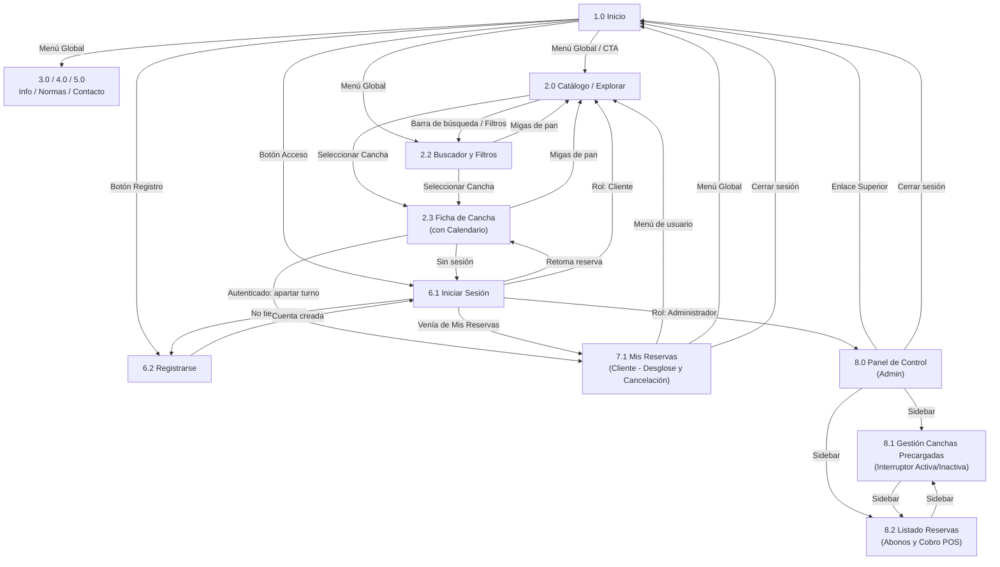

---

## 3.2 Pantallas del Sistema

| Código | Pantalla | Descripción | Acceso |
| :--- | :--- | :--- | :--- |
| **1.0** | Inicio | Página de entrada con llamada a la acción, collage multideportivo y acceso a autenticación. | Público |
| **2.0** | Catálogo / Explorar | Listado de instalaciones deportivas disponibles (6 disciplinas). | Público |
| **2.2** | Buscador y Filtros | Barra de búsqueda y panel lateral facetado (deporte, modalidad, superficie, cubierta, precio). | Público |
| **2.3** | Ficha de Cancha | Detalle de la cancha, fotos, condiciones y calendario de turnos. Para reservar requiere sesión. | Público (reservar: Cliente) |
| **3.0 / 4.0 / 5.0** | Info / Normas / Contacto | Páginas informativas sobre funcionamiento, indumentaria requerida y canales de WhatsApp. | Público |
| **6.1** | Iniciar Sesión | Autenticación mediante correo y clave; redirige según rol (Cliente o Administrador). | Público |
| **6.2** | Registrarse | Creación de cuenta de cliente o de administrador mediante código de acceso corporativo. | Público |
| **7.1** | Mis Reservas | Historial de turnos con desglose de abono y saldo, e intercepción de cancelación (> 2 horas). | Cliente |
| **8.0** | Panel de Control | Dashboard del área administrativa con métricas operativas y accesos directos. | Administrador |
| **8.1** | Gestión de Canchas Precargadas | Inventario de canchas precargadas para consulta y alternancia de estado (Activa / Inactiva) mediante interruptor. No permite agregar, eliminar ni editar datos. | Administrador |
| **8.2** | Listado de Reservas | Supervisión de turnos, validación de comprobantes de abono, reserva asistida y módulo POS de caja. | Administrador |

---

## 3.3 Navegación Principal y Secundaria por Rol

| Elemento                               | Visitante                                           | Cliente                                                     | Administrador                                                             |
| :------------------------------------- | :-------------------------------------------------- | :---------------------------------------------------------- | :------------------------------------------------------------------------ |
| **Navegación principal (menú global)** | Inicio, Catálogo, Info / Normas / Contacto          | Inicio, Catálogo, Info / Normas / Contacto                  | Enlace superior a Inicio / Dashboard                                      |
| **Menú de usuario**                    | Botones Acceso (6.1) y Registro (6.2)               | Mis Reservas (7.1) y Cerrar sesión                          | Cerrar sesión y Perfil administrativo                                     |
| **Navegación secundaria**              | Filtros y buscador (2.2); calendario de Ficha (2.3) | Filtros y buscador (2.2); calendario; botón Cancelar en 7.1 | Sidebar: Gestión de Canchas Precargadas (8.1) y Listado de Reservas (8.2) |
| **Migas de pan**                       | Inicio > Catálogo > Ficha                           | Inicio > Catálogo > Ficha                                   | Panel > Gestión de Canchas Precargadas                                    |
| **Acciones contextuales (modales)**    | Intercepción de sesión al reservar                  | Modal de Confirmación y datos de abono; cancelación (> 2h)  | Validación de abono; Cobro en sitio POS; Bloqueo; Asistida                |
| **Pantallas restringidas**             | 7.1 y 8.x redirigen a Iniciar Sesión                | 8.x no accesible                                            | 7.1 no aplica (gestiona vía 8.2)                                          |

---

# 4. Flujos de Navegación

Cada flujo modela el recorrido de una tarea crítica en 5 a 7 pasos principales, con nodos de decisión (rombos) para la sesión activa, los campos obligatorios, la colisión de reservas y las reglas de negocio temporales.

---

## 4.1 Flujo 1: Búsqueda, Selección y Agendamiento de una Cancha

| Campo                   | Descripción                                                                                                                                                                                                                                                                                                               |
| :---------------------- | :------------------------------------------------------------------------------------------------------------------------------------------------------------------------------------------------------------------------------------------------------------------------------------------------------------------------ |
| **Actor**               | Cliente (o visitante)                                                                                                                                                                                                                                                                                                     |
| **Objetivo**            | Buscar una cancha, elegir un horario libre, generar la reserva web y obtener los datos para abonar por Yappy/banco.                                                                                                                                                                                                       |
| **Precondición**        | El usuario está en el Catálogo (2.0) o Buscador (2.2). Si es visitante, el sistema lo intercepta antes de confirmar. Creación de reserva permitida únicamente si faltan más de 2 horas para el inicio del turno; a las 2 horas exactas o menos no se permite el agendamiento.                                |
| **Resultado esperado**  | La reserva queda registrada en estado *Pendiente* con temporizador TTL activo, el horario se bloquea provisionalmente (en vista pública aparece como *No disponible temporalmente*), y se muestra el resumen de reserva e instrucciones para transferir el abono mínimo del 30 % (fijo del sistema calculado según la duración; ej. $7.50 para 1 hora a $25.00/h) con botón a WhatsApp. La reserva permanece *Pendiente* hasta que el administrador valide el abono. Si no queda *Confirmada* dentro del TTL, se cancela y se libera el horario. |
| **Excepción principal** | Si otro usuario confirmó o apartó el mismo bloque de forma simultánea, se muestra «Este horario ya no está disponible. Seleccione otro.» y se recarga el calendario.                                                                                                                                                      |

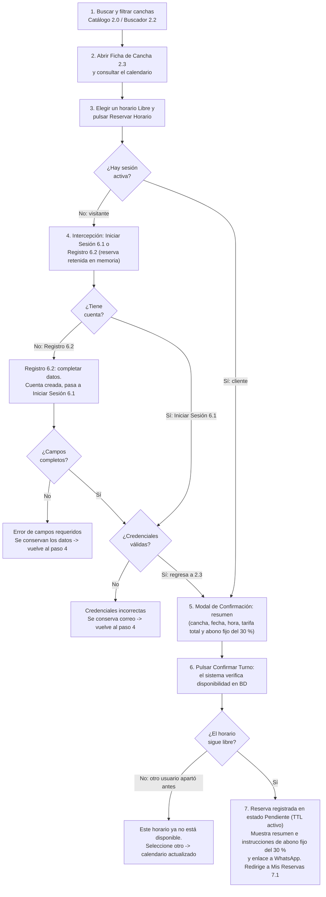

---

## 4.2 Flujo 2: Consulta de Historial y Cancelación de una Reserva Vigente

| Campo | Descripción |
| :--- | :--- |
| **Actor** | Cliente |
| **Objetivo** | Revisar el historial de reservas y cancelar una reserva vigente dentro de los plazos reglamentarios, registrando el motivo. |
| **Precondición** | El cliente tiene sesión activa (si es visitante, se redirige a Iniciar Sesión 6.1) y accede a Mis Reservas (7.1). |
| **Resultado esperado** | Cancelable únicamente si faltan más de 2 horas para el inicio del turno (a las 2 horas exactas o menos no se permite la cancelación). Si faltan más de 2 horas, el usuario selecciona o redacta el motivo obligatorio de cancelación; al confirmar, el sistema guarda el motivo, cambia el estado a *Cancelada*, libera el bloque horario de inmediato y actualiza la tarjeta en el historial. Si el turno expiró previamente por inacción del TTL, se muestra en estado *Cancelada* con motivo *Vencimiento del TTL*. |
| **Excepción principal** | Si faltan 2 horas exactas o menos para el turno, el sistema bloquea la acción indicando: «Cancelable únicamente si faltan más de 2 horas; a las 2 horas exactas o menos no se permite la cancelación. Comuníquese con recepción». |

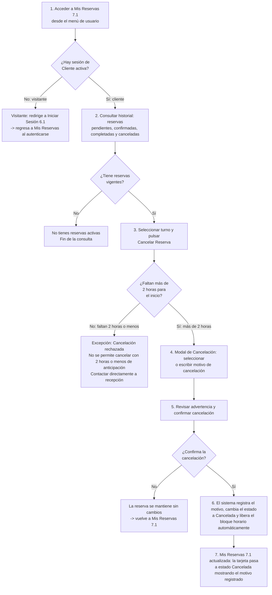

---

## 4.3 Flujo 3: Gestión de Canchas Precargadas (Activa / Inactiva)

| Campo                   | Descripción                                                                                                                                                                                                                                                                       |
| :---------------------- | :-------------------------------------------------------------------------------------------------------------------------------------------------------------------------------------------------------------------------------------------------------------------------------- |
| **Actor**               | Administrador                                                                                                                                                                                                                                                                     |
| **Objetivo**            | Consultar las canchas precargadas existentes y alternar su estado entre Activa e Inactiva mediante un interruptor para controlar su visibilidad en el catálogo.                                                                                                                   |
| **Precondición**        | El administrador inició sesión con su correo y contraseña; el sistema validó que su rol sea Administrador. El código corporativo se usa únicamente durante el registro para asignar ese rol.                                                                                      |
| **Resultado esperado**  | La cancha seleccionada cambia su estado de disponibilidad en el sistema; si se conmuta a Inactiva, deja de mostrarse en el catálogo público y en los resultados del buscador, preservando su historial transaccional. No se agregan, eliminan ni editan los datos de las canchas. |
| **Excepción principal** | Si se intenta cambiar a Inactiva una cancha con reservas activas (pendientes o confirmadas), el sistema emite una advertencia requiriendo resolver o reubicar dichos turnos previamente desde el Listado de Reservas (8.2).                                                       |

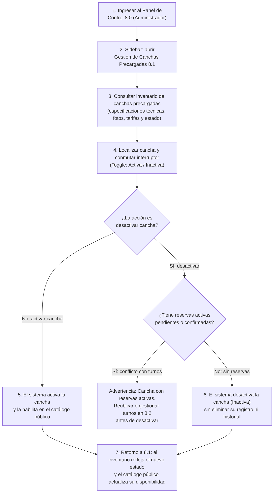

---

## 4.4 Flujo 4: Bloqueo Manual de Horarios por Mantenimiento o Lluvia

| Campo                   | Descripción                                                                                                                                                                        |
| :---------------------- | :--------------------------------------------------------------------------------------------------------------------------------------------------------------------------------- |
| **Actor**               | Administrador                                                                                                                                                                      |
| **Objetivo**            | Inhabilitar un rango de fechas y horas en una cancha por reparaciones o lluvia.                                                                                                    |
| **Precondición**        | El administrador inició sesión con su correo y contraseña (rol Administrador validado) y se encuentra en Gestión de Canchas Precargadas (8.1).                                     |
| **Resultado esperado**  | Los intervalos quedan marcados como no disponibles y el calendario público (2.3) los muestra con trama de *Mantenimiento*.                                                         |
| **Excepción principal** | Si existen reservas activas (pendientes o confirmadas) en ese rango, el sistema bloquea la acción y solicita resolverlas o reubicarlas primero desde el Listado de Reservas (8.2). |

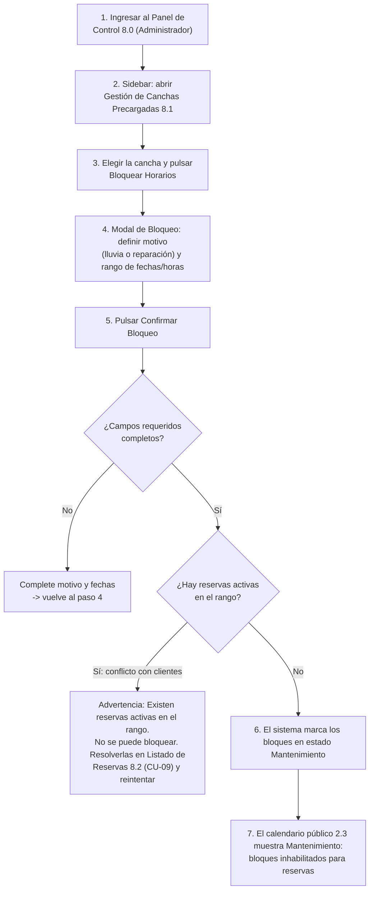

---

## 4.5 Flujo 5: Registro de una Reserva Asistida (Atención Presencial o Telefónica)

| Campo                   | Descripción                                                                                                                                                                                                                                                                                                                                                                                        |
| :---------------------- | :------------------------------------------------------------------------------------------------------------------------------------------------------------------------------------------------------------------------------------------------------------------------------------------------------------------------------------------------------------------------------------------------- |
| **Actor**               | Administrador                                                                                                                                                                                                                                                                                                                                                                                      |
| **Objetivo**            | Registrar un turno en el sistema a nombre de un solicitante que acude en persona o llama por teléfono.                                                                                                                                                                                                                                                                                             |
| **Precondición**        | El administrador inició sesión con su correo y contraseña; el sistema validó que su rol sea Administrador. El código corporativo se usa únicamente durante el registro para asignar ese rol. Se encuentra en el Listado de Reservas (8.2).                                                                                                                                                         |
| **Resultado esperado**  | El turno queda registrado formalmente como *Confirmada*. Si se recibe el pago completo (100 %), el saldo queda en cero ($0.00) y no se vuelve a cobrar en el POS; si se recibe un abono (30 %), solo se cobrará el saldo restante en caja antes de ingresar a jugar. En ambos casos, la reserva permanece *Confirmada* mientras se realiza el turno y pasa a *Completada* cuando el turno termina. |
| **Excepción principal** | Si faltan los datos de contacto del cliente o el bloque fue tomado justo antes, el sistema alerta sin borrar la información.                                                                                                                                                                                                                                                                       |

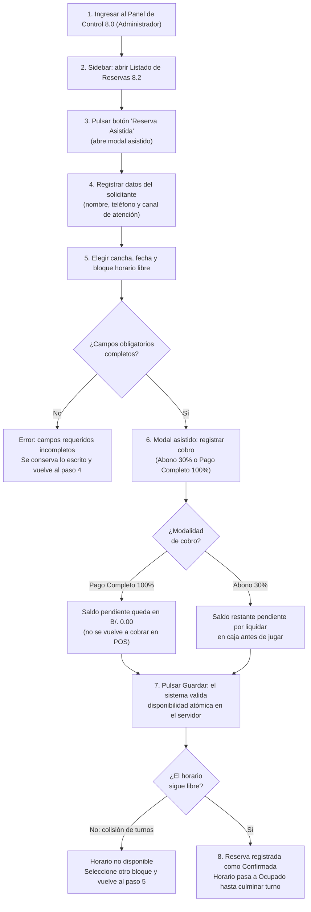

---

## 4.6 Flujo 6: Liquidación Presencial y Cobro de Saldo en Caja (Check-in / POS)

| Campo                   | Descripción                                                                                                                                                                                                                                                                                                                                                                         |
| :---------------------- | :---------------------------------------------------------------------------------------------------------------------------------------------------------------------------------------------------------------------------------------------------------------------------------------------------------------------------------------------------------------------------------- |
| **Actor**               | Administrador (Recepcionista / Cajero)                                                                                                                                                                                                                                                                                                                                              |
| **Objetivo**            | Recibir al cliente al llegar al complejo, cobrar el saldo pendiente si aplica, emitir el comprobante y autorizar el acceso; la reserva culminará como *Completada* al finalizar el turno.                                                                                                                                                                                           |
| **Precondición**        | El cliente tiene una reserva previa en estado *Confirmada* y se presenta en ventanilla antes de ingresar a la cancha. El administrador inició sesión con su correo y contraseña (rol Administrador).                                                                                                                                                                                |
| **Resultado esperado**  | Al registrar el pago, el saldo pendiente queda en cero ($0.00) y se emite el comprobante digital de liquidación. La reserva permanece en estado *Confirmada* mientras se realiza el turno y pasa automáticamente a *Completada* cuando el turno termina. Si el turno fue pagado al 100 % previamente en la reserva asistida, el saldo ya es $0.00 y únicamente se valida el acceso. |
| **Excepción principal** | Si el cliente no cuenta con el saldo pendiente, el turno se retiene en espera y no se autoriza el ingreso a la cancha hasta su liquidación.                                                                                                                                                                                                                                         |

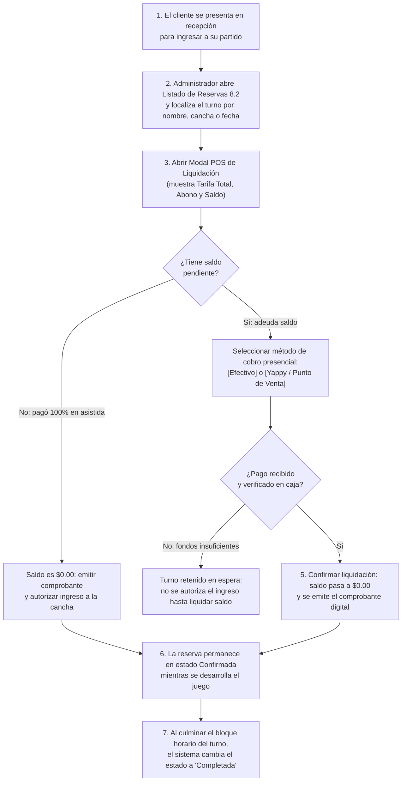

---

# 5. Wire frames

*(Espacio reservado para que Jose Rozette adjunte los wireframes estructurales de baja/media fidelidad de las Vistas 1 a 6).*

---

# 6. Prototipo (Link)

*(Espacio reservado para que Alexander Meneses adjunte el enlace interactivo público de Figma y las capturas en alta fidelidad).*

- **Enlace al Prototipo Interactivo en Figma:** [Pendiente de adjuntar enlace público / Enlace Figma]

---

# 7. Auditoría y Uso de la IA

### Tabla 3. Auditoría y Uso de la IA - Fase 2

| Sección | Integrante(s) | Herramienta y Link al prompt utilizado | Aporte de la IA | Aporte Intelectual del equipo |
| :--- | :--- | :--- | :--- | :--- |
| **Arquitectura de Información, Sitemap y Correcciones Integrales de Negocio** | Gonzalez, Walter | Antigravity / Gemini — [Ver prompts 3, 4, 5, 6, 9, 10, 11, 12 y 13 en prompts.md](./prompts.md) | Asistió en la maquetación técnica del documento en Markdown, estructuración de la taxonomía ampliada, generación de sintaxis Mermaid para diagramas de flujo y revisión de coherencia de reglas de negocio. | Análisis, formulación y orquestación de todas las correcciones integrales de la Fase 2: integración de 6 disciplinas y 9 canchas con normativas técnicas de calzado, solución del abono asíncrono vía Yappy/WhatsApp con abono mínimo fijo del 30 % del sistema, formulación de la política de caducidad TTL (45 min) con cancelación automática por motivo Vencimiento del TTL, regla estricta de anticipación cancelable únicamente si faltan más de 2 horas (bloqueando creación/cancelación a las 2 horas o menos), solicitud obligatoria de motivo de cancelación en Flujo 2, desglose financiero dinámico según duración de turno (ejemplos 1h y 2h), gestión de canchas precargadas con interruptor Activa/Inactiva (eliminando CRUD y formulario 8.1.1), autenticación administrativa mediante correo y contraseña (código corporativo restringido al registro), diferenciación formal entre constancia digital de abono y comprobante digital de liquidación final, y separación del cobro presencial (POS / Check-in) de la finalización del turno (Completada al concluir el bloque horario). (Terminado). |
| **Modelo de Navegación Refinado, Flujos de Navegación y Auditoría Cruzada de Interfaces** | Sanchez, Jose | Gemini — [Ver prompts 7 y 8 en prompts.md](./prompts.md) | Asistió en la estructuración de los diagramas de flujo de tareas críticas y en la depuración de pasos redundantes e inconsistencias lógicas. | Elaboración del diagrama de navegación general, estructuración de las matrices de pantallas y roles, modelado detallado de los flujos de tareas críticas 1 al 6 con manejo de decisiones e intercepciones, y auditoría cruzada de consistencia entre los diagramas y los wireframes/prototipo (asegurando el cumplimiento de la regla de cancelación a >2h, la bifurcación de cobro en reservas asistidas y el enlace directo al catálogo precargado sin pantallas de edición). (Terminado). |
| **Wireframes (Diseño Estructural de Baja / Media Fidelidad)** | Rozette, Jose | Figma / Draw.io — Ninguna | Ninguno | Diseño y corrección estructural de las 6 vistas clave en media fidelidad monocromática: Landing (1.0) con buscador de 6 disciplinas y aviso de abono 30 %, Catálogo (2.0/2.2) con filtros facetados por 4 superficies y comodidades, Ficha de Cancha Desktop (2.3) con matriz semanal completa, estado «No disponible temporalmente» y cálculo de tarifa según duración, Ficha Móvil (2.3) con carrusel táctil y modal de instrucciones de abono con TTL de 45 min, Panel de Cliente Mis Reservas (7.1) con tarjeta de 4 valores financieros y modal de cancelación con motivo obligatorio bajo la regla estricta de >2h, y Panel de Control Admin separando Gestión de Canchas Precargadas (8.1) con interruptor Toggle Activa/Inactiva del Listado de Reservas (8.2) con temporizador TTL, validación de abonos y cobro POS. (Terminado). |
| **Prototipo de Interfaz de Alta Fidelidad y Sistema de Diseño** | Meneses, Alexander | Figma — Ninguna | Ninguno | Conceptualización y actualización del prototipo interactivo en alta fidelidad en Figma: definición de la guía de estilos con paleta cromática accesible WCAG 2.1 AA (azul institucional `#1B365D`, verde `#2E7D32`), tipografía, componentes UI interactivos, código multimodal de disponibilidad (Verde: Libre, Ámbar: No disponible temporalmente / Pendiente TTL, Gris: Ocupado, Amarillo rayado: Mantenimiento), construcción de flujos interactivos para el modal de Reserva Asistida (modalidades 30 % y 100 %) y Liquidación Presencial en Mostrador (POS con emisión de comprobante final de liquidación), y despliegue del enlace público interactivo. (Terminado). |
